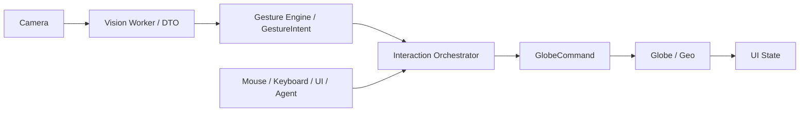

# Gesture Globe

使用 Vite、TypeScript、Three.js 和 MediaPipe 构建的浏览器端手势控制 3D 地球应用，包含模块化视觉 Worker、输入仲裁、地点选择、诊断、自动化测试及 Agent 工具接口。

**Beta / Portfolio project · Engineering implementation complete · Automated test suite available · Manual acceptance in progress**

这是可供本地开发和工程评审的项目。自动测试不证明所有真人手势、生产性能或 20 分钟稳定性已通过；源码公开也不代表应用已经获准部署或模型可以再分发。详见 [当前状态](docs/status.md)。

## 功能与操作

- Three.js 地球、离线 Natural Earth 地图与 243 个城市点、地点卡和球面选点。
- 鼠标拖动/滚轮、键盘旋转/缩放/复位，以及五种手势；统一输入仲裁保留手动操作优先权。
- 本地视觉 Worker、单帧在途控制、手部连续性、姿势稳定条件、冷却和丢手恢复。
- 新手引导、手势图解、设置、诊断、降级提示及可取消的相机过渡。
- 默认关闭的 Agent 工具网关与地理编码/天气/路线适配器接口；没有配置真实外部服务。

| 手势               | 用法与预期效果                                                |
| ------------------ | ------------------------------------------------------------- |
| Open Palm / 张掌   | 五指张开并稳定，移动掌心旋转地球；停手停止位移。              |
| Pinch / 捏合       | 拇指、食指捏合保持，上下移动整只手缩放；不是靠指尖反复开合。  |
| Closed Fist / 握拳 | 稳住拳头暂停手势运动；不会关闭摄像头或禁用鼠标。              |
| Pointing / 食指    | 伸出食指，以屏幕指针对准地球并停留选点。                      |
| Victory / V 字     | 食指、中指成 V 并保持到复位完成；离开姿势并冷却后可再次触发。 |

页面点击 **手势图解**，展开 **看图做手势**，逐项查看摆手、动作、触发与效果；支持动画/静态切换和减少动画偏好。图解已实现，主观易用性尚待确认。

## 安装与本地运行

需要 Node.js 24、npm 11、Git，以及支持 WebGL、Web Workers 和摄像头 API 的桌面浏览器。已使用的本地工具链为 Node 24.14.0 / npm 11.9.0。Chrome/Edge 的完整实机验收仍在进行。

```sh
git clone https://github.com/zinuotiger/gesture-globe.git
cd gesture-globe
npm ci
npm run assets:fetch
npm run assets:verify
npm run dev
```

打开命令输出的 loopback 地址（通常为 `http://127.0.0.1:5173`）。摄像头需要 localhost 或 HTTPS 安全上下文，由用户主动开启并授权；拒绝权限后仍可用鼠标和键盘。隐藏预览不会关闭摄像头，**关闭摄像头**才释放轨道与 Worker。

### 模型与许可证

`assets:fetch` 从 Google 官方固定版本 `gesture_recognizer/float16/1` 单独下载到 `public/models/gesture_recognizer.task`，校验清单中固定的 SHA-256，且不会覆盖来源不明的同名文件。

- 模型为 **EXTERNAL_LOCAL / UNRESOLVED**，不随仓库或构建包分发。
- 当前未取得明确模型公开再分发许可证据，公开发布流程保持 **BLOCKED_BY_LICENSE**。
- MediaPipe Tasks Vision SDK 的 Apache-2.0 仅用于 SDK / 软件代码，不能推导为模型权重许可证。
- 项目源代码许可证尚未由作者指定，本仓库未添加 LICENSE；第三方许可分别见 [NOTICE](docs/NOTICE.md) 和 [资产策略](docs/asset-policy.md)。

## 验证与构建

首次浏览器自动化需要安装与锁定 Playwright 版本匹配的 Chromium：

```sh
npx --no-install playwright install chromium
npm run lint
npm run format:check
npm run typecheck
npm run test:unit
npm run test:contract
npm run test:integration
npm run test:coverage -- --maxWorkers=1
npm run assets:verify
npm run build
npm run test:e2e -- --workers=1
npm run release:verify
```

也可用 `npm run quality` 顺序执行正式门禁。`release:verify` 当前应以退出码 **2** 报告 **EXPECTED BLOCKED / BLOCKED_PENDING_LICENSE**；退出码 1 是异常失败，不能视作预期阻塞。覆盖率门槛目前针对配置 schema 与共享 DTO，不是全应用覆盖率。

`dist` 刻意不含模型；`npm run preview` 的手势降级提示是这一策略的结果。不要为了预览而把模型复制进发布目录。构建成功不等于允许部署。

CI 在 push / pull request 上执行无实体摄像头的自动门禁。测试运行器可从同一固定上游获取临时本地模型，并校验哈希；模型和原始运行记录不作为 CI 附件发布。合成视频、回放和真实 SDK 自动测试均不冒充真人摄像头验收。

## 架构与技术栈



Camera 管理权限与媒体流；Vision 做 MediaPipe 推理；Gesture 是无 DOM 的纯解释层；Interaction 仲裁所有输入；Globe/Geo 执行命令；UI 订阅状态并发送动作。`main.ts` 仅负责组合。

技术栈：Vite、TypeScript、Three.js、MediaPipe Tasks Vision、Vitest、Playwright、ESLint、Prettier。版本由 `package-lock.json` 固定。

```text
src/         app、camera、vision/workers、gesture、interaction、globe、geo、ui、agent 等模块
public/      允许分发的地图、城市与 SDK 资源；模型由本地下载脚本获取
scripts/     资产下载、哈希校验、构建资产白名单和质量门禁
tests/       unit、contract、integration、e2e 与合成测试夹具
docs/        架构、需求、公开状态、验收方法与第三方许可
.agents/     可复用的交付 Skill、任务图和控制器
.github/     自动化质量检查
```

## 隐私与当前边界

- 不请求麦克风；原始摄像头帧不上传、不持久化；手势在本地浏览器中处理。
- 诊断只保留有界标量和脱敏事件，不保存完整关键点流。
- 捏合缩放已有用户基本可用反馈；鼠标滚轮晃动与 V 字复位已修复，等待真人复测。
- 张掌、握拳、食指仍需逐项真人诊断；摄像头、隐私、真实性能、主观视觉和 20 分钟稳定性验收部分完成或未执行。
- 外部 Agent 服务只有接口与契约/本地 HTTP 测试，真实地理编码、天气和路线联调未执行。
- 单主手、桌面优先、离线城市数据有精度与覆盖限制；现有主包体积超过 Vite 的 500 kB 建议值。

## 文档与贡献

从 [文档导航](docs/README.md)、[系统架构](docs/architecture.md)、[需求规格](docs/Gesture_Globe_实施级需求规格_v3.0.md)、[公开状态](docs/status.md) 和 [已知限制](docs/known-limitations.md) 开始。

开发请遵循 [AGENTS.md](AGENTS.md) 和 [交付 Skill](.agents/skills/gesture-globe-delivery/SKILL.md)，保持模块边界、固定资产来源与测试断言。提交前运行相关门禁，不提交模型、凭据、缓存或本地治理记录；新增依赖或改变需求应先取得维护者授权。源码 LICENSE 尚未指定，贡献与使用前请向维护者确认许可条件。

公开克隆不包含原作者的 `.gesture-globe` 账本和人工证据。如需启用自己的任务控制器，可按 Skill 初始化独立本地账本；它不会继承原项目的完成或验收记录。普通安装、构建与自动测试不需要私有账本。
