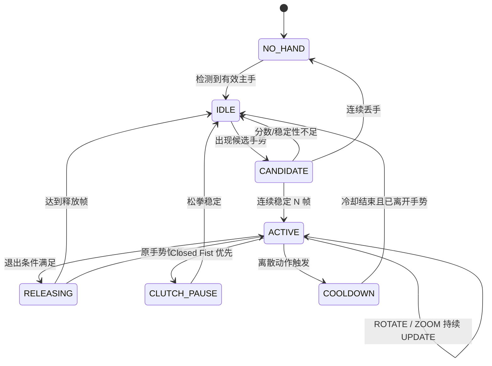
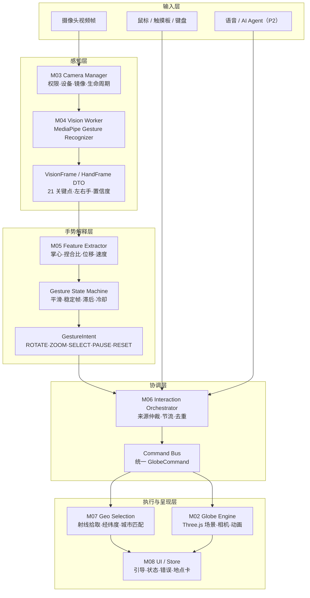

> **文档定位**：本文件是可直接进入开发的实施级基线，覆盖需求、架构、文件级模块边界、接口契约、错误与配置、测试目录、Codex 任务卡、验收证据和作品集交付。
>
> **核心原则**：第一版先实现“本地、稳定、可预测的真实手势控制闭环”；AI Agent、天气、路线和语音属于后续扩展，不得破坏 P0 主链路。

# 目录

| 章节 | 内容 |
| --- | --- |
| 1 | 产品定义与范围 |
| 2 | 用户旅程与用例 |
| 3 | 交互、坐标与手势详细规格 |
| 4 | UI / UX 详细规格 |
| 5 | 总体架构与线程模型 |
| 6 | 模块化详细需求 |
| 7 | 核心数据契约与接口 |
| 8 | 非功能需求 |
| 9 | 异常、恢复与降级矩阵 |
| 10 | 测试、验收与发布门槛 |
| 11 | 工程目录与开发约束 |
| 12 | 里程碑与模块任务分解 |
| 13 | 风险、默认决策与待确认项 |
| 14 | 后续 GeoPilot Agent 需求边界 |
| 15 | 页面与组件实施规格 |
| 16 | 应用状态、生命周期与并发控制 |
| 17 | 模块文件级实施蓝图 |
| 18 | 手势、坐标与控制算法实施规格 |
| 19 | 补充接口、事件与版本契约 |
| 20 | 错误码、提示与恢复目录 |
| 21 | 配置、资产与静态数据字典 |
| 22 | 隐私、安全与可访问性实施检查 |
| 23 | 测试用例目录与真实手势评估 |
| 24 | 详细工作分解与 Codex 任务卡 |
| 25 | 发布验收、证据包与作品集交付 |
| 附录 A～H | 参考资料、术语、追踪、夹具与表单 |

# 文档控制

| 项目 | 内容 |
| --- | --- |
| 文档版本 | v3.0.3 |
| 日期 | 2026-09-26 |
| 状态 | 实施级开发基线 / 可直接拆成编码任务 |
| 目标平台 | Windows 10/11 桌面浏览器；Chrome / Edge 为首要验收对象 |
| 技术方向 | Vite + TypeScript + Three.js + MediaPipe Tasks Vision |
| MVP 形态 | 纯前端、本地手势识别、无业务后端也可运行 |
| 后续扩展 | 语音、城市查询、路线、天气和多模态 Agent |

## 版本记录

| 版本 | 变更 |
| --- | --- |
| v1.0 | 建立产品范围、12 个模块、五类手势和基础发布门槛。 |
| v2.0 | 补充用例、页面状态、坐标规范、主手选择、完整模块接口、120+ 条细化需求、数据契约、异常策略、测试追踪和开发任务分解。 |
| v3.0 | 增加页面组件状态、正交应用状态、文件级模块蓝图、算法伪代码、接口与事件版本规则、完整错误目录、配置字典、50 个唯一编号核心测试、84 个 Codex 任务 ID及发布证据模板。 |
| v3.0.1 | 修正第 12.1 节里程碑任务范围；明确 manifest 与第 24 章为任务图权威来源；增加文档—manifest 一致性验证。 |
| v3.0.2 | GOV-003 / GG-DEV-GATE-v1：按用户授权分离工程放行与整体验收；摄像头及关联真人手势基线延至控制集成后联合验收。保留全部任务、原依赖、完成标准与发布门槛。 |
| v3.0.3 | GOV-004：原84项含MS-8全部工程实现后集中人工验收；保留人工欠项及发布阻塞；有依据的常规恢复不再受旧两次计数阻断。 |

> 任务图权威：当前用户的明确治理变更授权优先；`.agents/skills/gesture-globe-delivery/references/task-manifest.json` 是机器可执行任务图，第 24 章是其人类可读详细镜像。第 12.1 节及其他任务范围表只是派生摘要。manifest 与第 24 章冲突必须停止；派生摘要不一致须通过明确授权修复，不得据摘要增加任务或删除 manifest 任务以通过验证。文件名保持 v3.0，文档内部版本为 v3.0.3。

## 需求用语和优先级

| 标记 | 解释 |
| --- | --- |
| 必须 / SHALL | 不满足即不能通过对应版本验收。 |
| 应该 / SHOULD | 默认实现；若不实现必须记录原因和风险。 |
| 可以 / MAY | 增强项，不阻塞当前版本。 |
| P0 | MVP 与演示闭环必须。 |
| P1 | 增强体验与维护性。 |
| P2 | Agent 与外部数据阶段。 |

## 阅读方式

- 产品/评审：第 1～4、8、10 节。
- 开发：第 3、5～9、11 节及各模块 requirement 表。
- 测试：第 3、8～10 节，以及 requirement→test 追踪表。
- 给 Codex 拆任务：优先使用第 24 节任务卡；每次只执行一个可验收任务，禁止跨越未完成依赖。

# 1. 产品定义与范围

## 1.1 背景与问题

普通 3D 地球通常依赖鼠标或触摸操作。Gesture Globe 的目标不是简单增加“摄像头识别到手”的炫酷效果，而是建立一套可长期演示、可测试、可解释的浏览器端人机交互闭环：摄像头帧在本地完成识别，手势经过稳定化和状态机后转换为统一命令，再由 Three.js 地球执行。

项目首先解决四个实际问题：

- 识别结果有抖动、误判和丢帧，不能逐帧直接操作地球。
- 摄像头坐标、镜像预览、Canvas 和 3D 世界存在多套坐标，容易方向错误。
- 鼠标、手势和未来 Agent 可能同时控制，需要明确仲裁和取消。
- 权限、模型、纹理或 WebGL 失败时，项目仍要有可使用的降级路径。

## 1.2 产品定义

Gesture Globe 是运行在桌面浏览器中的 3D 地球交互应用。用户可用单手完成旋转、缩放、临时锁定、地点选择和恢复初始视角；摄像头不可用时，鼠标、触摸板和键盘仍能完成核心操作。第一版不依赖业务后端。

## 1.3 产品目标

| 目标ID | 目标 | 衡量方式 |
| --- | --- | --- |
| G-01 | 首次用户能快速进入体验。 | 从页面打开到完成一次旋转，标准网络/设备下目标 ≤2 分钟。 |
| G-02 | 手势可预测、可停止。 | 静止 60s 明显误动作 ≤1；丢手后不持续驱动。 |
| G-03 | 失败可降级。 | 拒绝摄像头、模型失败、纹理失败时仍有可理解界面和备用控制。 |
| G-04 | 架构可扩展。 | 新增手势或 Agent 工具不要求修改 Vision 与 Globe 的核心内部实现。 |
| G-05 | 工程可验收。 | 有自动化测试、真实性能数据、错误矩阵、隐私检查和可复现演示。 |

## 1.4 成功标准

| 维度 | MVP 发布门槛 |
| --- | --- |
| 功能 | 五类手势闭环、鼠标/键盘备用、地点选择、错误恢复全部完成。 |
| 性能 | 参考设备渲染中位 ≥50 FPS，动作到可见反馈 P95 ≤150ms，推理不积压。 |
| 识别 | Open Palm / Pinch 启动成功率各 ≥90%；Victory / Pointing 各 ≥85%。 |
| 稳定 | 连续 20 分钟无持续内存增长、无超过 1s 的控制延迟堆积。 |
| 隐私 | 音频永不请求；不上传/保存原始帧；关闭后摄像头轨道停止。 |
| 工程 | P0 需求均有代码与测试/手工证据，干净环境可构建运行。 |

> 上述阈值属于项目发布目标，不是第三方模型的官方保证；必须在真实设备上测量并记录环境。

## 1.5 非目标

- MVP 不实现账号、云同步、多人协作、摄像头录像或云端图像分析。
- MVP 不实现全球三维建筑、实时卫星云图、实时航班或完整 GIS 平台。
- MVP 不训练自定义神经网络，不把 LLM 放入实时控制主链路。
- MVP 不承诺手机、VR、展馆多摄像头和双手复杂交互。
- MVP 不使用手势推断用户身份、情绪、健康或其他敏感属性。

## 1.6 用户角色

| 角色 | 目标 | 关键需求 |
| --- | --- | --- |
| 体验者 / 面试官 | 快速确认项目是真的、可控、不会乱跳。 | 短引导、清楚反馈、失败时仍能操作。 |
| 演示者 / 项目作者 | 在不同机器和光线下稳定演示并解释实现。 | 诊断、配置、标准验收脚本、可恢复。 |
| 开发维护者 | 新增手势、地点和 Agent 能力。 | 模块边界、类型契约、纯函数测试、回放夹具。 |
| 测试者 | 复现边界和回归问题。 | 需求 ID、固定输入、指标定义、手工矩阵。 |

## 1.7 版本范围

| 版本 | 包含 |
| --- | --- |
| P0 / MVP | 3D 地球、摄像头、单手识别、五类手势、状态机、地点选择、引导、诊断、自动化测试与构建。 |
| P1 / 增强 | 设备切换、更多城市/搜索、路线弧线、诊断导出、主题、两手实验、更多浏览器。 |
| P2 / Agent | 语音/文字意图、天气与路线工具、执行进度、撤销、工具网关。 |

## 1.8 默认运行约束

- 单人、单主手；出现多手时只选择一只控制手。
- 线上 HTTPS，本地开发 localhost；嵌入 iframe 时需要明确 camera 权限策略。
- 核心模型、WASM、纹理和城市数据固定版本并由项目本地托管。
- 首要验收分辨率 1366×768 与 1920×1080；P0 以桌面浏览器为准。
- 所有阈值均是“初始默认值”，必须可配置并通过真实测试调优。

# 2. 用户旅程与用例

## 2.1 主旅程

1. 页面打开，先展示可用的 3D 地球和鼠标操作提示。
2. 用户点击“启用手势控制”，阅读本地处理说明并授权摄像头。
3. 应用启动视频流和 Vision Worker，展示镜像预览、骨架和准备提示。
4. 用户把一只手完整放入画面，系统进入 READY。
5. 用户用张开手掌旋转、捏合移动缩放、握拳临时锁定、食指停留选择、Victory 重置。
6. 用户可随时用鼠标接管、关闭摄像头或查看帮助。
7. 退出/关闭时释放摄像头、Worker、动画和事件监听。

## 2.2 用例清单

| ID | 用例 | 前置与触发 | 主流程 | 异常与完成 |
| --- | --- | --- | --- | --- |
| UC-001 | 首次启动 | 页面可访问；打开应用 | 先显示地球与启用按钮；后台不请求摄像头 | WebGL 不可用时显示兼容页；用户可用鼠标探索 |
| UC-002 | 启用手势 | 地球已就绪；点击启用 | 说明隐私→请求权限→启动流→加载模型→准备检查 | 拒绝/超时/无设备进入降级；READY 或 DEGRADED |
| UC-003 | 手掌旋转 | READY 且手完整入框；Open Palm 稳定 | 建立锚点→逐帧位移→死区/限幅→旋转 | 丢手、握拳、鼠标接管立即结束；视图停在最后位置 |
| UC-004 | 捏合缩放 | READY；Pinch 稳定 | 首帧设锚点→掌心上下增量→缩放限制 | 临界比例用滞后；进入时不跳变；相机距离处于允许范围 |
| UC-005 | 握拳锁定 | 任一手势活动；Closed Fist | 中止当前手势→显示 PAUSE→允许调整手位 | 松拳后回 IDLE，不恢复旧 delta；安全待命 |
| UC-006 | 指向选择 | READY 且指针命中地球；Pointing Up | 显示指针→停留进度→射线交点→经纬度→城市/标记 | 指向背景或移动过大重置；单次 selectionId |
| UC-007 | 恢复视角 | 任一视图；Victory 稳定 | 触发一次 RESET_VIEW→平滑返回 | 用户手动操作可打断；冷却防重入；初始 ViewState |
| UC-008 | 摄像头失败降级 | 任意摄像头错误；错误发生 | 解释原因→提供重试和继续鼠标 | 不循环弹权限、不白屏；地球仍可使用 |
| UC-009 | 鼠标接管 | 手势已开启；用户拖动/滚轮 | 建立手动来源锁→暂抑制手势→执行鼠标操作 | 锁超时后手势可重新候选；来源显示 MOUSE |
| UC-010 | 关闭并重开 | 手势已运行；点击关闭后再次启用 | 停止 tracks/Worker→状态归零→重新申请/复用权限→新会话 | 迟到旧消息按 sessionId 丢弃；只有一个流和一个 Worker |

## 2.3 首次使用验收脚本

1. 用户不阅读长文档，仅依据首屏提示启用摄像头。
2. 手进入引导框，系统显示“手已检测 / 准备完成”。
3. 完成一次旋转和一次缩放；操作中能看到当前手势。
4. 握拳让地球停止，松拳后不会跳动。
5. 用食指选择一点并看到经纬度/附近城市。
6. 做 Victory，视图只恢复一次。
7. 关闭摄像头，浏览器占用指示熄灭，鼠标仍可用。

# 3. 交互、坐标与手势详细规格

## 3.1 控制模式

| 模式 | 说明 | 进入 | 退出 |
| --- | --- | --- | --- |
| MOUSE | 鼠标/触摸板/键盘控制。 | 首屏默认或用户手动输入 | 手动锁超时后可回 AUTO |
| GESTURE_READY | 摄像头与模型就绪，但无稳定手势。 | 准备检查通过 | 稳定手势→GESTURE_ACTIVE；关闭→MOUSE |
| GESTURE_ACTIVE | 一个稳定手势正在控制或触发。 | 状态机 ACTIVE | 释放、丢手、握拳、鼠标抢占 |
| GESTURE_PAUSED | Closed Fist 离合器生效。 | 握拳稳定 | 松拳稳定后回 READY |
| AUTO | 系统按最近有效来源自动仲裁。 | 默认策略 | 用户可显式关闭手势 |

## 3.2 输入来源优先级与抢占

| 优先级 | 来源/事件 | 规则 |
| --- | --- | --- |
| 1 | 生命周期与安全操作 | 关闭摄像头、页面销毁、Esc 取消始终生效。 |
| 2 | 真实用户鼠标/触摸/键盘 | 立即取消自动过渡或 Agent，建立短时手动锁。 |
| 3 | Closed Fist | 立即停止手势连续控制，但不阻止 UI 操作。 |
| 4 | 稳定手势 | 在无手动锁时产生连续或离散意图。 |
| 5 | Agent / 脚本 | 仅在 P2 且无用户抢占时执行，可取消。 |
| 6 | 自动旋转 | 最低优先级，任何有效输入都停止。 |

## 3.3 坐标系统

| 坐标 | 范围/方向 | 责任模块 | 转换规则 |
| --- | --- | --- | --- |
| 模型图像坐标 | x,y∈[0,1]；原点左上，y 向下 | M04/M05 | 保持原始结果，算法在统一坐标上工作。 |
| 镜像显示坐标 | x_display=1-x_model | M03 CoordinateAdapter | 只在适配层转换一次。 |
| CameraCard 像素 | 相对预览容器 | M08 | 考虑 object-fit 后的可见区域与裁切。 |
| Globe canvas 像素 | 相对 WebGL canvas | M07 | 扣除 canvas bounding rect。 |
| NDC | x,y∈[-1,1]，y 向上 | M07 | x=2px/w-1；y=1-2py/h。 |
| Three.js 世界坐标 | 地球半径 R，Y 轴指北 | M02/M07 | Raycaster 交点归一化。 |
| 地理坐标 | lat[-90,90]；lon[-180,180) | M07 | 统一 longitudeOffset 校正纹理方向。 |

## 3.4 主手选择

1. 若上一主手仍存在，优先选择掌心距离上一位置最近且在最大跟踪距离内的手。
2. 否则计算候选质量：handedness/检测置信度、bbox 面积和手完整度；选择最高者。
3. 选择后默认锁定 500ms；锁定期内不因另一只手分数略高而切换。
4. 连续丢失约 180ms 后解除；重新检测必须从 CANDIDATE 开始。
5. P0 不混合两只手的关键点，也不支持双手缩放。

## 3.5 准备检查与轻量校准

| 检查项 | 初始规则 | 反馈 |
| --- | --- | --- |
| 手完整度 | 21 点齐全，关键指尖不长期位于边界 2% 区域 | 请把整只手放入画面 |
| 大小 | bbox 面积处于约 4%～35% | 太远/太近 |
| 稳定 | 掌心速度低于阈值并持续约 400ms | 保持手掌稳定 |
| 置信度 | 主手检测与手势候选达到最低门槛 | 改善光线或调整角度 |
| 方向 | 不要求固定左/右手；记录当前主手 | 已检测左手/右手 |

准备检查用于反馈，不应成为无法跳过的长校准。用户可以继续使用鼠标，设置中可以重新打开准备向导。

## 3.6 特征定义

```ts
palmCenter = mean(landmark[0], [5], [9], [13], [17])
palmWidth  = distance(landmark[5], landmark[17])
pinchRatio = distance(landmark[4], landmark[8]) / max(palmWidth, epsilon)
velocity   = (smoothedPalm(t) - smoothedPalm(t-1)) / deltaTime
```

| 特征 | 用途 | 边界 |
| --- | --- | --- |
| palmCenter | 旋转/缩放锚点、主手跟踪 | 关键点缺失则该帧无效 |
| palmWidth | 尺度归一化 | 小于 epsilon 时拒绝 Pinch |
| pinchRatio | Pinch 进入/退出 | 使用滞后阈值 |
| bboxArea | 距离提示、主手质量 | 过小/过大只提示，不控制 |
| pointer(landmark 8) | 地点选择 | 使用镜像显示坐标映射 |
| frameGap | 陈旧/跳帧判断 | >150ms 时重建连续锚点 |

## 3.7 稳定化处理顺序

`输入校验 → 主手选择 → 特征提取 → 离群点检查 → EMA → 手势候选融合 → 稳定帧/释放帧 → 死区 → 限幅 → Intent`

| 机制 | 默认初值 | 作用 |
| --- | --- | --- |
| EMA alpha | 0.25；pointer 可 0.35 | 降低抖动，值越小越稳但延迟更大。 |
| 连续手势稳定帧 | Open Palm 4；Pinch 3 | 避免单帧误判。 |
| 离散手势稳定帧 | Victory 6；Pointing 由停留时间决定 | 降低误触发。 |
| 释放帧 | 3 | 退出也做去抖。 |
| 移动死区 | 0.006 归一化位移 | 消除静止小抖动。 |
| 单帧位移上限 | 0.05 | 拦截跳点。 |
| 陈旧帧 | 150ms | 旧结果不参与连续控制。 |
| 丢手时间 | 约180ms | 短暂遮挡容忍，之后彻底结束。 |

## 3.8 手势映射总表

| ID | 识别 | 动作 | 进入 | 活动行为 | 退出/冷却 |
| --- | --- | --- | --- | --- | --- |
| G-ROTATE | Open_Palm | 旋转 | score≥0.72，4 帧 | 掌心 dx/dy→yaw/pitch | 保持阈值失败 3 帧或被抢占 |
| G-ZOOM | Pinch 几何 | 缩放 | ratio≤0.30，3 帧 | 掌心 dy→camera distance | ratio≥0.40，3 帧 |
| G-CLUTCH | Closed_Fist | 暂停手势 | score≥0.65，2 帧 | 不发连续命令 | 松拳稳定后回 IDLE |
| G-SELECT | Pointing_Up | 选地点 | score≥0.72 | 命中地球并停留约650ms | 触发后约800ms冷却 |
| G-RESET | Victory | 恢复视角 | score≥0.78，6 帧 | 触发一次 RESET_VIEW | 约1200ms且需离开后重武装 |

> 分数与阈值是初始调参值，必须由真实验收数据确认；进入阈值和保持/退出阈值应分离。

## 3.9 各手势行为细则

### 3.9.1 Open Palm 旋转

- 进入 ACTIVE 的首帧只保存平滑掌心为 anchor，不发送旋转。
- 每个有效帧计算当前掌心与上一有效掌心的增量；先死区、再限幅、再乘灵敏度。
- 视觉方向以“用户手向右移动，地球画面跟手向右移动”为验收标准，具体符号由坐标适配测试确定。
- Pitch 应限制，避免相机翻转；地球 mesh 不旋转，以保持地理坐标稳定。
- 停止移动时不使用惯性继续手势驱动；OrbitControls 的视觉阻尼需与手势停止语义协调。

### 3.9.2 Pinch 缩放

- Pinch 检测只用于“握住控制”，缩放量由掌心上下增量产生，避免直接用指尖间距导致临界抖动。
- 进入首帧不缩放；手向上/下与拉近/推远的最终方向在可用性测试中固定，并提供反转配置。
- 距离达到 minDistance/maxDistance 时继续手势只显示边界反馈，不累积隐藏偏移。
- Pinch 优先于 Pointing_Up，避免食指伸出时被识别为指向。

### 3.9.3 Closed Fist 临时锁定

- 它是“离合器”：握拳期间暂停手势，不是点击一次永久开关。
- 进入时向当前 ROTATE/ZOOM/SELECT 发送 END/CANCEL，并清除连续锚点。
- 松拳后回到 IDLE，再次张手必须重新经过候选；不得从旧坐标继续。

### 3.9.4 Pointing Up 停留选择

- 指针使用食指尖 landmark 8，经过镜像和预览到 canvas 的坐标适配。
- 只有 Raycaster 命中地球才累计进度；背景、UI 区域或手丢失立即取消。
- 停留圆以首次命中点为中心；小抖动允许，明显移动重置。
- 触发时冻结 selectionId 和经纬度，不使用冷却期后来的移动更新旧选择。

### 3.9.5 Victory 重置

- 基于上升沿触发；保持 Victory 只执行一次。
- 重置过渡可被鼠标、键盘或新的有效手势打断。
- 默认只重置视图，不清除已选地点；清除是单独命令。

## 3.10 手势状态机



| 状态 | 进入条件 | 允许输出 | 退出 |
| --- | --- | --- | --- |
| NO_HAND | 无有效主手 | NONE | 检测到有效手→IDLE |
| IDLE | 有手但无稳定候选 | 候选反馈 | 候选出现→CANDIDATE；丢手→NO_HAND |
| CANDIDATE | 同一手势连续计数 | 进度/候选，不执行动作 | 稳定→ACTIVE；失败→IDLE |
| ACTIVE | 达到稳定条件 | START/UPDATE 或 TRIGGER | 释放→RELEASING；握拳→PAUSED；离散动作→COOLDOWN |
| RELEASING | 退出条件计数 | 必要时最后 UPDATE | 达到释放帧→IDLE；恢复→ACTIVE |
| PAUSED | Closed Fist 生效 | PAUSE 状态 | 松拳稳定→IDLE；丢手→NO_HAND |
| COOLDOWN | 离散动作已触发 | 不重复触发 | 冷却结束且已离开手势→IDLE |

## 3.11 边界与冲突

| 情况 | 预期行为 |
| --- | --- |
| 两只手出现 | 保持当前主手；只有丢失后才切换。 |
| 手部分出框 | 不生成新 delta，显示调整位置。 |
| 光线差/分数低 | 进入候选或 NONE，不猜测有效手势。 |
| 鼠标拖动中手势出现 | 鼠标来源锁期间忽略手势连续命令。 |
| 模型结果迟到 | 按 frameId/年龄丢弃。 |
| 标签页恢复 | 清空锚点，重新候选。 |
| 屏幕缩放/布局变化 | 下一帧重新读取 canvas rect，不缓存旧坐标。 |
| 浏览器弹窗遮挡 | 页面非 active/visible 时暂停推理。 |

# 4. UI / UX 详细规格

## 4.1 信息架构

```text
┌──────────────────── 顶部状态栏 ────────────────────┐
│ Gesture Globe | 摄像头/模型/手势状态 | 帮助 | 设置 │
├─────────────────────────────────────────────────────┤
│                                                     │
│                    3D 地球主画布                    │
│          指针 / 停留环 / 地理标记 / 轻提示          │
│                                                     │
│  左下：操作提示/当前模式       右下：摄像头预览卡   │
│                                                     │
├──────────────────── 底部反馈条 ────────────────────┤
│ 当前手势 · ROTATE/ZOOM/PAUSE · 错误或恢复动作      │
└─────────────────────────────────────────────────────┘
选择成功后：侧边出现 LocationCard；诊断层为可选覆盖层。
```

## 4.2 页面状态

| 状态 | 主界面 | CameraCard | 主操作 |
| --- | --- | --- | --- |
| 首次可用 | 地球+鼠标提示 | 未开启 | 启用手势 |
| 请求权限 | 地球可继续用 | 等待授权 | 取消 |
| 加载模型 | 地球可继续用 | 加载阶段 | 关闭/重试 |
| 准备中 | 地球 | 预览+骨架+调整提示 | 跳过提示/关闭 |
| READY | 地球 | 手已检测 | 做手势 |
| ACTIVE | 地球响应+动作标签 | 有效手势高亮 | 握拳暂停/鼠标接管 |
| 选择中 | 指针+停留环 | Pointing 状态 | 移动取消 |
| 已选择 | 标记+地点卡 | 常规 | 清除/聚焦 |
| DEGRADED | 地球仍可用 | 错误说明 | 重试/继续鼠标 |
| FATAL | 静态兼容提示 | 关闭 | 查看要求 |

## 4.3 首次引导内容

1. 说明：视频只在本机浏览器中用于手部识别，项目不录制、不上传，音频不会开启。
2. 展示五种手势，每种只有“姿势 + 动作 + 一句注意事项”。
3. 进入准备检查：手完整入框、距离适中、光线可辨。
4. 完成后进入 READY；可跳过教学，不可跳过浏览器权限本身。

## 4.4 关键文案示例

| 场景 | 建议文案 |
| --- | --- |
| 权限拒绝 | 摄像头权限未开启。你仍可使用鼠标控制地球；可在浏览器地址栏的摄像头设置中允许后重试。 |
| 无设备 | 没有检测到可用摄像头。请连接设备后重试，或继续使用鼠标。 |
| 设备占用 | 摄像头可能正被其他程序使用。关闭相关程序后重试。 |
| 模型失败 | 手势模型未加载成功。地球仍可使用鼠标；检查网络或重新加载模型。 |
| 手太近 | 手离摄像头太近，请稍微后退。 |
| 手出框 | 请把手腕和指尖都放进画面。 |
| 无地球命中 | 请把指尖移到地球表面并保持。 |

## 4.5 备用控制

| 输入 | 动作 |
| --- | --- |
| 鼠标左键拖动 | 旋转视图 |
| 滚轮/触摸板缩放 | 调整距离 |
| 方向键 | 小步旋转 |
| + / - | 小步缩放 |
| R | 恢复视角 |
| Esc | 取消选择、关闭对话框或中断过渡 |
| H | 打开/关闭帮助（P1） |

## 4.6 可访问性与动效

- 所有核心操作有鼠标/键盘替代；摄像头不是使用地球的前提。
- 焦点可见；对话框有正确的焦点进入、循环和返回。
- 颜色之外同时使用文字/图标；错误和状态有可读文本。
- 诊断数据不在 aria-live 中高频播报；只播报关键状态变化。
- 减少动态效果时关闭自动旋转、降低过渡幅度或直接跳转。
- 摄像头预览可折叠，骨架可关闭，避免视觉负担。

# 5. 总体架构与线程模型

## 5.1 架构原则

- 感知（Vision）、解释（Gesture）、协调（Interaction）、执行（Globe）分层。
- Globe 只接收命令；Vision 只输出 DTO；UI 只通过 Store/actions 交互。
- 跨线程消息只包含可结构化克隆数据，不传 Three.js 或 MediaPipe 实例。
- 连续帧采用“最新优先”，不以堆队列换吞吐。
- 手动用户输入永远可以打断自动/Agent 行为。
- 失败优先局部降级，资源与隐私生命周期必须可证明。



## 5.2 主数据流

```text
Camera video
  → FrameScheduler（若 Worker 空闲则创建/转移最新帧）
  → VisionWorker / MediaPipe
  → VisionFrame
  → PrimaryHandSelector + FeatureExtractor
  → GestureStateMachine
  → GestureIntent
  → InteractionOrchestrator
  → GlobeCommand / GeoSelectRequest
  → GlobeEngine / GeoSelection
  → AppStore
  → UI + Diagnostics
```

## 5.3 线程职责

| 线程 | 允许 | 禁止 |
| --- | --- | --- |
| 主线程 | Three.js、DOM/UI、视频元素、事件仲裁、Store | 同步运行 MediaPipe 连续推理、积压大量帧 |
| Vision Worker | 模型/WASM、recognizeForVideo、结果标准化 | DOM、Three.js、直接显示错误、持久化帧 |
| 测试进程 | mock frame/DTO、算法回放、浏览器自动化 | 依赖真实个人摄像头才能通过 CI |

## 5.4 Worker 帧时序

```text
Main                      Worker
 |---- INIT(config) ------->|
 |<--- READY ---------------|
 |-- PROCESS(frame#101) ---->|
 |   busy=true               | recognizeForVideo
 |   frame#102: drop busy    |
 |<-- RESULT(frame#101) -----|
 |   apply if fresh          |
 |-- PROCESS(frame#103) ---->|
 |---- PAUSE --------------->|
 |<--- PAUSED ---------------|
 |---- DISPOSE ------------->|
 |<--- DISPOSED -------------|
```

## 5.5 依赖边界

| 模块 | 允许直接依赖 | 禁止 |
| --- | --- | --- |
| M02 Globe | M09/shared/Three.js | MediaPipe、gestureName、DOM 业务 UI |
| M03 Camera | M09/browser APIs | Gesture Engine、Three.js |
| M04 Vision | M09/MediaPipe/shared DTO | DOM、Globe、业务 Store 直接写入 |
| M05 Gesture | M09/shared math | Camera、DOM、Three.js |
| M06 Interaction | 模块公开接口、shared | 访问 Vision landmarks 或私有对象 |
| M07 Geo | M02 公共拾取引用、M09 data | 手势分类、摄像头 |
| M08 UI | M01 Store/actions | 模块私有类、原始 Worker 对象 |
| M10 Diagnostics | 事件/指标接口 | 原始视频帧、完整 landmarks |
| M12 Agent | M06/M07 白名单接口 | 摄像头帧、任意脚本执行 |

# 6. 模块化详细需求

本节是开发拆分的核心。每个 requirement 必须在代码、测试或手工验收中有对应证据。

## 6.1 M01 App Shell（应用外壳与生命周期）

**目标**：负责应用装配、能力检测、全局状态、生命周期、错误边界和模块启停；不承载手势算法或 Three.js 细节。

**优先级**：P0  
**输入 / 输出**：用户操作、浏览器生命周期事件、模块状态事件 → AppState、启动/停止命令、错误事件、功能开关  
**依赖**：M02～M10 的公开接口；M09 配置；shared 类型。  
**建议目录**：`src/app、src/shared/state、src/shared/events`

### 子组件

| 子组件 | 职责 |
| --- | --- |
| Bootstrapper | 按依赖顺序初始化配置、Store、Globe、Camera、Vision、Gesture 和 UI。 |
| CapabilityDetector | 检测 WebGL、Worker、MediaDevices、安全上下文和必要浏览器能力。 |
| AppStore | 维护正交状态切片与派生状态，避免单一巨型状态枚举。 |
| LifecycleCoordinator | 处理启用、关闭、页面隐藏、恢复、销毁和重复进入。 |
| ErrorBoundary | 将模块错误转换为可恢复状态和用户可理解提示。 |

### 功能需求与验收

| 需求ID | 优先级 | 需求 | 验收标准 |
| --- | --- | --- | --- |
| APP-001 | P0 | 首屏优先初始化地球，摄像头默认关闭。 | 拒绝或未请求摄像头时，鼠标仍可旋转、缩放和重置。 |
| APP-002 | P0 | 启动时完成能力检测，分别报告 WebGL、Worker、MediaDevices 和安全上下文。 | 不支持项进入 DEGRADED 或 FATAL，并给出原因和替代路径。 |
| APP-003 | P0 | 全局状态拆分为 appPhase、cameraStatus、visionStatus、gestureStatus、controlSource、selection 和 diagnostics。 | 任一状态变化可独立订阅，不出现互相矛盾的加载文案。 |
| APP-004 | P0 | 提供“启用手势”“关闭手势”“重试”“恢复默认设置”入口。 | 关闭手势后 200ms 内停止提交新帧和发送手势命令。 |
| APP-005 | P0 | 页面 hidden 时暂停视觉推理；返回 visible 时清空旧参考帧再恢复。 | 切换标签页后不会使用陈旧 delta 造成大幅跳动。 |
| APP-006 | P0 | 销毁流程按手势→视觉→摄像头→地球→监听器顺序释放资源。 | 连续启停 10 次无重复监听、摄像头占用或 Worker 泄漏。 |
| APP-007 | P0 | 模块初始化失败必须局部隔离，纹理、摄像头、模型或城市数据失败不导致整页白屏。 | 故障注入时至少保留地球或静态兼容提示。 |
| APP-008 | P0 | 每次启动手势会话生成 sessionId；事件仅在内存中关联，不包含设备唯一标识。 | 诊断可关联同一会话，刷新页面后不保留会话内容。 |
| APP-009 | P0 | 启动和停止方法幂等；重复点击按钮不会创建两个流或两个 Worker。 | 双击启用/关闭后仅存在一个有效实例。 |
| APP-010 | P1 | 保存非敏感偏好：是否显示骨架、是否自动旋转、画质档位、是否减少动态效果。 | 偏好异常或版本不兼容时回退默认值。 |
| APP-011 | P0 | 派生 overallStatus：READY、ACTIVE、DEGRADED、ERROR，不用其替代底层状态。 | UI 可显示总体状态，同时保留精确故障来源。 |
| APP-012 | P0 | 所有模块状态事件携带 timestamp 和 schemaVersion。 | 旧版本事件被拒绝或兼容转换，不静默误用。 |

### 异常与降级

- 能力检测异常按“不支持”处理但记录原因；不得无限重试。
- 销毁期间到达的迟到消息按 sessionId/frameId 丢弃。
- FATAL 仅用于 WebGL 与静态占位都无法呈现等不可继续场景。

### 关键测试点

- 重复启停 10 次资源审计
- 页面 hidden/visible 的陈旧帧测试
- 四类模块故障注入
- 状态组合与派生状态单元测试

## 6.2 M02 Globe Engine（3D 地球与视图执行）

**目标**：维护 Three.js 场景、相机轨道、渲染循环、地球视觉层和视图过渡；只理解 GlobeCommand，不理解手势名称。

**优先级**：P0  
**输入 / 输出**：GlobeCommand、窗口尺寸、画质配置 → ViewState、交互事件、渲染性能采样、拾取所需对象  
**依赖**：Three.js；M09 资源与参数；不依赖 M03～M05。  
**建议目录**：`src/globe、src/globe/layers、src/globe/controls`

### 子组件

| 子组件 | 职责 |
| --- | --- |
| SceneManager | Scene、Renderer、Camera、Resize 和 WebGL 生命周期。 |
| EarthLayer | 地球球体、纹理、光照、可选云层和大气层。 |
| CameraRig | 唯一视图状态：azimuth、polar、distance、target。 |
| OrbitControlAdapter | 把鼠标/触摸板操作同步到 CameraRig。 |
| CommandExecutor | 执行 ROTATE、ZOOM、RESET_VIEW、FOCUS_GEO 等命令。 |
| TransitionController | 可取消的缓动过渡与自动旋转。 |
| OverlayLayer | 地理标记、路线和高亮的锚定层。 |

### 功能需求与验收

| 需求ID | 优先级 | 需求 | 验收标准 |
| --- | --- | --- | --- |
| GLB-001 | P0 | 渲染地球球体、日间纹理、基础光照、星空和轻量大气层。 | 首次加载后可辨认地球，比例正确，无明显透明排序或纹理破损。 |
| GLB-002 | P0 | 地球 mesh 保持固定，旋转交互优先通过 CameraRig 环绕相机实现。 | 经纬度、标记和射线拾取不因视图旋转而失去一致性。 |
| GLB-003 | P0 | OrbitControls 作为鼠标/触摸板备用控制，启用阻尼、关闭平移并限制距离。 | 拖动旋转、滚轮缩放；不会穿入球体或无限远离。 |
| GLB-004 | P0 | 暴露 applyCommand(command)、getViewState()、cancelTransition() 和 dispose()。 | 集成测试无需摄像头即可控制完整视图。 |
| GLB-005 | P0 | 连续 ROTATE/ZOOM 命令基于 deltaTime 执行，并限制最大角速度、极角和距离。 | 不同刷新率下速度接近，异常 delta 不会甩飞视图。 |
| GLB-006 | P0 | RESET_VIEW 在 600～1000ms 内平滑回到一致初始状态。 | 保持 Victory 不重复启动过渡；手动输入可立即取消过渡。 |
| GLB-007 | P0 | FOCUS_GEO 将给定经纬度平滑移到可视中心，并可选目标距离。 | 已知城市坐标在过渡结束后位于中心容差范围内。 |
| GLB-008 | P0 | 首次可低速自动旋转；任何真实用户输入立即暂停，空闲恢复由配置决定。 | 自动旋转不与手势/鼠标叠加。 |
| GLB-009 | P0 | 响应 ResizeObserver、设备像素比和全屏变化；pixelRatio 有上限。 | 1366×768、1920×1080 和缩放窗口均不拉伸。 |
| GLB-010 | P0 | 纹理失败时使用备用低分辨率资源或程序化材质。 | 断网/资源 404 时不白屏，地球仍可交互。 |
| GLB-011 | P0 | 支持 LOW、MEDIUM、HIGH 三档画质，低档关闭云层/后处理并降低 pixelRatio。 | 切换画质不重建应用，不丢失当前视图。 |
| GLB-012 | P0 | 处理 webglcontextlost / restored；丢失时暂停渲染并提示。 | 模拟上下文丢失后可恢复，无法恢复时进入静态降级。 |
| GLB-013 | P0 | OverlayLayer 按经纬度锚定标记，标记随视图正确遮挡。 | 背面标记不可透过地球显示。 |
| GLB-014 | P1 | 提供截图接口，仅导出地球画布，不包含摄像头预览。 | 导出前有明确用户动作，不触及视频帧。 |

### 异常与降级

- Renderer 创建失败进入静态兼容页。
- 过渡目标非法时拒绝命令并记录 validation error。
- 任何 dispose 后的命令均被忽略并返回明确状态。

### 关键测试点

- CameraRig 边界与 deltaTime 测试
- 已知经纬度聚焦测试
- WebGL context lost 测试
- 窗口与 DPR 视觉回归

## 6.3 M03 Camera（权限、视频流与坐标适配）

**目标**：封装摄像头授权、设备、MediaStream、视频源、镜像显示和资源释放；不做手势判断。

**优先级**：P0  
**输入 / 输出**：用户启用动作、CameraOptions、页面生命周期 → CameraState、HTMLVideoElement/帧源、坐标转换函数、错误分类  
**依赖**：浏览器 MediaDevices；M09 配置；M01 生命周期。  
**建议目录**：`src/camera、src/camera/coordinates`

### 子组件

| 子组件 | 职责 |
| --- | --- |
| PermissionController | 检查环境并在用户动作后申请摄像头。 |
| StreamController | 创建、监控和停止 MediaStreamTrack。 |
| VideoSource | 等待 metadata、提供可采样的视频源。 |
| CoordinateAdapter | 集中完成模型坐标、镜像显示坐标和 canvas 坐标转换。 |
| DeviceSelector | P1 设备枚举与切换。 |

### 功能需求与验收

| 需求ID | 优先级 | 需求 | 验收标准 |
| --- | --- | --- | --- |
| CAM-001 | P0 | 仅在用户点击“启用手势控制”后请求摄像头。 | 首次打开页面不弹权限框。 |
| CAM-002 | P0 | 请求 audio:false；视频约束使用 ideal 而非全部 exact，首选 1280×720、30fps。 | 低规格摄像头可自动降级，不因理想约束失败。 |
| CAM-003 | P0 | 调用前验证 secure context、navigator.mediaDevices 和页面活跃状态。 | HTTP 非 localhost 环境显示正确原因，不误判硬件损坏。 |
| CAM-004 | P0 | 将 NotAllowed、NotFound、NotReadable、Overconstrained、Abort、InvalidState 分类为业务错误。 | 每类错误有不同恢复建议和是否可重试标记。 |
| CAM-005 | P0 | 预览对用户镜像显示，但模型原始坐标不被多处重复翻转。 | 手向右移动时屏幕指针和地球反馈与用户直觉一致。 |
| CAM-006 | P0 | start/stop 幂等；stop 调用所有 track.stop() 并解除 video.srcObject。 | 关闭后浏览器摄像头占用指示熄灭。 |
| CAM-007 | P0 | 只有 video.readyState 和尺寸有效后才允许提交帧。 | 黑帧/零尺寸不会进入推理。 |
| CAM-008 | P0 | 监听 track ended、mute/unmute 和设备中断。 | 摄像头被拔出或被系统终止后自动停止推理并提示。 |
| CAM-009 | P0 | 摄像头预览可隐藏/折叠；隐藏预览不等于停止识别。 | UI 状态明确区分“隐藏画面”和“关闭摄像头”。 |
| CAM-010 | P0 | 不得录制、上传或持久化原始帧；不得请求麦克风。 | 网络审查无视频上传，请求约束 audio 恒为 false。 |
| CAM-011 | P1 | 授权后可枚举并切换摄像头；切换采用先停后启。 | 切换失败回到原设备或鼠标降级，无两个流并存。 |
| CAM-012 | P0 | 权限请求超过 20s 未决时显示“等待浏览器授权”，允许取消。 | 取消不会继续在后台等待并意外启动摄像头。 |

### 异常与降级

- 权限拒绝不循环弹窗。
- Overconstrained 时移除高要求重试一次。
- 流中断只重试一次；频繁中断进入 DEGRADED。

### 关键测试点

- 每类 DOMException 映射测试
- start/stop 幂等与 track 释放
- 镜像坐标映射
- 权限长时间未决取消

## 6.4 M04 Vision Runtime（MediaPipe 与 Worker 推理）

**目标**：在 Dedicated Worker 中加载 MediaPipe Gesture Recognizer、调度帧、标准化结果并输出版本化 VisionFrame。

**优先级**：P0  
**输入 / 输出**：ImageBitmap/可转移帧、时间戳、模型配置 → VisionFrame、VisionStatus、耗时、丢帧与错误事件  
**依赖**：@mediapipe/tasks-vision；Web Worker；M03 帧源；M09 资源清单。  
**建议目录**：`src/vision、src/workers/vision.worker.ts`

### 子组件

| 子组件 | 职责 |
| --- | --- |
| VisionWorkerClient | 主线程协议、初始化、提交、暂停、恢复、销毁。 |
| VisionWorker | 模型/WASM 加载与 recognizeForVideo 调用。 |
| FrameScheduler | 目标频率、单帧在途、过期帧丢弃和背压。 |
| ResultNormalizer | 把 MediaPipe 结果转换为纯 DTO。 |
| VisionHealthMonitor | 超时、崩溃、重启和耗时指标。 |

### 功能需求与验收

| 需求ID | 优先级 | 需求 | 验收标准 |
| --- | --- | --- | --- |
| VIS-001 | P0 | 固定依赖、WASM 和模型版本；生产资源本地托管并记录校验/许可证。 | 构建不使用运行时 latest URL，资产版本可追溯。 |
| VIS-002 | P0 | Gesture Recognizer 运行模式设为 VIDEO，默认 numHands=1。 | 摄像头帧使用单调时间戳逐帧识别。 |
| VIS-003 | P0 | 推理在 Dedicated Worker 运行；Worker 不直接访问 DOM 或 Three.js。 | 持续识别时主线程无同步推理长任务。 |
| VIS-004 | P0 | 主线程通过可转移帧对象提交最新帧，处理完成后显式 close。 | 内存不因未释放 ImageBitmap 持续增长。 |
| VIS-005 | P0 | 最多 1 帧在途；Worker 忙时不排队旧帧，只记录 droppedBusy。 | 慢设备上端到端延迟不随运行时间增长。 |
| VIS-006 | P0 | 默认目标推理频率 24Hz，可在 15～30Hz 范围自适应。 | 降低频率仍保持地球渲染和低延迟。 |
| VIS-007 | P0 | 输出 VisionFrame：frameId、captureTime、resultTime、sourceSize、hands、inferenceMs。 | M05 不引用 MediaPipe 原始对象。 |
| VIS-008 | P0 | 每只手输出 handedness、分类候选、21 个图像关键点和 bbox；世界坐标默认可选关闭。 | P0 所需特征完整，DTO 大小受控。 |
| VIS-009 | P0 | 结果帧年龄超过 150ms 或 frameId 早于最后应用帧时丢弃。 | 迟到结果不会驱动控制。 |
| VIS-010 | P0 | 初始化协议包含 INIT→READY/ERROR；未 READY 不接受 PROCESS_FRAME。 | 启动竞态有明确状态，不静默丢请求。 |
| VIS-011 | P0 | 页面隐藏或手势关闭时 PAUSE；恢复时清空 pending frame。 | 暂停期间不继续占用 CPU 推理。 |
| VIS-012 | P0 | Worker 崩溃或心跳超时自动重建一次；再次失败进入 DEGRADED。 | 不存在无限重启风暴。 |
| VIS-013 | P0 | Worker 不保存历史原始帧；仅保留当前正在处理的可转移对象。 | 内存快照中无帧队列。 |
| VIS-014 | P1 | 支持 mock worker 和预录 VisionFrame 回放。 | CI 无摄像头、无真实模型也可验证上层逻辑。 |

### 异常与降级

- 模型或 WASM 404 自动重试一次并报告具体资产。
- 单帧推理异常丢弃该帧；连续 3 次异常停止 Worker。
- 初始化超过 12s 视为超时，可手动重试。

### 关键测试点

- Worker 协议契约
- 队列长度恒 ≤1
- 迟到帧丢弃
- ImageBitmap close 与 20 分钟内存曲线

## 6.5 M05 Gesture Engine（手势特征、融合与状态机）

**目标**：把 VisionFrame 转换成稳定、可解释、可回放的 GestureIntent；所有算法可脱离摄像头测试。

**优先级**：P0  
**输入 / 输出**：VisionFrame、GestureConfig、时间 → GestureIntent[]、GestureDebugState、手部可视反馈数据  
**依赖**：M09 参数；纯 shared math；不依赖 DOM、摄像头或 Three.js。  
**建议目录**：`src/gesture、src/gesture/features、src/gesture/state-machine`

### 子组件

| 子组件 | 职责 |
| --- | --- |
| PrimaryHandSelector | 选择并短时锁定主手，避免两手跳换。 |
| FeatureExtractor | 掌心、掌宽、Pinch 比、速度、bbox、指尖和完整度。 |
| TemporalFilter | EMA、离群点、死区、帧间隔与丢手处理。 |
| GestureFusion | 融合内置分类与几何规则，执行优先级。 |
| GestureStateMachine | NO_HAND、IDLE、CANDIDATE、ACTIVE、RELEASING、COOLDOWN。 |
| IntentMapper | 生成 START/UPDATE/END/TRIGGER 语义。 |

### 功能需求与验收

| 需求ID | 优先级 | 需求 | 验收标准 |
| --- | --- | --- | --- |
| GST-001 | P0 | 主手优先保持上一帧近邻；丢失后再按置信度与面积选择。 | 两只手同时出现时控制源不会每帧跳换。 |
| GST-002 | P0 | 主手锁定默认 500ms；连续丢失约 180ms 后解除。 | 短暂遮挡不换手，真正离开后可接管。 |
| GST-003 | P0 | 特征函数纯函数化：distance、palmCenter、palmWidth、bbox、pinchRatio、velocity。 | 每个函数有边界、空值和左右手单元测试。 |
| GST-004 | P0 | 掌心默认取关键点 0/5/9/13/17 的均值；掌宽取 5↔17。 | 固定夹具输出可复现。 |
| GST-005 | P0 | Pinch 比例为 distance(4,8)/max(distance(5,17), epsilon)。 | 不同手距下判定相对稳定，零掌宽不产生 NaN。 |
| GST-006 | P0 | 位置与比例使用 EMA，默认 alpha=0.25；指针可使用更高 alpha。 | 静止抖动降低，快速动作延迟仍在目标内。 |
| GST-007 | P0 | 帧间位移超过可配置上限或间隔超过 150ms 时不生成连续 delta，并重建锚点。 | 跳帧不会甩飞地球。 |
| GST-008 | P0 | 统一优先级 Closed_Fist > Victory > Pinch > Pointing_Up > Open_Palm > None。 | 同帧多条件满足时结果确定且有测试。 |
| GST-009 | P0 | Open_Palm 连续稳定默认 4 帧后进入 ROTATE；低于保持阈值 3 帧退出。 | 单帧误识别不切换模式。 |
| GST-010 | P0 | ROTATE 使用平滑掌心逐帧位移，先应用死区，再限幅，再映射到 yaw/pitch。 | 手停下即停止，无最后速度持续驱动。 |
| GST-011 | P0 | Pinch 进入/退出使用滞后阈值，初值 0.30/0.40，稳定 3 帧。 | 临界距离不在 PINCH/None 间抖动。 |
| GST-012 | P0 | ZOOM 激活后使用掌心 Y 的增量控制距离；激活首帧只设锚点不发 delta。 | 进入缩放不发生瞬间跳变。 |
| GST-013 | P0 | Closed_Fist 为“离合器”而非开关；默认稳定 2 帧即可中断当前连续手势。 | 握拳立即停止手势命令，松拳后重新候选。 |
| GST-014 | P0 | Pointing_Up 生成平滑 pointer；仅在地球命中时累计约 650ms 停留。 | 快速划过或指向背景不触发选择。 |
| GST-015 | P0 | 停留圆半径默认归一化 0.018；超出半径超过容忍时间重置进度。 | 小抖动不中断，明显移动重新计时。 |
| GST-016 | P0 | Victory 稳定 6 帧触发一次 RESET，冷却约 1200ms，并要求离开手势后重新武装。 | 保持 2 秒只触发一次。 |
| GST-017 | P0 | 无手或低置信度时不沿用上一帧 delta；丢手发 END 并清空锚点。 | 手离开画面后地球立即停止手势驱动。 |
| GST-018 | P0 | 所有阈值按手势分开配置并做范围校验；代码中不散落魔法数字。 | 配置审查可看到单位、默认值和用途。 |
| GST-019 | P0 | 输出 GestureIntent 包含 kind、phase、timestamp、confidence、sourceHandId 和 payload。 | M06 无需读取 landmarks 即可工作。 |
| GST-020 | P1 | 支持记录/回放 VisionFrame 和 GestureDebugState。 | 同一输入与配置产生一致状态转换。 |

### 异常与降级

- 关键点不足 21 个时该手无效。
- 掌宽过小、手出框或 bbox 过小只显示“调整位置”，不执行控制。
- 配置非法时回退安全默认值并报告。

### 关键测试点

- 每种手势边界序列
- 滞后与稳定帧
- 左右手一致性
- 丢手/跳帧/两手抢夺
- 60 秒静止误动作

## 6.6 M06 Interaction Orchestrator（输入仲裁与命令总线）

**目标**：把手势、鼠标、键盘、UI 和未来 Agent 的输入统一为 InputIntent，仲裁后发送受验证的 GlobeCommand。

**优先级**：P0  
**输入 / 输出**：InputIntent、AppState、ViewState → GlobeCommand、GeoSelectRequest、UI feedback、审计事件  
**依赖**：M02/M07 公共接口；M09 控制配置；M10 事件记录。  
**建议目录**：`src/interaction、src/interaction/adapters、src/interaction/commands`

### 子组件

| 子组件 | 职责 |
| --- | --- |
| InputAdapter | 为 gesture/mouse/keyboard/ui/agent 生成统一意图。 |
| SourceArbiter | 来源锁、优先级、抢占和恢复。 |
| CommandMapper | 意图到 GlobeCommand 的确定性映射。 |
| RateLimiter | 连续命令节流、deltaTime 归一化和限速。 |
| EdgeDeduplicator | RESET/SELECT 等一次性命令去重。 |
| CommandBus | 发布命令和可观察执行结果。 |

### 功能需求与验收

| 需求ID | 优先级 | 需求 | 验收标准 |
| --- | --- | --- | --- |
| INT-001 | P0 | 所有控制来源必须先转成 InputIntent，不允许直接改 Camera 或 mesh。 | 代码依赖审查中仅 M02 可修改 Three.js 视图对象。 |
| INT-002 | P0 | 鼠标/触摸开始后建立默认 800ms 手动来源锁，暂时抑制手势连续命令。 | 不会出现鼠标拖动和手势同时控制。 |
| INT-003 | P0 | Closed_Fist 只暂停手势来源，不阻止用户点击 UI 或使用 Esc。 | 握拳期间仍可关闭摄像头。 |
| INT-004 | P0 | 任一手动输入取消正在运行的 RESET/FOCUS/Agent 视图过渡。 | 用户始终能夺回控制。 |
| INT-005 | P0 | 连续命令携带 dt，并在映射层限制 yaw、pitch、zoom 的单次和每秒上限。 | 刷新率变化不明显改变控制速度。 |
| INT-006 | P0 | 离散命令使用 rising edge + eventId 去重。 | 重复投递同一事件只执行一次。 |
| INT-007 | P0 | 鼠标位于按钮、设置面板、文本区域或 camera card 上时不转发地球拖动。 | 操作 UI 不误转地球。 |
| INT-008 | P0 | 命令进入总线前校验数值有限、范围合法、时间不过期。 | NaN、Infinity 和过期命令被拒绝。 |
| INT-009 | P0 | 控制来源变化产生 SOURCE_CHANGED 事件供 UI 显示。 | 用户能看到当前由鼠标、手势或 Agent 控制。 |
| INT-010 | P0 | SELECT 意图在命中后才生成 SELECT_GEO；取消/丢手产生 SELECT_CANCEL。 | 选择进度与最终命令一致。 |
| INT-011 | P1 | 支持 InputIntent 录制和回放，不包含视频。 | 回归测试可重放控制序列。 |
| INT-012 | P2 | Agent 优先级低于当前用户手动输入，且每个耗时动作可取消。 | Agent 不与用户抢夺视图。 |

### 异常与降级

- 未知 intent/command 类型拒绝并记录 schema error。
- Command handler 抛错不阻塞后续队列。
- 来源锁超时必须自动释放，不能永久卡住。

### 关键测试点

- 鼠标与手势竞争
- 离散事件去重
- NaN/过期命令
- 手动打断动画
- 固定意图重放

## 6.7 M07 Geo Selection（地球拾取、经纬度与地点）

**目标**：把屏幕指针转换为地球表面交点、经纬度、附近城市和可视标记；不负责识别指向手势。

**优先级**：P0  
**输入 / 输出**：pointer、Camera、Earth mesh、城市数据 → GeoHit、GeoSelection、marker command、selection state  
**依赖**：Three.js Raycaster；M02 公共场景引用；M09 城市数据/偏移配置。  
**建议目录**：`src/geo、src/geo/data、src/geo/selection`

### 子组件

| 子组件 | 职责 |
| --- | --- |
| ScreenMapper | 显示坐标→canvas 像素→NDC。 |
| EarthRaycaster | 只对可拾取地球层求最近交点。 |
| GeoConverter | 世界坐标↔经纬度，处理纹理经度偏移。 |
| DwellSelector | 命中、进度、漂移、取消和冷却。 |
| CityIndex | 本地城市数据校验与最近邻计算。 |
| MarkerManager | 当前选择标记、标签和清除策略。 |

### 功能需求与验收

| 需求ID | 优先级 | 需求 | 验收标准 |
| --- | --- | --- | --- |
| GEO-001 | P0 | 指针先转换到地球 canvas 局部坐标，再转 NDC[-1,1]。 | 页面有面板或缩放时仍能正确拾取。 |
| GEO-002 | P0 | Raycaster 仅命中 earthPickLayer，并取最近正向交点。 | 指向星空、标记或 UI 不生成地理坐标。 |
| GEO-003 | P0 | 球面归一化后计算纬度与经度，使用单一 longitudeOffset 校正纹理。 | 不少于 10 个已知城市点验证方向与误差。 |
| GEO-004 | P0 | 纬度限制 [-90,90]，经度规范化到 [-180,180)。 | 日期变更线附近不出现 360° 跳变显示。 |
| GEO-005 | P0 | 选择进度只在持续命中地球且指针位于停留圆内时增长。 | 指向背景立即暂停/取消进度。 |
| GEO-006 | P0 | 达到 dwellMs 后只产生一次 selectionId，并进入冷却。 | 保持指向不会重复创建标记。 |
| GEO-007 | P0 | 选择成功显示纬度、经度、最近城市（若在阈值内）和距离。 | 超出城市阈值时显示“未匹配附近城市”，不猜测。 |
| GEO-008 | P0 | 内置不少于 100 个全球主要城市，字段含 id、名称、国家/地区、lat、lon。 | 数据通过 schema、唯一 ID 和范围校验。 |
| GEO-009 | P0 | 最近城市使用 Haversine 距离；默认显示阈值 150km，可配置。 | 单元测试覆盖赤道、极区和日期变更线。 |
| GEO-010 | P0 | 当前 P0 只保留一个选择标记；新选择替换旧标记。 | UI 卡片和 marker 总是一一对应。 |
| GEO-011 | P0 | RESET_VIEW 默认不清除选择；Esc/“清除地点”明确清除。 | 视图重置与数据状态语义分离。 |
| GEO-012 | P1 | 提供 focusLocation 和 route overlay 基础接口。 | P1 可复用经纬度转换，不改 P0 选择链路。 |

### 异常与降级

- 城市数据失败时仍显示坐标。
- 经纬度结果非有限数时拒绝选择。
- Raycaster 无命中只更新 pointer 状态，不创建错误。

### 关键测试点

- NDC 与 canvas 偏移
- 球面→经纬度
- Haversine
- 日期变更线与极区
- 停留选择取消/冷却

## 6.8 M08 UI & Onboarding（界面、引导与可访问性）

**目标**：让首次用户理解如何启用、操作和恢复；显示状态、摄像头预览、错误、地点卡片和替代控制。

**优先级**：P0  
**输入 / 输出**：AppState、Vision/gesture feedback、selection、errors → 用户动作、设置、键盘命令、重试/关闭事件  
**依赖**：M01 Store；各模块只读状态与公开 actions；不访问内部实例。  
**建议目录**：`src/ui、src/ui/components、src/ui/onboarding、src/ui/i18n`

### 子组件

| 子组件 | 职责 |
| --- | --- |
| AppHUD | 顶栏状态、控制来源和主要操作。 |
| OnboardingDialog | 隐私说明、手势教程和准备检查。 |
| CameraCard | 预览、骨架、手势标签、隐藏/关闭。 |
| GestureFeedback | 候选/激活、ROTATE/ZOOM、停留环和提示。 |
| LocationCard | 坐标、城市、清除/聚焦。 |
| ErrorCenter | 非阻塞错误、恢复动作和详情。 |
| SettingsPanel | 画质、骨架、自动旋转、减少动态效果。 |

### 功能需求与验收

| 需求ID | 优先级 | 需求 | 验收标准 |
| --- | --- | --- | --- |
| UI-001 | P0 | 全屏地球为主视觉；HUD、地点卡和 camera card 不遮挡主要控制区域。 | 1366×768 下无需页面滚动即可完成主流程。 |
| UI-002 | P0 | 首屏显示“启用手势控制”、鼠标操作提示和本地处理说明。 | 用户在授权前知道摄像头用途。 |
| UI-003 | P0 | 首次启用展示 5 个手势的简短说明，可跳过并从帮助重开。 | 引导不超过 3 个步骤，跳过不阻塞使用。 |
| UI-004 | P0 | 准备状态显示手是否完整入框、距离是否合适、模型是否就绪。 | 未准备好时给出具体动作，而非只显示“失败”。 |
| UI-005 | P0 | 状态栏显示 camera、vision、hand、active gesture、control source。 | 关键状态不靠用户猜测地球是否响应。 |
| UI-006 | P0 | CameraCard 默认镜像，叠加 21 点骨架；骨架和预览可分别隐藏。 | 隐藏骨架不停止识别，关闭摄像头才停止。 |
| UI-007 | P0 | 候选手势与有效手势视觉上区分；有效操作显示 ROTATE/ZOOM/PAUSE 等。 | 单帧候选不会误导为已执行。 |
| UI-008 | P0 | Pointing 期间显示指针、是否命中地球和环形停留进度。 | 进度重置与实际选择逻辑同步。 |
| UI-009 | P0 | LocationCard 显示城市（若有）、国家/地区、经纬度、距离和清除操作。 | 卡片数据与当前 marker 的 selectionId 一致。 |
| UI-010 | P0 | 错误文案包含“发生了什么、影响什么、下一步怎么做”。 | 不直接向普通用户显示异常类名或堆栈。 |
| UI-011 | P0 | 可恢复错误提供重试；摄像头错误同时提供“继续用鼠标”。 | 降级路径一键可达。 |
| UI-012 | P0 | 键盘替代：方向键旋转、+/- 缩放、R 重置、Esc 取消/关闭。 | 无摄像头用户可完成核心流程。 |
| UI-013 | P0 | 按钮、开关、对话框有可见焦点、语义标签和键盘操作。 | 基础键盘巡检无焦点陷阱。 |
| UI-014 | P0 | 状态不只用颜色表达，至少同时使用文本或图标。 | 色觉差异不影响理解。 |
| UI-015 | P0 | 遵循 prefers-reduced-motion：关闭自动旋转、缩短或取消大幅过渡。 | 系统减少动态效果时无强制持续运动。 |
| UI-016 | P0 | 宽度 <1024 时折叠次要面板；P0 不承诺手机手势识别。 | 小窗口仍能使用鼠标和关闭摄像头。 |
| UI-017 | P0 | 设置变更即时生效并显示当前值；危险操作不隐藏。 | 用户能随时关闭摄像头和恢复默认设置。 |
| UI-018 | P0 | 诊断层生产默认关闭，可由设置或显式查询参数开启。 | 普通界面不被高频指标干扰。 |
| UI-019 | P1 | 界面文本从 locale 资源读取，首版至少 zh-CN。 | 业务代码不散落大量固定文案。 |

### 异常与降级

- Store 数据缺失使用“未知/未就绪”，不渲染 undefined。
- 高频状态显示最多 4Hz，避免 UI 自身造成卡顿。
- 错误队列去重，避免同一故障刷屏。

### 关键测试点

- 关键状态视觉回归
- 键盘与焦点巡检
- 减少动态效果
- 错误文案与恢复按钮
- 1366×768/1920×1080

## 6.9 M09 Config & Data（配置、资产和静态数据）

**目标**：集中维护阈值、相机/地球参数、资产清单、城市数据、功能开关和环境差异。

**优先级**：P0  
**输入 / 输出**：环境变量、静态 JSON、构建信息 → 只读 AppConfig、资产 URL、验证报告、版本信息  
**依赖**：Zod 或等价轻量 schema（可选）；不得依赖业务模块。  
**建议目录**：`src/config、src/assets、public/data、scripts/validate-assets`

### 子组件

| 子组件 | 职责 |
| --- | --- |
| ConfigSchema | 类型、默认值、范围和跨字段校验。 |
| AssetManifest | 模型、WASM、纹理、字体和数据路径。 |
| CityDataset | 本地地理数据与校验脚本。 |
| FeatureFlags | P0/P1/P2 和实验功能开关。 |
| LocaleResources | 用户文案与错误映射。 |

### 功能需求与验收

| 需求ID | 优先级 | 需求 | 验收标准 |
| --- | --- | --- | --- |
| CFG-001 | P0 | 所有关键参数集中到类型化配置，启动时验证。 | 非法值报告字段并回退安全默认值。 |
| CFG-002 | P0 | 每个参数记录单位、用途、默认值、建议范围和是否允许运行时修改。 | 代码审查无需搜索魔法数字。 |
| CFG-003 | P0 | 区分 dev/test/production；生产关闭调试覆盖和任意 URL 资产注入。 | 测试可注入固定配置，生产不接受不可信模型地址。 |
| CFG-004 | P0 | AssetManifest 固定模型、WASM、纹理和城市数据路径及版本。 | 构建产物可列出实际资产版本。 |
| CFG-005 | P0 | 维护第三方资源来源、许可证和必要署名。 | README/NOTICE 可追溯每项资源。 |
| CFG-006 | P0 | 城市数据构建时校验 ID 唯一、坐标范围、名称非空和 UTF-8。 | 错误数据使构建失败而非运行时静默跳过。 |
| CFG-007 | P0 | 功能开关有 owner、阶段和默认值；P2 Agent 默认关闭。 | 生产不能因未配置而意外开启实验功能。 |
| CFG-008 | P0 | 配置与 DTO 均带 schemaVersion。 | 变更字段时有迁移或明确破坏性版本。 |
| CFG-009 | P0 | 客户端不得包含 API key、私钥或后端密钥。 | 构建扫描无已知密钥模式。 |
| CFG-010 | P1 | 诊断导出包含生效配置的脱敏快照。 | 不包含本地绝对路径或设备唯一 ID。 |

### 异常与降级

- 生产资产清单缺项使 CI 失败。
- 本地偏好解析失败清除该项，不清空全部存储。
- 配置跨字段冲突（如 pinchEnter ≥ pinchExit）拒绝。

### 关键测试点

- 配置范围/跨字段校验
- 资产存在性
- 城市数据 schema
- 生产 feature flag 快照

## 6.10 M10 Diagnostics（性能、健康与脱敏事件）

**目标**：提供可复现的性能和识别健康信息，帮助调参和演示；不保存图像或生物特征。

**优先级**：P0/P1  
**输入 / 输出**：各模块 metric/event → DiagnosticsSnapshot、健康告警、脱敏导出  
**依赖**：Performance API；M01 Store；不得依赖视频帧。  
**建议目录**：`src/diagnostics、src/diagnostics/metrics`

### 子组件

| 子组件 | 职责 |
| --- | --- |
| MetricCollector | FPS、帧时间、推理耗时、端到端延迟和丢帧。 |
| EventRingBuffer | 最近事件的固定大小内存环形缓冲。 |
| HealthSummary | 渲染、视觉、手势和资源健康状态。 |
| DiagnosticsPanel | 低频刷新指标与最近事件。 |
| Exporter | P1 脱敏 JSON 导出。 |

### 功能需求与验收

| 需求ID | 优先级 | 需求 | 验收标准 |
| --- | --- | --- | --- |
| OBS-001 | P0 | 采集 render FPS、中位/P95 帧时间。 | 统计窗口和采样方式有文档。 |
| OBS-002 | P0 | 采集 inference FPS、最近/平均/P95 inferenceMs、busy/stale drop。 | 可判断卡顿来自渲染还是推理。 |
| OBS-003 | P0 | 采集 capture→result→intent→command→visible 的阶段时间戳。 | 能估算动作到画面响应，而非只看模型耗时。 |
| OBS-004 | P0 | 记录当前 gesture state、来源切换和命令类型，但不记录完整 landmarks。 | 日志可解释状态机又不保存手部数据。 |
| OBS-005 | P0 | 事件缓冲默认 200 条，超出覆盖最旧项。 | 长时间运行内存有上限。 |
| OBS-006 | P0 | 诊断 UI 更新不超过 4Hz。 | 开启诊断层不显著降低渲染帧率。 |
| OBS-007 | P0 | 对持续低 FPS、推理超时、丢帧率高和 Worker 重启生成健康告警。 | 告警有触发阈值和恢复条件。 |
| OBS-008 | P0 | 日志禁止图像、完整设备 ID、精确本地路径和用户身份信息。 | 隐私审查通过。 |
| OBS-009 | P1 | 导出 JSON 包含版本、浏览器大类、配置、指标和事件。 | 导出前显示内容说明，不含帧或关键点。 |
| OBS-010 | P0 | 错误事件带 module、code、recoverable、timestamp、sessionId。 | 错误可按模块聚合，不依赖堆栈识别。 |

### 异常与降级

- Performance API 缺失时降级为基础计时。
- 导出失败只影响诊断，不影响控制。
- 指标计算异常不允许抛入主渲染循环。

### 关键测试点

- P95 计算
- 环形缓冲上限
- 脱敏导出快照
- 诊断层性能影响

## 6.11 M11 QA & Build（测试、CI 与发布）

**目标**：保证纯算法可回归、模块契约可验证、浏览器主流程可自动化，并保留真实摄像头验收证据。

**优先级**：P0  
**输入 / 输出**：源代码、fixtures、浏览器环境、构建配置 → 测试报告、覆盖率、性能报告、发布产物  
**依赖**：Vitest；Playwright 或等价 E2E；CI 环境。  
**建议目录**：`tests/unit、tests/integration、tests/e2e、tests/fixtures、scripts/bench`

### 子组件

| 子组件 | 职责 |
| --- | --- |
| Unit Suite | math、features、state machine、config、geo。 |
| Contract Suite | Worker 消息与 DTO schema。 |
| Integration Suite | VisionFrame→Intent→Command、pointer→geo。 |
| E2E Suite | 页面、权限模拟、错误降级和资源释放。 |
| Performance Harness | 预录输入、FPS、延迟和长期运行。 |
| Release Pipeline | lint/typecheck/test/build/报告/资产审查。 |

### 功能需求与验收

| 需求ID | 优先级 | 需求 | 验收标准 |
| --- | --- | --- | --- |
| QA-001 | P0 | TypeScript strict，核心类型禁止 any 绕过。 | typecheck 零错误。 |
| QA-002 | P0 | lint、format check、typecheck、unit、integration、E2E、build 有独立命令。 | 干净环境可按 README 一次执行。 |
| QA-003 | P0 | 核心纯函数行/分支覆盖率目标 ≥85%。 | 覆盖报告纳入 CI，阈值下降使任务失败。 |
| QA-004 | P0 | Worker 协议测试覆盖 INIT/READY/PROCESS/RESULT/PAUSE/RESUME/DISPOSE/ERROR。 | 错误和超时路径均可复现。 |
| QA-005 | P0 | 使用自制关键点序列或许可明确的短视频夹具；不得使用真实用户隐私视频。 | fixtures 有来源说明且仓库可公开。 |
| QA-006 | P0 | 集成测试覆盖五类手势的 START/UPDATE/END/TRIGGER。 | 同一输入序列输出稳定。 |
| QA-007 | P0 | E2E 覆盖摄像头允许、拒绝、无设备、模型失败、Worker 失败和关闭资源。 | CI 无真实摄像头也可运行。 |
| QA-008 | P0 | 视觉回归覆盖 1366×768、1920×1080 的首屏、就绪、错误、选择。 | 关键面板无重叠或裁切。 |
| QA-009 | P0 | 性能基准使用固定输入，记录机器、浏览器、画质和配置。 | 性能结果可比较，不脱离环境宣称。 |
| QA-010 | P0 | 20 分钟稳定性测试监控内存、队列、延迟和错误。 | 无持续增长、无 >1s 延迟积压。 |
| QA-011 | P0 | Chrome/Edge 最近两个主版本做手工摄像头矩阵。 | 发布报告列出实测版本与限制。 |
| QA-012 | P0 | 隐私测试确认 audio:false、无帧上传、关闭后 tracks ended。 | 有网络与 MediaStream 证据。 |
| QA-013 | P0 | 资产、许可证、bundle 和 source map 策略在 CI 检查。 | 生产包无测试视频、密钥或本地路径。 |
| QA-014 | P0 | 需求追踪表映射 requirement→test→evidence。 | 每个 P0 需求有证据或明确豁免。 |
| QA-015 | P0 | 发布前从空目录 npm ci 后完成 build 和 preview smoke。 | 不存在依赖本机缓存的隐式步骤。 |

### 异常与降级

- 波动性能测试报告分布，不只给一次结果。
- 无法自动化的真实手势项必须有标准化手工协议。
- 任何 P0 豁免需记录原因、风险和后续任务。

### 关键测试点

- 本模块定义测试体系本身；验收见第 10 节。

## 6.12 M12 Agent Gateway（后续多模态 Agent 扩展）

**目标**：在不暴露 Three.js 内部对象或摄像头帧的前提下，为自然语言、语音和外部工具提供白名单操作。

**优先级**：P2  
**输入 / 输出**：自然语言意图/工具调用、结构化上下文 → 受控 InputIntent、结果卡片、进度与错误  
**依赖**：M06 命令入口；M07 地理能力；可选后端；默认未启用。  
**建议目录**：`src/agent、src/agent/tools（P2 创建）`

### 子组件

| 子组件 | 职责 |
| --- | --- |
| ToolRegistry | 声明工具 schema、权限和执行器。 |
| AgentContextBuilder | 提供当前视图、选择地点和可用能力。 |
| AgentActionCoordinator | 把工具调用转为 InputIntent 并管理取消/进度。 |
| ExternalDataAdapters | 天气、地理编码、路线等可替换适配器。 |
| ActionHistory | 最近操作、撤销和结果摘要。 |

### 功能需求与验收

| 需求ID | 优先级 | 需求 | 验收标准 |
| --- | --- | --- | --- |
| AGT-001 | P2 | 只开放 focusLocation、resetView、selectGeo、drawRoute、showWeather 等白名单工具。 | 无法执行任意 JS 或直接获取 Three.js 对象。 |
| AGT-002 | P2 | 工具参数经过 schema 验证和范围限制。 | 非法经纬度、未知工具和超长文本被拒绝。 |
| AGT-003 | P2 | Agent 上下文仅含 ViewState、GeoSelection、功能状态和脱敏版本信息。 | 不含视频、关键点或设备唯一标识。 |
| AGT-004 | P2 | 所有视图动作进入 M06，遵守来源锁、限速和用户抢占。 | 用户手动操作立即中断 Agent 过渡。 |
| AGT-005 | P2 | 外部网络工具显示数据来源、时间和失败状态。 | 外部失败不伪造结果。 |
| AGT-006 | P2 | 耗时动作显示进度和取消；最近一次纯视图动作可撤销。 | 用户可随时停止。 |
| AGT-007 | P2 | 语音输入独立申请麦克风权限，不复用摄像头授权。 | MVP 摄像头流程仍保持 audio:false。 |
| AGT-008 | P2 | 工具执行记录结构化事件，不保存原始音频/视频。 | 诊断导出符合隐私边界。 |
| AGT-009 | P2 | 外部返回内容做长度、类型和 HTML 安全处理。 | 地点卡不执行不可信脚本。 |
| AGT-010 | P2 | Agent 功能通过 feature flag 和单独配置启用。 | P0 构建不依赖模型 API 或后端。 |

### 异常与降级

- 超时、限流、无网络均返回结构化失败并保留本地地球。
- 工具中途取消不留下半完成视图锁。
- 不确定地点需向用户确认，不猜测经纬度。

### 关键测试点

- 工具 schema
- 用户抢占
- 取消与撤销
- 外部失败
- 隐私上下文快照

# 7. 核心数据契约与接口

## 7.1 视觉输出 DTO

```ts
export type NormalizedPoint = Readonly<{ x: number; y: number; z: number }>;

export interface GestureCategoryDto {
  name: string;
  score: number;
}

export interface HandObservation {
  localId: string;                    // 会话内临时 ID
  handedness: "Left" | "Right" | "Unknown";
  handednessScore: number;
  gestures: ReadonlyArray<GestureCategoryDto>;
  landmarks: ReadonlyArray<NormalizedPoint>; // 必须为 21 个
  worldLandmarks?: ReadonlyArray<NormalizedPoint>;
  bbox: Readonly<{ x: number; y: number; width: number; height: number }>;
}

export interface VisionFrame {
  schemaVersion: 1;
  sessionId: string;
  frameId: number;
  captureTimeMs: number;
  resultTimeMs: number;
  inferenceMs: number;
  source: Readonly<{ width: number; height: number }>;
  hands: ReadonlyArray<HandObservation>;
}
```

## 7.2 手势意图

```ts
export type GestureIntentKind =
  | "NONE" | "ROTATE" | "ZOOM" | "PAUSE" | "SELECT" | "RESET";
export type IntentPhase = "START" | "UPDATE" | "END" | "CANCEL" | "TRIGGER";

export interface GestureIntent {
  schemaVersion: 1;
  id: string;
  sessionId: string;
  source: "gesture";
  sourceHandId: string;
  kind: GestureIntentKind;
  phase: IntentPhase;
  timestampMs: number;
  confidence: number;
  delta?: Readonly<{ x: number; y: number }>;
  pointer?: Readonly<{ x: number; y: number }>;
  debug?: Readonly<{ candidate: string; stableFrames: number }>;
}
```

## 7.3 统一输入与 GlobeCommand

```ts
export type InputSource = "gesture" | "mouse" | "keyboard" | "ui" | "agent";

export interface InputIntent<T = unknown> {
  schemaVersion: 1;
  id: string;
  source: InputSource;
  kind: string;
  phase: IntentPhase;
  timestampMs: number;
  payload: T;
}

export type GlobeCommand =
  | { type: "ROTATE"; id: string; at: number; yaw: number; pitch: number }
  | { type: "ZOOM"; id: string; at: number; delta: number }
  | { type: "RESET_VIEW"; id: string; at: number; durationMs?: number }
  | { type: "FOCUS_GEO"; id: string; at: number; lat: number; lon: number; distance?: number }
  | { type: "SET_AUTOROTATE"; id: string; at: number; enabled: boolean }
  | { type: "CANCEL_TRANSITION"; id: string; at: number };
```

## 7.4 视图与地点

```ts
export interface ViewState {
  schemaVersion: 1;
  azimuth: number;
  polar: number;
  distance: number;
  target: Readonly<{ x: number; y: number; z: number }>;
  autoRotate: boolean;
  transition: "IDLE" | "RESET" | "FOCUS";
}

export interface GeoSelection {
  schemaVersion: 1;
  selectionId: string;
  selectedAtMs: number;
  latitude: number;
  longitude: number;
  nearestCity?: Readonly<{
    id: string; name: string; countryOrRegion: string; distanceKm: number;
  }>;
}
```

## 7.5 Worker 消息协议

| 方向 | 消息 | 关键字段 | 规则 |
| --- | --- | --- | --- |
| Main→Worker | INIT | sessionId, asset URLs, options | 仅一次；重复 INIT 必须先 dispose。 |
| Worker→Main | READY | modelVersion, capabilities | READY 后才可提交帧。 |
| Main→Worker | PROCESS_FRAME | frameId, captureTime, ImageBitmap | 同一时间最多一帧在途。 |
| Worker→Main | FRAME_RESULT | VisionFrame | Main 检查 sessionId、frameId、年龄。 |
| Main→Worker | PAUSE/RESUME | reason | RESUME 后首帧重建锚点。 |
| 双向 | ERROR | module, code, recoverable | 不发送原始帧或完整堆栈给普通 UI。 |
| Main→Worker | DISPOSE | sessionId | 关闭模型并确认 DISPOSED。 |

## 7.6 公开服务接口

| 接口 | 主要方法 | 说明 |
| --- | --- | --- |
| CameraService | start(), stop(), getState(), subscribe() | 只负责流和视频源。 |
| VisionWorkerClient | initialize(), submitFrame(), pause(), resume(), dispose() | 维护单帧在途和协议。 |
| GestureEngine | update(frame), reset(reason), getDebugState() | 纯逻辑，可离线回放。 |
| InteractionOrchestrator | dispatch(intent), lockSource(), cancelSource() | 唯一输入仲裁入口。 |
| GlobeController | applyCommand(), getViewState(), cancelTransition(), dispose() | 唯一视图执行入口。 |
| GeoSelector | hitTest(), toGeo(), select(), clear() | 地点链路。 |
| Diagnostics | recordEvent(), observeMetric(), snapshot() | 不接受帧数据。 |

## 7.7 参数默认值（调参起点）

| 参数 | 初值 | 允许范围/说明 |
| --- | --- | --- |
| vision.targetHz | 24 | 15～30；根据 inference P95 动态降频。 |
| vision.staleFrameMs | 150 | 超过即不驱动。 |
| gesture.emaAlpha | 0.25 | 0.1～0.6。 |
| gesture.pointerAlpha | 0.35 | 指针可更跟手。 |
| gesture.deadzone | 0.006 | 归一化位移。 |
| gesture.maxFrameDelta | 0.05 | 超过视为离群或限幅。 |
| openPalm.enterScore | 0.72 | 需真实数据调优。 |
| openPalm.holdScore | 0.55 | 低于连续 3 帧退出。 |
| pinch.enterRatio | 0.30 | 必须小于 exitRatio。 |
| pinch.exitRatio | 0.40 | 形成滞后区。 |
| point.dwellMs | 650 | 建议 500～900ms。 |
| point.radiusNorm | 0.018 | 同时可设最小像素半径。 |
| victory.cooldownMs | 1200 | 且必须离开后重武装。 |
| interaction.mouseLockMs | 800 | 手动输入后的手势抑制。 |
| geo.cityThresholdKm | 150 | 超过只显示坐标。 |

# 8. 非功能需求

## 8.1 性能预算

| 指标 | 目标 | 测量方式 |
| --- | --- | --- |
| 地球可交互 | 缓存命中参考设备 ≤3s | Navigation/Performance marks。 |
| 模型就绪 | 启用后目标 ≤5s；超时 12s | 从用户动作到 READY。 |
| 渲染 | 中位 ≥50 FPS；P95 frame time ≤33ms | 至少 2 分钟窗口。 |
| 推理 | 目标 20～30Hz；无队列积压 | 固定预录输入。 |
| 端到端 | 动作→可见响应 P95 ≤150ms | 阶段时间戳近似测量。 |
| 内存 | 20 分钟无持续线性增长 | 启停、识别、选择循环。 |
| 诊断开销 | 开启面板 FPS 下降目标 <5% | 同设备 A/B。 |

## 8.2 可靠性

- 启用/关闭 10 次后仍只有一个有效流和一个 Worker。
- 单帧异常不终止会话；连续错误按明确策略降级。
- 所有连续操作都有超时/丢手/取消路径。
- 任何动画都能被用户输入打断。
- Store 中不得出现“摄像头已关闭但 vision 仍 active”等非法组合。

## 8.3 隐私与安全

- 摄像头必须由用户主动启用；请求 `audio:false`。
- 视频帧只在当前浏览器会话处理；不上传、不录制、不写入 IndexedDB/localStorage。
- 日志、测试证据和诊断导出不含帧、完整关键点、设备唯一 ID 或用户身份。
- 生产限制资产来源，避免任意模型 URL；第三方资源固定版本并审查许可证。
- 外部内容进入 UI 前做类型、长度和 HTML 安全处理。
- 线上使用 HTTPS；嵌入场景明确 Permissions Policy。

## 8.4 兼容性

| 层级 | 要求 |
| --- | --- |
| 正式支持 | Windows 10/11；Chrome / Edge 最近两个主版本。 |
| 尽力兼容 | 其他 Chromium 桌面浏览器；需记录测试结果。 |
| P0 不承诺 | Safari、Firefox、手机浏览器、WebView、VR。 |
| 能力检测 | 不基于 User-Agent 猜测，优先检测实际 API。 |

## 8.5 可维护性

- TypeScript strict；公开接口集中导出；模块内部对象不跨层。
- main.ts 只装配，不承载摄像头、算法或渲染业务。
- 状态机、坐标转换、配置验证和地理计算必须为可单测纯逻辑。
- 所有阈值集中配置，有单位、默认值、范围和注释。
- 模型、纹理和数据有资产清单；构建不依赖 latest CDN。

# 9. 异常、恢复与降级矩阵

| 错误码 | 情况 | 检测与自动处理 | 降级 | 恢复 |
| --- | --- | --- | --- | --- |
| E-CAM-001 | 权限拒绝 | getUserMedia NotAllowed；提示重新授权；不自动再弹 | 鼠标/键盘 | 用户手动重试 |
| E-CAM-002 | 无设备 | NotFound；提示连接摄像头 | 鼠标/键盘 | 连接后重试 |
| E-CAM-003 | 设备占用/硬件错误 | NotReadable；提示关闭其他程序 | 鼠标/键盘 | 手动重试一次 |
| E-CAM-004 | 约束不满足 | Overconstrained；降低分辨率/帧率重试一次 | 鼠标/键盘 | 失败后降级 |
| E-CAM-005 | 权限长期未决 | 20s 未 resolve/reject；显示等待并允许取消 | 鼠标/键盘 | 取消后无后台启动 |
| E-CAM-006 | 流被终止 | track ended；停止推理并提示 | 鼠标/键盘 | 重启一次 |
| E-VIS-001 | 模型/WASM 失败 | fetch/init error；明确资产并重试一次 | 鼠标/键盘 | 手动重试 |
| E-VIS-002 | Worker 崩溃 | error/heartbeat；重建一次 | 鼠标/键盘 | 再次失败降级 |
| E-VIS-003 | 推理连续异常 | 连续3帧异常；停止会话 | 鼠标/键盘 | 用户重试 |
| E-VIS-004 | 帧过期 | age>150ms；直接丢弃 | 维持视图 | 自动恢复 |
| E-GLB-001 | 纹理失败 | asset error；备用材质/低清纹理 | 完整控制 | 可后台重试 |
| E-GLB-002 | WebGL context lost | contextlost；暂停并尝试恢复 | 静态提示 | 恢复或 FATAL |
| E-GEO-001 | 城市数据失败 | schema/fetch；只显示经纬度 | 地点选择仍可用 | 可重载数据 |
| E-PERF-001 | 持续低 FPS | 阈值窗口；降低 DPR/关闭云层/降推理频率 | 低画质 | 恢复后谨慎升档 |
| E-GST-001 | 手丢失/出框 | 无有效主手；END + 清锚点 + 提示 | 维持视图 | 重新候选 |
| E-CFG-001 | 配置非法 | schema error；回退安全默认并记录 | 功能可用 | 修复构建配置 |

## 9.1 重试原则

- 自动重试最多一次，且需退避；不得出现权限或 Worker 重试风暴。
- 用户可理解的错误不显示原始堆栈；开发模式可在诊断层看到 code。
- 恢复后必须清空旧帧、旧锚点、旧来源锁和旧 selection progress。
- 重复错误按 code 去重，保留计数和最后发生时间。

# 10. 测试、验收与发布门槛

## 10.1 测试分层

| 层级 | 重点 | 示例 |
| --- | --- | --- |
| 单元 | 纯函数、状态机、配置、地理 | Pinch 比、EMA、滞后、NDC、Haversine。 |
| 契约 | Worker/DTO | 消息顺序、schemaVersion、错误与 dispose。 |
| 集成 | 跨模块链路 | VisionFrame→GestureIntent→GlobeCommand。 |
| E2E | 浏览器主流程 | 授权 mock、拒绝、启停、错误降级、键盘。 |
| 视觉回归 | 布局状态 | 首屏、READY、ACTIVE、错误、地点卡。 |
| 性能 | 固定输入 | FPS、推理、端到端、丢帧、20 分钟。 |
| 真实摄像头 | 模型和环境 | 左右手、三档光线、不同距离、不同摄像头。 |

## 10.2 核心自动化用例

| 测试ID | 关联需求 | 断言 |
| --- | --- | --- |
| UT-GST-001 | GST-005 | 不同掌宽下 Pinch ratio 保持尺度不变 |
| UT-GST-002 | GST-011 | 0.30/0.40 滞后区不会反复切换 |
| UT-GST-003 | GST-016 | Victory 保持只产生一个 TRIGGER |
| UT-GST-004 | GST-017 | 丢手产生 END 且清空锚点 |
| UT-GEO-001 | GEO-003 | 已知 10 个城市的方向与经纬度 |
| UT-GEO-002 | GEO-009 | 日期变更线 Haversine |
| CT-VIS-001 | VIS-010 | READY 前拒绝 PROCESS_FRAME |
| CT-VIS-002 | VIS-005 | Worker busy 时队列不增长 |
| IT-FLOW-001 | GST/INT/GLB | Open Palm 序列产生受限 ROTATE |
| IT-FLOW-002 | GST/INT/GLB | Pinch 首帧无跳变，随后产生 ZOOM |
| IT-FLOW-003 | GEO/UI | 指向停留产生 selectionId 与 marker |
| E2E-CAM-001 | CAM-001 | 页面初始不请求摄像头 |
| E2E-CAM-002 | CAM-006 | 关闭后所有 track readyState=ended |
| E2E-DEG-001 | APP-007 | 模型、纹理、权限失败均不白屏 |
| PERF-VIS-001 | VIS-005 | 慢推理下延迟不随时间积压 |
| PERF-STAB-001 | QA-010 | 20 分钟内存和延迟稳定 |

## 10.3 真实手势评估协议

- 每种手势至少 20 次独立尝试；每次先回到 READY，再开始计数。
- 覆盖左手/右手、约 0.5m/1.0m/1.5m、明亮/一般/较暗三档环境。
- 记录成功、误触发、进入耗时、退出耗时和备注，不只记录“感觉流畅”。
- 失败样本可保存脱敏的关键点序列；不默认保存真实视频。
- 调参后必须重新跑固定序列，避免只对某个现场过拟合。

## 10.4 Given / When / Then 验收

```text
场景：握拳中止旋转
Given 手势控制 READY，Open Palm 已处于 ROTATE ACTIVE
When 用户做 Closed Fist 并稳定达到进入条件
Then 系统在目标延迟内结束 ROTATE，不再发送旋转更新
And 状态显示 PAUSE
And 用户松拳后必须重新候选，不沿用旧 anchor

场景：摄像头拒绝后仍可使用
Given 用户首次打开应用
When 用户点击启用并拒绝摄像头权限
Then 页面显示具体授权恢复说明
And 地球仍可用鼠标旋转、滚轮缩放和 R 重置
And 应用不再次自动弹出权限请求

场景：Victory 防重复
Given 当前视图偏离初始状态
When 用户保持 Victory 2 秒
Then RESET_VIEW 只执行一次
And 冷却结束前不产生第二次 RESET_VIEW
```

## 10.5 发布门槛（Definition of Done）

- 所有 P0 需求有测试或标准化手工证据；未完成项不得只标“基本可用”。
- lint、format check、typecheck、unit、integration、E2E、build 全部通过。
- Chrome 和 Edge 真实摄像头矩阵通过，并记录版本、机器、摄像头和光线。
- 性能、识别和稳定性达到第 1.4/8.1 节，或发布说明明确偏差。
- 关闭后摄像头轨道、Worker、RAF 和监听器释放；网络确认无帧上传。
- README、架构、手势、调参、测试、已知限制和资源许可证齐全。
- 提供 1～2 分钟演示脚本和可复现诊断截图/报告。

# 11. 工程目录与开发约束

## 11.1 推荐目录

```text
gesture-globe/
├─ public/
│  ├─ models/                 # 固定版本 MediaPipe task / WASM
│  ├─ textures/               # 地球、星空、备用纹理
│  └─ data/cities.json
├─ src/
│  ├─ app/                    # M01
│  ├─ globe/                  # M02
│  ├─ camera/                 # M03
│  ├─ vision/                 # M04 主线程 client
│  ├─ workers/vision.worker.ts
│  ├─ gesture/                # M05
│  ├─ interaction/            # M06
│  ├─ geo/                    # M07
│  ├─ ui/                     # M08
│  ├─ config/                 # M09
│  ├─ diagnostics/            # M10
│  ├─ agent/                  # M12，P2 才启用
│  └─ shared/                 # DTO、events、math、errors
├─ tests/
│  ├─ unit/
│  ├─ contract/
│  ├─ integration/
│  ├─ e2e/
│  └─ fixtures/
├─ scripts/
│  ├─ validate-assets/
│  └─ bench/
├─ NOTICE.md
└─ README.md
```

## 11.2 强制约束

- `main.ts` 只做依赖装配，不实现视觉、手势或地球算法。
- 正式代码不得用随机数、setTimeout 或假数据模拟“识别成功”。
- Vision Worker 不操作 DOM；Globe 不 import MediaPipe；UI 不持有内部服务实例。
- 所有跨层通信使用版本化 DTO/事件；未知版本必须显式处理。
- 连续输入不可排队积压；只处理最新帧/最新状态。
- 资源失败必须有备用或明确降级；用户可见错误必须可理解。
- 测试夹具不包含未授权的真实个人视频。
- 任何调参都要同时更新配置说明和回归测试。

## 11.3 推荐命令

```bash
npm run dev
npm run lint
npm run format:check
npm run typecheck
npm run test
npm run test:contract
npm run test:integration
npm run test:e2e
npm run test:coverage
npm run bench
npm run build
npm run preview
```

# 12. 里程碑与模块任务分解

## 12.1 依赖顺序

`工程基线 → Globe → Camera → Vision → Gesture → Interaction → Geo/UI → Diagnostics/QA → Agent`

| 里程碑 | 主题 | 任务范围 | 交付 | 完成证据 |
| --- | --- | --- | --- | --- |
| MS-0 | 工程基线 | TASK-001～008 | Vite/TS strict、目录、lint/test/build、配置 schema、资源清单 | lint/typecheck/test/build 通过 |
| MS-1 | 地球执行层 | TASK-101～110 | 场景、CameraRig、OrbitControls、命令、重置、画质、故障降级 | 无摄像头完成全部备用控制 |
| MS-2 | 摄像头 | TASK-201～208 | 显式授权、流、镜像、错误分类、stop、预览 | 真实设备 start/stop 10 次无泄漏 |
| MS-3 | 视觉 Worker | TASK-301～310 | 模型、协议、单帧在途、DTO、暂停/重启、mock | 固定帧输出 VisionFrame，队列≤1 |
| MS-4 | 手势引擎 | TASK-401～412 | 特征、主手、平滑、五手势、状态机、回放 | 固定序列得到稳定 Intent |
| MS-5 | 输入仲裁 | TASK-501～508 | 适配器、来源锁、限速、去重、命令总线 | 鼠标/手势冲突测试通过 |
| MS-6 | 地点与 UI | TASK-601～612 | Raycaster、经纬度、城市、引导、状态、错误、键盘 | 首次旅程完整通过 |
| MS-7 | 质量发布 | TASK-701～710 | 诊断、性能、自适应、E2E、20min、隐私、文档 | 全部 DoD 证据齐全 |
| MS-8 | Agent 扩展 | TASK-801～806 | 工具网关、上下文、天气/路线、取消/撤销 | 不修改 P0 主链路即可启用 |

## 12.2 任务拆分原则

- 每个任务只跨一个主要模块，若必须跨模块，先明确接口和 mock。
- 每个任务必须包含代码、测试、运行命令、验收步骤和已知问题。
- 先完成依赖接口和假实现，再接真实摄像头/模型；但最终验收禁止保留假识别。
- 不要把五种手势一次全部交给同一个超大任务；先旋转闭环，再逐个加入。
- 每个里程碑结束保存可运行状态，避免最后才集成。

## 12.3 推荐的手势任务顺序

1. GST 基础数学、主手选择、EMA 和状态机框架。
2. Open Palm → ROTATE 完整闭环。
3. Closed Fist 中止/重置锚点。
4. Pinch → ZOOM 与滞后。
5. Victory → RESET 的上升沿和冷却。
6. Pointing → pointer → Raycaster → dwell → selection。
7. 两手、丢手、标签页和鼠标竞争回归。

# 13. 风险、默认决策与待确认项

## 13.1 风险矩阵

| 风险 | 级别 | 控制 |
| --- | --- | --- |
| 手势抖动/误判 | 高 | 混合识别、EMA、稳定/释放、滞后、死区、离合器、真实矩阵。 |
| 推理阻塞渲染 | 高 | Worker、单帧在途、ImageBitmap 释放、自适应频率。 |
| 镜像与经纬度方向错误 | 高 | 集中坐标适配、已知城市点测试、固定 longitudeOffset。 |
| 鼠标与手势抢夺 | 高 | 来源锁、用户优先、动画可取消。 |
| 权限/设备差异 | 中 | 精细错误分类、ideal 约束、鼠标降级。 |
| 模型/纹理来源不稳定 | 中 | 固定版本、本地托管、备用资源、许可证清单。 |
| 范围膨胀成 GIS/Agent 平台 | 高 | P0 只做本地地球闭环，实时数据与 Agent 后置。 |
| 演示机器性能不足 | 中 | 画质档、自适应、诊断和参考设备记录。 |

## 13.2 已固定的默认决策

- 地球 mesh 固定，交互围绕 CameraRig 进行。
- P0 识别一只主手；Pinch 为关键点几何，其余四种优先使用内置分类。
- Closed Fist 是保持式离合器，不是永久暂停开关。
- Pointing 采用停留选择，不采用“单次点击手势”。
- 摄像头默认关闭，视频本地处理，音频永远关闭。
- Vision 推理使用 Worker，并坚持最新帧策略。

## 13.3 实现前仍需最终选择但不阻塞开发

| 项 | 默认 | 何时确认 |
| --- | --- | --- |
| 视觉主题与纹理 | 深色太空、东亚初始视角、许可明确资源 | MS-1 结束前 |
| 最终缩放方向 | 捏合后上移放大/下移缩小，可配置反转 | MS-4 可用性测试 |
| 城市数据来源 | 本地 ≥100 城市、许可可公开 | MS-6 前 |
| 参考性能设备 | 记录实际演示机配置 | MS-7 基准前 |
| 是否保留云层 | MEDIUM/HIGH 开启，LOW 关闭 | MS-1 性能测试 |

# 14. 后续 GeoPilot Agent 需求边界

P2 可以把项目升级为多模态地理探索 Agent，但必须复用 M06 的输入与命令路径。典型闭环：

```text
“带我去深圳”
→ 解析意图
→ 地理编码得到 lat/lon
→ 调用 focusLocation
→ M06 仲裁
→ M02 执行并返回 ViewState
→ UI 显示深圳卡片

“这里天气怎么样”
→ 读取当前 GeoSelection
→ 调用 showWeather
→ 外部工具返回带时间/来源的数据
→ UI 展示；失败时明确说明，不伪造
```

Agent 阶段必须保持以下边界：

- 不访问摄像头帧或手部关键点。
- 不直接修改 Three.js；只调用白名单工具。
- 用户鼠标/手势输入始终能打断。
- 外部数据带来源、时间和失败状态。
- 语音权限独立申请，不改变 MVP 的 audio:false。

# 15. 页面与组件实施规格

本节把第 4 节从“界面要求”细化到“组件、状态、事件和布局”层级。所有组件只消费 Store/selectors，并通过 actions 发送意图；不得直接持有 Camera、Vision、Gesture 或 Three.js 私有实例。

## 15.1 页面区域与组件 ID

| ID | 组件 | 可见条件 | 主要数据 | 用户动作 | 实施约束 |
| --- | --- | --- | --- | --- | --- |
| UIR-01 | GlobeViewport | 始终可见；FATAL 除外 | ViewState、selection、quality | 鼠标拖动、滚轮、键盘、指针命中 | 主交互画布；不得被透明面板拦截 |
| UIR-02 | TopStatusBar | 所有非 FATAL 状态 | camera/vision/hand/source/health | 启用/关闭、帮助、设置 | 状态更新≤4Hz；关键状态有文本 |
| UIR-03 | PrimaryActionPanel | 未启用、DEGRADED 或恢复场景 | overallStatus、recoverable error | 启用手势、重试、继续鼠标 | 同一时间只突出一个主动作 |
| UIR-04 | CameraCard | 手势会话启动后；可折叠 | video、skeleton、handedness、gesture | 隐藏预览、隐藏骨架、关闭手势 | 隐藏不等于停止；关闭才释放轨道 |
| UIR-05 | GestureFeedback | READY/ACTIVE/PAUSED/SELECTING | candidate、active intent、dwell progress | 无直接业务操作 | 候选与已执行必须视觉区分 |
| UIR-06 | LocationCard | 存在 GeoSelection 时 | 城市、国家/地区、经纬度、距离 | 聚焦、清除、复制坐标 | selectionId 与 marker 必须一致 |
| UIR-07 | ErrorCenter | 存在用户可见错误时 | AppError、retry action | 重试、继续鼠标、查看详情 | 同码去重；严重度决定展示层级 |
| UIR-08 | OnboardingDialog | 首次启用或用户从帮助打开 | 隐私说明、五手势、准备检查 | 下一步、跳过、取消 | 最多三步；焦点锁定与返回 |
| UIR-09 | SettingsPanel | 用户打开时 | 画质、灵敏度、骨架、动效、反转 | 即时更新、恢复默认 | 变更通过 action，不直接改模块实例 |
| UIR-10 | DiagnosticsPanel | 显式启用；生产默认隐藏 | FPS、P95、推理、丢帧、事件 | 导出、清空会话事件 | 不得显示视频帧或完整 landmarks |

## 15.2 页面层级与交互安全区

```text
z-index 500：模态对话框 / FATAL 兼容层
z-index 400：设置、帮助、诊断抽屉
z-index 300：ErrorCenter、LocationCard、CameraCard
z-index 200：TopStatusBar、PrimaryAction、GestureFeedback
z-index 100：标记标签、指针、停留环
z-index   0：Three.js Canvas
```

- 所有浮层必须有真实背景或点击区域，不允许透明元素覆盖地球后继续拦截 pointer events。
- 地球中心区域应保留为默认手势目标区；CameraCard 与 LocationCard 不应同时遮挡中心。
- Pointing 指针进入按钮、对话框、抽屉等 UI 安全区时，必须取消地点停留，不允许“穿透 UI”选中地球。
- 错误条、状态条与 CameraCard 的布局变化必须触发下一帧重新读取 canvas/client rect，不能继续使用旧坐标。

## 15.3 组件状态矩阵

| 组件 | 状态 | 显示内容 | 行为/验收 |
| --- | --- | --- | --- |
| PrimaryActionPanel | IDLE | 启用手势控制 | 用户点击后进入 CAMERA_REQUESTING |
| PrimaryActionPanel | REQUESTING | 等待浏览器授权… / 取消 | 取消必须使迟到授权结果失效 |
| PrimaryActionPanel | LOADING | 正在加载手势模型… / 关闭 | 显示阶段但地球继续可用 |
| PrimaryActionPanel | READY | 手势已启用 / 关闭 | 不重复显示启用按钮 |
| PrimaryActionPanel | DEGRADED | 重试 / 继续使用鼠标 | 保留具体原因和恢复建议 |
| CameraCard | NO_HAND | 预览+“请把整只手放入画面” | 不显示 ACTIVE 颜色 |
| CameraCard | CANDIDATE | 候选标签+稳定进度 | 不宣称动作已执行 |
| CameraCard | ACTIVE | 有效手势+动作标签 | 标签与 GestureIntent kind 一致 |
| CameraCard | PAUSED | 握拳暂停 | 停止连续动作并清锚点 |
| CameraCard | HIDDEN | 仅保留摄像头状态图标 | 识别仍运行；按钮明确“显示预览” |
| LocationCard | MATCHED | 城市/国家/距离/坐标 | 可聚焦和清除 |
| LocationCard | COORD_ONLY | 仅经纬度 | 不得猜测附近城市 |
| ErrorCenter | BANNER | 可恢复且不阻塞 | 例如纹理降级、城市数据失败 |
| ErrorCenter | DIALOG | 需要用户决策 | 例如授权、重试或关闭 |
| ErrorCenter | FATAL | 静态兼容说明 | 不再显示不可用的主操作 |

## 15.4 响应式规则

| 视口宽度 | 布局 | 验收重点 |
| --- | --- | --- |
| ≥1440px | CameraCard 320×240 左右；LocationCard 320～360px；全量状态文字 | 主安全区为视口中间 60% |
| 1024～1439px | CameraCard 260～300px；次要状态可图标化 | 地球中心不被左右面板同时覆盖 |
| 768～1023px | 面板改为可折叠抽屉；CameraCard 可缩到 220px | 仍支持鼠标；手势标注为实验/尽力 |
| <768px | P0 不承诺摄像头手势；展示兼容提示与鼠标/触摸基础模式 | 关闭大部分浮层，避免误认为正式支持 |

## 15.5 反馈时序

| 反馈 | 时序要求 | 说明 |
| --- | --- | --- |
| 候选手势 | 检测到后 ≤100ms 更新，但最多 10Hz | 只显示候选，不触发动作。 |
| 有效手势 | 状态机进入 ACTIVE 后下一次 UI 刷新显示 | 标签必须与已发出的 Intent 同步。 |
| 握拳暂停 | 目标 ≤150ms | 同时停止地球动作并显示 PAUSE。 |
| 停留进度 | 视觉进度与算法使用同一 startedAt/elapsed | 禁止 UI 自己计时。 |
| 成功选择 | selectionId 产生后立即显示 marker，再加载城市匹配 | 城市数据慢时先显示坐标。 |
| 可恢复错误 | 事件确认后 ≤250ms | 不遮挡仍可使用的地球。 |
| FATAL | 一经确认立即替换主体验 | 不再保留误导性的启用按钮。 |

## 15.6 焦点、键盘与播报

- 默认 Tab 顺序：启用/关闭 → 帮助 → 设置 → CameraCard 控制 → LocationCard → ErrorCenter 动作。
- 对话框打开时焦点进入标题后的第一个可操作控件；关闭后返回原触发按钮。
- `aria-live="polite"` 只播报 READY、ACTIVE 手势变化、选择成功和错误恢复；高频坐标、FPS、帧号不得播报。
- `Esc` 优先级：关闭最上层对话框/抽屉 → 取消选择进度 → 中断过渡 → 清除非持久提示；不得默认关闭摄像头。
- 方向键控制地球时，焦点位于表单输入框或滑块时不得抢占键盘事件。

# 16. 应用状态、生命周期与并发控制

## 16.1 正交状态模型

应用不得使用一个巨型字符串表示全部状态。Store 至少包含以下正交切片：

| 切片 | 取值 | 责任 |
| --- | --- | --- |
| appPhase | BOOT \| GLOBE_READY \| RUNNING \| DEGRADED \| FATAL \| DISPOSING | 总体生命周期，不替代子状态 |
| cameraStatus | OFF \| REQUESTING \| STARTING \| STREAMING \| INTERRUPTED \| ERROR | 媒体流和权限状态 |
| visionStatus | OFF \| INITIALIZING \| READY \| PAUSED \| RESTARTING \| ERROR | Worker/模型状态 |
| handStatus | UNKNOWN \| NO_HAND \| UNREADY \| READY | 是否有可用主手 |
| gestureStatus | IDLE \| CANDIDATE \| ACTIVE \| RELEASING \| PAUSED \| COOLDOWN | 手势状态机摘要 |
| controlSource | NONE \| MOUSE \| KEYBOARD \| GESTURE \| UI \| AGENT \| AUTO_ROTATE | 最近/当前实际控制来源 |
| selectionStatus | NONE \| AIMING \| DWELLING \| SELECTED \| ERROR | 地点选择生命周期 |
| transitionStatus | IDLE \| RESETTING \| FOCUSING \| CANCELING | 视图动画状态 |
| qualityLevel | LOW \| MEDIUM \| HIGH \| AUTO | 渲染与推理质量策略 |
| privacyStatus | CAMERA_OFF \| LOCAL_PROCESSING | 用户可见的数据处理摘要 |

```ts
export interface AppStateV1 {
  schemaVersion: 1;
  sessionId: string | null;
  appPhase: AppPhase;
  cameraStatus: CameraStatus;
  visionStatus: VisionStatus;
  handStatus: HandStatus;
  gesture: Readonly<{ status: GestureStatus; kind: GestureIntentKind; confidence: number }>;
  control: Readonly<{ source: InputSource | "NONE"; lockUntilMs: number; ownerId?: string }>;
  selection: Readonly<{ status: SelectionStatus; value?: GeoSelection; progress?: number }>;
  view: ViewState;
  qualityLevel: QualityLevel;
  errors: ReadonlyArray<AppError>;
  diagnostics: DiagnosticsSnapshot;
}
```

## 16.2 状态不变量

| ID | 不变量 | 目的 |
| --- | --- | --- |
| INV-001 | cameraStatus=OFF ⇒ visionStatus∈{OFF,ERROR} | 摄像头关闭后不得继续正常推理 |
| INV-002 | visionStatus≠READY ⇒ gestureStatus∉{ACTIVE,PAUSED,COOLDOWN} | 视觉未就绪不能存在有效手势 |
| INV-003 | gestureStatus=ACTIVE ⇒ cameraStatus=STREAMING ∧ visionStatus=READY | 有效控制必须有完整链路 |
| INV-004 | appPhase=FATAL ⇒ controlSource=NONE | FATAL 不继续派发控制命令 |
| INV-005 | controlSource=MOUSE ⇒ gesture 连续命令被来源锁抑制 | 避免抢夺 |
| INV-006 | selectionStatus=DWELLING ⇒ gesture active kind=SELECT | 停留进度必须来自有效指向 |
| INV-007 | transitionStatus≠IDLE ∧ 用户输入 ⇒ 先 CANCEL_TRANSITION | 用户始终可打断自动动画 |
| INV-008 | sessionId 变化 ⇒ pending frame/anchor/lock/dwell 全部失效 | 阻止旧会话污染新会话 |

不变量必须由 reducer/selector 单元测试覆盖。任何模块试图产生非法组合时，Store 应拒绝该 action 或归一化到安全状态，并记录 `E-APP-STATE-001`。

## 16.3 生命周期转换

| 当前状态 | 事件 | 守卫 | 下一状态 | 副作用 |
| --- | --- | --- | --- | --- |
| BOOT | bootstrap() | WebGL 可用 | GLOBE_READY | 初始化 Store、Globe、UI |
| BOOT | bootstrap() | WebGL 不可用且无静态替代 | FATAL | 显示兼容说明 |
| GLOBE_READY | enableGesture() | 用户动作且能力检测通过 | CAMERA_REQUESTING | 创建新 sessionId |
| CAMERA_REQUESTING | permission granted | 请求仍属当前 token | VISION_LOADING | 绑定流并初始化 Worker |
| CAMERA_REQUESTING | reject/cancel/timeout | — | DEGRADED | 释放临时资源；保留鼠标 |
| VISION_LOADING | READY | sessionId 匹配 | GESTURE_READY | 启动帧调度 |
| VISION_LOADING | ERROR/timeout | 重试已耗尽 | DEGRADED | 停 Worker/流或按策略保留预览 |
| GESTURE_READY | stable gesture | 无手动来源锁 | ACTIVE | 发 START/TRIGGER |
| ACTIVE | release/lost/manual input | — | GESTURE_READY | 发 END/CANCEL，清锚点 |
| 任意非 FATAL | disableGesture() | — | GLOBE_READY | 停止调度→Worker→tracks |
| 任意 | dispose() | — | DISPOSING | 幂等释放全部资源 |

## 16.4 启用手势的原子步骤

1. 生成 `operationId` 与新 `sessionId`，保存当前启动 token。
2. 检查 secure context、MediaDevices、Worker 和模型资产 URL；失败即停止，不请求权限。
3. 在用户点击调用栈中发起 `getUserMedia`；显示 REQUESTING，可取消。
4. 权限成功后检查 token 仍有效；若用户已取消，立即 stop tracks，不进入下一步。
5. 等待视频 metadata/尺寸有效；并行创建 Worker，但只有两者均就绪才启动帧调度。
6. Worker READY 时再次核对 sessionId；设置 `visionStatus=READY`。
7. 清空 GestureEngine、来源锁、dwell 和旧诊断窗口；进入 GESTURE_READY。
8. 任一步失败都执行相反顺序回滚，并保留 Globe 鼠标模式。

## 16.5 关闭手势的原子步骤

```text
mark session closing
→ stop FrameScheduler and reject new frames
→ GestureEngine.reset("DISABLE") and emit END/CANCEL
→ VisionWorkerClient.pause/dispose with timeout
→ close in-flight ImageBitmap
→ stop every MediaStreamTrack
→ clear video.srcObject
→ clear source lock, anchors, dwell and camera UI
→ set camera/vision OFF and return GLOBE_READY
```

- `disableGesture()` 必须幂等；同时调用多次返回同一个关闭 Promise 或安全完成。
- dispose 确认超时不能阻塞 track.stop()；隐私释放优先于优雅 Worker 退出。
- 迟到的 `READY/FRAME_RESULT/DISPOSED` 消息只可用于诊断，不可改变新会话状态。

## 16.6 并发与取消规则

| 场景 | 规则 |
| --- | --- |
| 双击“启用” | 第二次调用复用进行中的 Promise，不创建第二个流。 |
| REQUESTING 时点击取消 | 令 token 失效；迟到成功流立即 stop。 |
| LOADING 时关闭 | Worker READY 到达也不得恢复会话。 |
| Worker 重启同时用户关闭 | 用户关闭优先，重启任务读取 canceled token 后退出。 |
| 页面 hidden | 暂停帧调度；不自动关闭摄像头，UI 明确“已暂停”。 |
| 页面 unload | 不等待网络/导出，直接释放本地资源。 |
| 鼠标操作与 RESET 动画同时发生 | 先取消动画，再应用鼠标 delta。 |
| 新 selection 与旧城市匹配异步返回 | 仅当 selectionId 仍为当前值才更新卡片。 |

## 16.7 Store action 最小集合

`APP_BOOTSTRAPPED`、`GESTURE_ENABLE_REQUESTED`、`CAMERA_STATE_CHANGED`、`VISION_STATE_CHANGED`、`VISION_FRAME_APPLIED`、`GESTURE_INTENT_EMITTED`、`CONTROL_SOURCE_LOCKED`、`GLOBE_VIEW_CHANGED`、`SELECTION_PROGRESS_CHANGED`、`SELECTION_COMMITTED`、`ERROR_RAISED`、`ERROR_RESOLVED`、`GESTURE_DISABLE_REQUESTED`、`APP_DISPOSED`。

每个 action 必须带 `atMs`；跨异步边界的 action 还必须带 `sessionId` 和 `operationId`。

# 17. 模块文件级实施蓝图

## 17.1 文件与导出约定

- 一个文件应只有一个主要职责；公开类/函数与文件名一致。
- 每个模块通过 `index.ts` 只导出公开接口；上层不得从深层路径导入私有实现。
- `shared` 只允许放真正跨模块且无业务依赖的类型、数学和错误基类；不得成为杂物目录。
- 所有 `dispose()`、`stop()`、`reset()` 都必须幂等并有测试。
- 下表是默认文件蓝图；实现可合并微小文件，但不得破坏职责和依赖边界。

## 17.2 M01 App Shell

| 建议文件 | 形态 | 职责 | 公开契约 |
| --- | --- | --- | --- |
| src/app/bootstrap.ts | 函数 | 按依赖顺序创建服务并注册 dispose；不写业务算法 | bootstrapApp(config): Promise<AppRuntime> |
| src/app/appStore.ts | 类/工厂 | Store、reducer、subscribe、批处理 | createAppStore(initial): AppStore |
| src/app/selectors.ts | 纯函数 | overallStatus、可见组件、可用动作 | selectOverallStatus(state) |
| src/app/capabilityDetector.ts | 纯/适配 | 能力检测与 CapabilityReport | detectCapabilities() |
| src/app/lifecycleCoordinator.ts | 类 | enable/disable/hidden/visible/dispose | enableGesture(), disableGesture(), dispose() |
| src/app/errorBoundary.ts | 类 | 错误归一化、去重、恢复动作 | raise(error), resolve(code) |
| src/app/app.types.ts | 类型 | AppState、Action、Runtime 接口 | 仅类型导出 |

## 17.3 M02 Globe Engine

| 建议文件 | 形态 | 职责 | 公开契约 |
| --- | --- | --- | --- |
| src/globe/GlobeController.ts | 类 | 对外唯一入口，执行命令并发布 ViewState | applyCommand(), getViewState(), dispose() |
| src/globe/SceneManager.ts | 类 | renderer/scene/camera/RAF/resize/context | start(), stop(), resize(), dispose() |
| src/globe/CameraRig.ts | 类 | azimuth/polar/distance/target 与边界 | rotate(), zoom(), setView() |
| src/globe/CommandExecutor.ts | 类 | GlobeCommand→CameraRig/Overlay | execute(command) |
| src/globe/TransitionController.ts | 类 | 可取消 reset/focus 缓动 | start(), cancel(), update() |
| src/globe/controls/OrbitControlAdapter.ts | 类 | OrbitControls 与 CameraRig 双向同步 | enable(), disable(), dispose() |
| src/globe/layers/EarthLayer.ts | 类 | 地球材质/纹理/拾取 mesh | object3d, pickMesh, setQuality() |
| src/globe/layers/OverlayLayer.ts | 类 | marker/route/标签锚点 | setSelection(), clear() |
| src/globe/qualityProfiles.ts | 数据 | LOW/MEDIUM/HIGH 参数 | getQualityProfile(level) |

## 17.4 M03 Camera

| 建议文件 | 形态 | 职责 | 公开契约 |
| --- | --- | --- | --- |
| src/camera/CameraService.ts | 类 | start/stop/state/subscribe 对外入口 | start(options), stop() |
| src/camera/permissionController.ts | 函数 | 能力与 getUserMedia 调用包装 | requestCamera(options, signal) |
| src/camera/streamController.ts | 类 | track 监听、终止、设备切换 | attach(), stop(), onEnded() |
| src/camera/videoSource.ts | 类 | video metadata、尺寸、采样可用性 | bind(stream), waitUntilReady() |
| src/camera/cameraErrorMapper.ts | 纯函数 | DOMException→AppError | mapCameraError(error) |
| src/camera/coordinates/objectFit.ts | 纯函数 | cover/contain 尺寸与裁切 | computeObjectFitRect() |
| src/camera/coordinates/CoordinateAdapter.ts | 类/纯逻辑 | 模型/镜像/容器/canvas 转换 | modelToDisplay(), displayToCanvas() |

## 17.5 M04 Vision Runtime

| 建议文件 | 形态 | 职责 | 公开契约 |
| --- | --- | --- | --- |
| src/vision/VisionWorkerClient.ts | 类 | Worker 生命周期、协议、在途状态 | initialize(), submit(), pause(), dispose() |
| src/vision/FrameScheduler.ts | 类 | 目标频率、latest-only、背压 | start(source), stop(), tick() |
| src/vision/resultNormalizer.ts | 纯函数 | MediaPipe 结果→VisionFrame | normalizeResult(raw, meta) |
| src/vision/visionHealthMonitor.ts | 类 | 超时、心跳、重启预算 | observe(), shouldRestart() |
| src/workers/vision.worker.ts | Worker | 加载模型、recognizeForVideo、标准化消息 | 消息驱动，无 DOM |
| src/vision/vision.messages.ts | 类型 | Worker 消息可判别联合 | VisionRequest/VisionResponse |
| src/vision/mockVisionClient.ts | 测试适配 | 回放固定 VisionFrame | 用于 CI，不进入生产默认路径 |

## 17.6 M05 Gesture Engine

| 建议文件 | 形态 | 职责 | 公开契约 |
| --- | --- | --- | --- |
| src/gesture/GestureEngine.ts | 类 | VisionFrame→GestureIntent[] 对外入口 | update(frame), reset(reason) |
| src/gesture/PrimaryHandSelector.ts | 类 | 主手匹配、质量评分与锁定 | select(hands, time) |
| src/gesture/features/landmarkMath.ts | 纯函数 | distance/mean/bbox/angles | 无状态 |
| src/gesture/features/extractFeatures.ts | 纯函数 | HandObservation→HandFeatures | extractFeatures(hand) |
| src/gesture/filters/ema.ts | 纯/小状态 | 指数平滑 | update(value, dt) |
| src/gesture/filters/outlierGate.ts | 纯函数 | 跳点、陈旧帧和速度门控 | accept(prev,next,config) |
| src/gesture/fusion/classifyCandidate.ts | 纯函数 | 内置分类+几何规则+优先级 | classify(features, categories) |
| src/gesture/state-machine/GestureStateMachine.ts | 类 | 候选/活动/释放/冷却 | step(candidate, time) |
| src/gesture/IntentMapper.ts | 纯函数 | 状态转换→START/UPDATE/END/TRIGGER | mapTransition() |

## 17.7 M06 Interaction Orchestrator

| 建议文件 | 形态 | 职责 | 公开契约 |
| --- | --- | --- | --- |
| src/interaction/InteractionOrchestrator.ts | 类 | 唯一输入仲裁入口 | dispatch(intent), cancelSource() |
| src/interaction/SourceLockManager.ts | 类 | 来源锁 owner/超时/优先级 | tryAcquire(), release(), current() |
| src/interaction/IntentToCommand.ts | 纯函数 | InputIntent→GlobeCommand/GeoSelectRequest | mapIntent(intent, state) |
| src/interaction/CommandRateLimiter.ts | 类 | 连续命令限频与聚合 | push(command), flush() |
| src/interaction/Deduplicator.ts | 类 | 离散 intent id 去重 | seen(id), remember(id) |
| src/interaction/adapters/mouseAdapter.ts | 适配 | Orbit/DOM 事件→InputIntent | 不直接控制 Globe |
| src/interaction/adapters/keyboardAdapter.ts | 适配 | 键盘→InputIntent | 尊重输入焦点与快捷键 |

## 17.8 M07 Geo Selection

| 建议文件 | 形态 | 职责 | 公开契约 |
| --- | --- | --- | --- |
| src/geo/GeoSelector.ts | 类 | hitTest/toGeo/select/clear 对外入口 | selectAt(pointer) |
| src/geo/ScreenMapper.ts | 纯函数 | canvas rect、DPR、NDC | toNdc(pointer, rect) |
| src/geo/EarthRaycaster.ts | 类 | 仅拾取 earthPickLayer | hit(ndc) |
| src/geo/GeoConverter.ts | 纯函数 | world↔lat/lon | worldToGeo(), geoToWorld() |
| src/geo/DwellSelector.ts | 类 | 停留进度、漂移、取消、冷却 | update(hit, time) |
| src/geo/CityIndex.ts | 类 | schema 校验、最近城市 | nearest(lat,lon) |
| src/geo/MarkerManager.ts | 类 | selection marker 生命周期 | setSelection(), clear() |
| src/geo/geo.types.ts | 类型 | GeoPoint/CityRecord/GeoSelection | 类型导出 |

## 17.9 M08 UI & Onboarding

| 建议文件 | 形态 | 职责 | 公开契约 |
| --- | --- | --- | --- |
| src/ui/AppView.ts | 装配 | 挂载页面组件并订阅 selectors | mount(root, store) |
| src/ui/components/TopStatusBar.ts | 组件 | 状态与主要入口 | render(viewModel), dispose() |
| src/ui/components/CameraCard.ts | 组件 | 视频、骨架、状态和控制 | 不访问 CameraService |
| src/ui/components/GestureFeedback.ts | 组件 | 候选/ACTIVE/PAUSE/dwell | 低频 UI 更新 |
| src/ui/components/LocationCard.ts | 组件 | 地点数据和动作 | 按 selectionId 渲染 |
| src/ui/components/ErrorCenter.ts | 组件 | 错误展示与恢复 action | 同码去重 |
| src/ui/onboarding/OnboardingDialog.ts | 组件 | 三步引导和准备检查 | 可跳过/重开 |
| src/ui/settings/SettingsPanel.ts | 组件 | 配置编辑和恢复默认 | 只 dispatch actions |
| src/ui/a11y/focusManager.ts | 工具 | 焦点锁定、恢复、快捷键冲突 | 单元/E2E 可测 |

## 17.10 M09 Config & Data

| 建议文件 | 形态 | 职责 | 公开契约 |
| --- | --- | --- | --- |
| src/config/appConfig.ts | 数据/解析 | 合并默认、环境和偏好 | loadConfig(): AppConfig |
| src/config/configSchema.ts | schema | 范围和跨字段约束 | parseConfig(raw) |
| src/config/defaults.ts | 数据 | 唯一默认值来源 | readonly defaults |
| src/config/featureFlags.ts | 数据 | P0/P1/P2 开关与 owner | 生产安全默认 |
| src/config/assetManifest.ts | 数据/schema | 模型/WASM/纹理/城市清单 | validate manifest |
| src/data/cities.schema.ts | schema | CityRecord 校验 | 构建时失败 |
| src/data/loadCities.ts | 适配 | 加载并验证城市数据 | 失败返回坐标模式 |
| src/i18n/zh-CN.ts | 资源 | 用户文案与错误 key | 业务代码只引用 key |

## 17.11 M10 Diagnostics

| 建议文件 | 形态 | 职责 | 公开契约 |
| --- | --- | --- | --- |
| src/diagnostics/DiagnosticsService.ts | 类 | 记录指标/事件/快照 | record(), snapshot() |
| src/diagnostics/MetricWindow.ts | 类 | 滑动窗口、中位、P95 | 固定容量 |
| src/diagnostics/EventRingBuffer.ts | 类 | 固定长度事件缓冲 | 覆盖最旧 |
| src/diagnostics/LatencyTracer.ts | 类 | capture→visible 阶段追踪 | 按 traceId 关联 |
| src/diagnostics/HealthEvaluator.ts | 纯/状态 | 低 FPS/超时/丢帧告警 | evaluate(snapshot) |
| src/diagnostics/exporter.ts | 纯函数 | 脱敏 JSON | 不含帧/landmarks/绝对路径 |

## 17.12 M11 QA & Build

| 建议文件 | 形态 | 职责 | 公开契约 |
| --- | --- | --- | --- |
| tests/unit/** | 测试 | 纯函数、状态机、配置、geo | Vitest |
| tests/contract/** | 测试 | Worker/DTO/schema 协议 | 固定消息序列 |
| tests/integration/** | 测试 | Frame→Intent→Command、pointer→geo | 无真实摄像头 |
| tests/e2e/** | 测试 | 页面、权限 mock、启停、降级 | Playwright |
| tests/fixtures/** | 数据 | 关键点序列与许可明确素材 | 带来源元数据 |
| scripts/validate-assets.mjs | 脚本 | 资产存在、hash、license | CI 阻断 |
| scripts/bench.mjs | 脚本 | 固定输入性能基准 | 输出环境与分布 |
| scripts/build-report.mjs | 脚本 | 汇总版本、测试、bundle、资产 | 生成 release evidence |

## 17.13 M12 Agent Gateway

| 建议文件 | 形态 | 职责 | 公开契约 |
| --- | --- | --- | --- |
| src/agent/ToolRegistry.ts | 类 | 白名单工具 schema 与执行器 | register(), execute() |
| src/agent/AgentContextBuilder.ts | 纯函数 | ViewState/Selection/能力上下文 | 不含摄像头数据 |
| src/agent/AgentActionCoordinator.ts | 类 | 工具→InputIntent、进度、取消 | 全部进入 M06 |
| src/agent/adapters/GeocoderAdapter.ts | 接口 | 地点→lat/lon 可替换实现 | 超时/来源 |
| src/agent/adapters/WeatherAdapter.ts | 接口 | 天气数据适配 | 时间/来源/失败 |
| src/agent/ActionHistory.ts | 类 | 视图动作撤销与摘要 | 只保存结构化动作 |

# 18. 手势、坐标与控制算法实施规格

## 18.1 每帧处理管线

```text
validate VisionFrame
→ reject wrong session / old frame / invalid 21 points
→ select or retain primary hand
→ extract normalized features
→ reject outlier / stale delta
→ update temporal filters
→ classify candidate with priority
→ step gesture state machine
→ map transition to GestureIntent
→ M06 source arbitration
→ map to GlobeCommand or GeoSelectRequest
→ apply and mark visible timestamp
```

任何步骤失败都不得继续使用上一帧 delta。可恢复的无效帧输出 `NONE` 或维持 CANDIDATE，但不能伪造动作。

## 18.2 object-fit 与镜像坐标

给定视频源尺寸 `(sw, sh)`、预览容器 `(cw, ch)`：

```ts
scaleCover = Math.max(cw / sw, ch / sh)
renderW = sw * scaleCover
renderH = sh * scaleCover
offsetX = (cw - renderW) / 2
offsetY = (ch - renderH) / 2

sourcePx = { x: modelX * sw, y: modelY * sh }
displayPx = {
  x: offsetX + (mirror ? sw - sourcePx.x : sourcePx.x) * scaleCover,
  y: offsetY + sourcePx.y * scaleCover
}
```

- 若预览采用 `contain`，scale 使用 `min`，空白区域不得映射为有效指针。
- 镜像只发生一次；模型/算法使用原始归一化坐标，用户指针使用显示坐标。
- 从 CameraCard 映射到 Globe canvas 必须明确设计：P0 默认使用“同屏比例映射”，即指尖在预览卡中的相对位置映射到 GlobeViewport 安全区；不能直接把 CameraCard 的像素当作 canvas 像素。
- `PointerMappingConfig` 必须支持 `fullViewport` 与 `safeRect` 两种模式，P0 默认 `safeRect`。

## 18.3 主手匹配与质量分

```ts
quality = 0.35 * handednessScore
        + 0.25 * gestureTopScore
        + 0.20 * completeness
        + 0.20 * sizeScore

continuity = clamp01(1 - distance(palm, previousPalm) / maxTrackDistance)
finalScore = previousHandCandidate ? 0.55 * continuity + 0.45 * quality : quality
```

- 权重属于调参起点，必须配置化。
- 上一主手在锁定时间内只要满足最低质量，不因另一只手略高就切换。
- handedness 只用于显示和弱评分，不作为固定左/右手偏好。
- localId 由会话内匹配生成，不是生物身份标识，刷新后必须消失。

## 18.4 时间与帧规则

| 规则 | 实施要求 |
| --- | --- |
| 时钟 | 主线程和 Worker 统一使用单调时间语义；跨线程只比较同一会话时间戳。 |
| 帧顺序 | `frameId` 严格递增；小于等于最后应用值的结果丢弃。 |
| 陈旧 | `resultTime-captureTime > staleFrameMs` 不驱动连续控制。 |
| 大间隔 | 相邻有效帧间隔 > anchorResetGapMs 时重建锚点。 |
| 速度 | delta 除以实际 dt，再做速度上限；避免 15Hz 与 30Hz 操作差异过大。 |
| UI | UI 可降频，但控制命令不得依赖 UI 刷新频率。 |

## 18.5 候选融合

```ts
function classifyCandidate(f: HandFeatures, c: Categories): Candidate {
  if (closedFistScore(c) >= cfg.fist.enterScore) return FIST;
  if (victoryScore(c) >= cfg.victory.enterScore) return VICTORY;
  if (f.pinchRatio <= cfg.pinch.enterRatio && pinchGeometryValid(f)) return PINCH;
  if (pointingScore(c) >= cfg.point.enterScore && pointGeometryValid(f)) return POINT;
  if (openPalmScore(c) >= cfg.openPalm.enterScore && palmGeometryValid(f)) return OPEN_PALM;
  return NONE;
}
```

进入后应使用对应的 `holdScore/exitRatio`，而不是每帧重新使用进入阈值。Closed Fist 可中断任何 ACTIVE；Victory 只能在非握拳且没有鼠标来源锁时触发。

## 18.6 ROTATE 映射

```ts
vx = filteredDeltaX / dtSeconds
vy = filteredDeltaY / dtSeconds
vx = applyDeadzoneAndClamp(vx, cfg.rotate.deadzoneSpeed, cfg.rotate.maxSpeed)
vy = applyDeadzoneAndClamp(vy, cfg.rotate.deadzoneSpeed, cfg.rotate.maxSpeed)

yawDelta   = signX * vx * dtSeconds * cfg.rotate.yawGain
pitchDelta = signY * vy * dtSeconds * cfg.rotate.pitchGain
```

- ACTIVE 首帧只创建 anchor。
- `signX/signY` 由用户直觉验收确定，并提供设置反转；测试只验证配置生效和一致性。
- pitch 先应用命令限幅，再由 CameraRig 限制最终 polar。
- 连续 2～3 帧速度低于停止阈值时可输出零 UPDATE 或不输出；不得产生惯性尾巴。

## 18.7 ZOOM 映射

P0 使用“Pinch 作为抓取状态、掌心 Y 位移作为缩放量”：

```ts
dy = filteredPalmY - anchorPalmY
zoomVelocity = clamp(dy / dt, -maxZoomSpeed, maxZoomSpeed)
commandDelta = direction * zoomVelocity * dt * zoomGain
```

相机距离建议使用乘法/指数语义以获得不同距离下的一致体感：

```ts
newDistance = clamp(currentDistance * Math.exp(commandDelta), minDistance, maxDistance)
```

达到边界后更新 anchor，避免用户反向移动时先抵消不可见的累计量。

## 18.8 SELECT 与停留

1. Pointing ACTIVE 后输出平滑 pointer，但不立刻选择。
2. M07 将 pointer 映射到安全区并射线命中地球。
3. 首次有效命中保存 `dwellCenter`、`startedAt` 和目标交点。
4. 指针在允许半径内且持续命中时，`progress=(now-startedAt)/dwellMs`。
5. 指针超半径但未超过 `driftGraceMs` 可暂停；超过后重置。
6. 命中对象变化到另一侧且角距离超过阈值时重置。
7. progress≥1 时冻结交点，创建一次 selectionId，进入冷却。
8. 城市匹配异步完成时必须按 selectionId 检查当前性。

## 18.9 FIST 与 RESET

- FIST 稳定后先发当前连续 Intent 的 `CANCEL`，再进入 PAUSED；不得先显示暂停后仍有一个尾帧命令。
- PAUSED 期间可以移动手重新定位；松拳后重新从 IDLE 建 anchor。
- Victory 的 `TRIGGER` 使用 `armed` 标志：触发后 `armed=false`；只有手势离开且冷却结束才重新置 true。
- RESET_VIEW 动画的所有权属于 `TransitionController`；GestureEngine 不判断动画是否完成。

## 18.10 地理转换约定

默认世界坐标约定：球心原点、Y 轴为北、半径 `R`。实际经度公式必须由 `GeoConvention` 单点定义：

```ts
lat = asin(clamp(y / R, -1, 1)) * RAD2DEG
lon = normalizeLon(atan2(z, x) * RAD2DEG + longitudeOffsetDeg)
```

若纹理方向需要使用 `atan2(-z, x)`，只能在 `GeoConvention` 中修改；不得在 marker、raycast、focus 等不同模块各自加负号。北京、深圳、新加坡、伦敦、纽约、悉尼、东京、开普敦、火奴鲁鲁和日期变更线附近点必须形成固定回归集。

## 18.11 调参与校准流程

1. 使用默认配置跑固定关键点序列，确认数学和状态机无回归。
2. 在一台参考设备上采集左右手、三档距离、三档光线的成功率与进入延迟。
3. 优先调稳定帧/hold 阈值，再调 EMA；不要先用极低 alpha 掩盖分类问题。
4. 分别评估“误触发、漏触发、进入慢、退出慢、动作抖动”五类问题。
5. 每次调整只改变一组相关参数并记录前后指标。
6. 达到标准后锁定 `configVersion`，测试报告必须记录该版本。

# 19. 补充接口、事件与版本契约

## 19.1 Result 与错误契约

```ts
export type Result<T, E = AppError> =
  | Readonly<{ ok: true; value: T }>
  | Readonly<{ ok: false; error: E }>;

export interface AppError {
  schemaVersion: 1;
  id: string;
  code: ErrorCode;
  module: ModuleId;
  severity: "INFO" | "WARNING" | "ERROR" | "FATAL";
  recoverable: boolean;
  retryPolicy: "NONE" | "USER" | "AUTO_ONCE";
  messageKey: string;
  atMs: number;
  sessionId?: string;
  operationId?: string;
  technical?: Readonly<{ name?: string; detail?: string }>;
}
```

普通 UI 只能使用 `messageKey` 和结构化恢复动作；`technical.detail` 仅进入开发诊断，且必须脱敏和截断。

## 19.2 事件信封

```ts
export interface EventEnvelope<TType extends string, TPayload> {
  schemaVersion: 1;
  eventId: string;
  type: TType;
  atMs: number;
  source: ModuleId;
  sessionId?: string;
  traceId?: string;
  payload: Readonly<TPayload>;
}
```

- 事件不可携带类实例、DOM、Three.js 对象、MediaPipe 原始对象或函数。
- 高频帧不进入全局 EventBus；VisionFrame 走专用通道，只有状态/指标摘要进入事件系统。
- 事件处理器失败必须被隔离，不能中断其他订阅者。

## 19.3 Worker 消息可判别联合

```ts
export type VisionRequest =
  | { type: "INIT"; schemaVersion: 1; sessionId: string; assets: VisionAssets; options: VisionOptions }
  | { type: "PROCESS_FRAME"; schemaVersion: 1; sessionId: string; frameId: number; captureTimeMs: number; bitmap: ImageBitmap }
  | { type: "PAUSE"; schemaVersion: 1; sessionId: string; reason: string }
  | { type: "RESUME"; schemaVersion: 1; sessionId: string }
  | { type: "DISPOSE"; schemaVersion: 1; sessionId: string };

export type VisionResponse =
  | { type: "READY"; schemaVersion: 1; sessionId: string; modelVersion: string }
  | { type: "FRAME_RESULT"; schemaVersion: 1; sessionId: string; frame: VisionFrame }
  | { type: "PAUSED" | "DISPOSED"; schemaVersion: 1; sessionId: string }
  | { type: "ERROR"; schemaVersion: 1; sessionId: string; error: AppError };
```

Worker 收到未知 schemaVersion 必须返回协议错误，不得猜测字段。

## 19.4 服务生命周期接口

```ts
export interface Disposable { dispose(): void | Promise<void>; }
export interface Startable<TOptions = void> { start(options: TOptions): Promise<Result<void>>; }
export interface Stoppable { stop(reason?: string): Promise<void>; }
export interface ObservableState<T> { getState(): Readonly<T>; subscribe(fn: (v: Readonly<T>) => void): () => void; }
```

- `subscribe` 返回解除函数；dispose 后自动解除内部订阅。
- start/stop 幂等；start 失败必须回到可再次 start 的稳定状态。
- 对外方法不得要求调用方理解内部 MediaPipe/Three.js 类型。

## 19.5 CityRecord 与资产清单

```ts
export interface CityRecord {
  schemaVersion: 1;
  id: string;
  name: string;
  countryOrRegion: string;
  latitude: number;
  longitude: number;
  aliases?: readonly string[];
  populationBand?: "GLOBAL" | "REGIONAL" | "LOCAL";
}

export interface AssetEntry {
  id: string;
  kind: "model" | "wasm" | "texture" | "data" | "font";
  url: string;
  version: string;
  sha256?: string;
  licenseId: string;
  required: boolean;
  fallbackId?: string;
}
```

## 19.6 版本规则

| 变更 | 规则 |
| --- | --- |
| 新增可选字段 | schemaVersion 可保持；消费者必须忽略未知可选字段。 |
| 删除/重命名字段或改变语义 | 提升 schemaVersion，并提供转换或明确拒绝。 |
| 配置默认值调整 | 提升 configVersion；性能/识别报告记录版本。 |
| Worker 协议变化 | 主线程与 Worker 构建版本必须一致；READY 返回实际版本。 |
| 本地偏好变化 | 带 storageVersion；失败只清理相关 key。 |
| 城市数据变化 | dataVersion 独立于应用版本。 |

## 19.7 traceId 与可见反馈

每个连续交互 START 创建 `traceId`，后续 UPDATE/END、GlobeCommand 和最近一次渲染完成标记沿用该 traceId。离散动作每次 TRIGGER 单独创建。诊断只保存时间戳和类型，不保存完整手部点。这样可以计算：

`capture → result → intent → command accepted → next rendered frame`。

# 20. 错误码、提示与恢复目录

## 20.1 错误目录

| 错误码 | 模块 | 级别 | 触发 | 用户影响/降级 | 恢复 |
| --- | --- | --- | --- | --- | --- |
| E-APP-BOOT-001 | M01 | FATAL | WebGL/渲染基础不可用 | 显示静态兼容页 | 无自动重试 |
| E-APP-STATE-001 | M01 | ERROR | 非法状态组合/action | 归一化到安全状态，开发提示 | 修复代码 |
| E-APP-DISPOSE-001 | M01 | WARNING | 资源释放超时 | 继续强制释放隐私资源 | 记录一次 |
| E-CAP-001 | M01 | ERROR | 非安全上下文 | 鼠标模式+HTTPS说明 | 环境修复后刷新 |
| E-CAP-002 | M01 | ERROR | Worker/MediaDevices 缺失 | 鼠标模式 | 换浏览器 |
| E-CAM-001 | M03 | ERROR | 权限拒绝/系统阻止 | 鼠标模式+授权说明 | 用户重试 |
| E-CAM-002 | M03 | ERROR | 没有设备 | 鼠标模式 | 连接后重试 |
| E-CAM-003 | M03 | ERROR | 设备占用或读取失败 | 鼠标模式 | 关闭占用程序后重试 |
| E-CAM-004 | M03 | WARNING | 约束不满足 | 降低约束自动重试一次 | 失败后鼠标 |
| E-CAM-005 | M03 | WARNING | 授权长期未决 | 允许取消 | 用户再次启用 |
| E-CAM-006 | M03 | ERROR | track ended/硬件拔出 | 停止推理 | 自动一次或用户重试 |
| E-CAM-007 | M03 | ERROR | 视频 metadata/尺寸超时 | 停止流 | 用户重试 |
| E-VIS-001 | M04 | ERROR | 模型加载失败 | 鼠标模式 | 自动一次/用户重试 |
| E-VIS-002 | M04 | ERROR | WASM 加载失败 | 鼠标模式 | 自动一次/用户重试 |
| E-VIS-003 | M04 | ERROR | Worker 崩溃/心跳超时 | 重建一次 | 再失败降级 |
| E-VIS-004 | M04 | WARNING | 连续推理异常 | 停止会话推理 | 用户重试 |
| E-VIS-005 | M04 | INFO | 帧过期或乱序 | 静默丢弃，诊断计数 | 自动 |
| E-VIS-006 | M04 | ERROR | 协议/schema 不兼容 | 停止 Worker | 重新构建部署 |
| E-GST-001 | M05 | INFO | 主手丢失/出框 | END+清锚点+提示 | 自动恢复 |
| E-GST-002 | M05 | WARNING | 特征为 NaN/关键点无效 | 丢帧 | 自动；连续则告警 |
| E-INT-001 | M06 | WARNING | 未知/非法 Intent | 拒绝命令 | 开发修复 |
| E-INT-002 | M06 | INFO | 来源锁拒绝命令 | 不执行 | 锁超时后自动 |
| E-GLB-001 | M02 | WARNING | 主纹理失败 | 备用纹理/材质 | 后台一次 |
| E-GLB-002 | M02 | ERROR | WebGL context lost | 暂停渲染 | 恢复或静态降级 |
| E-GLB-003 | M02 | WARNING | 非法命令/非有限值 | 拒绝命令 | 开发修复 |
| E-GEO-001 | M07 | WARNING | 城市数据加载/校验失败 | 仅显示坐标 | 用户/后台重载 |
| E-GEO-002 | M07 | INFO | 指针未命中地球 | 取消 dwell | 自动 |
| E-GEO-003 | M07 | WARNING | 经纬度计算非有限 | 拒绝选择 | 开发修复 |
| E-UI-001 | M08 | WARNING | 组件渲染数据缺失 | 显示未知/降级 | 等待状态恢复 |
| E-CFG-001 | M09 | ERROR | 配置非法 | 安全默认或阻断构建 | 修复配置 |
| E-CFG-002 | M09 | ERROR | 必需资产缺失/hash 不符 | 阻断生产构建 | 修复资产 |
| E-OBS-001 | M10 | INFO | 指标 API 不可用 | 基础计时 | 无需重试 |
| E-PERF-001 | M10 | WARNING | 持续低 FPS | 自动降画质/降推理率 | 稳定后谨慎恢复 |
| E-PERF-002 | M10 | WARNING | 推理延迟/丢帧过高 | 降低目标 Hz | 自动 |
| E-AGT-001 | M12 | ERROR | 未知/非法工具调用 | 拒绝并说明 | 修正请求 |
| E-AGT-002 | M12 | WARNING | 外部工具超时/限流 | 保留本地地球 | 用户重试 |

## 20.2 严重度与展示方式

| 严重度 | 展示 | 行为 |
| --- | --- | --- |
| INFO | 状态提示或诊断，不持久占位 | 自动消失或状态恢复后清除。 |
| WARNING | 非阻塞 banner/toast | 功能部分降级，保留继续路径。 |
| ERROR | ErrorCenter 卡片或对话框 | 需要重试、关闭或继续鼠标。 |
| FATAL | 主视图兼容页 | 停止不可用模块，不提供误导操作。 |

同一 `code+sessionId` 在 3 秒内重复只更新计数和最后时间，不重复创建多张卡片。

## 20.3 恢复动作规范

| 动作 | 规则 |
| --- | --- |
| RETRY | 只重试所属模块；先清理旧资源；生成新 operationId。 |
| CONTINUE_WITH_MOUSE | 关闭摄像头/视觉并回 GLOBE_READY，不清除当前视图和选择。 |
| OPEN_BROWSER_SETTINGS | Web 无法直接保证打开设置时，提供步骤说明而不是虚假按钮。 |
| RELOAD_APP | 仅用于协议/构建不一致等无法局部恢复情况。 |
| LOWER_QUALITY | 用户可手动选择；自动降级必须显示当前档位。 |
| DISMISS | 只隐藏已恢复或不再相关的错误；未解决 ERROR 不应永久消失。 |

## 20.4 错误文案模板

```text
标题：发生了什么（不用异常类名）
影响：哪些功能暂时不可用
继续：仍可使用什么
操作：一个主恢复动作 + 一个安全替代动作
详情：错误码、时间、版本；开发模式可见脱敏技术信息
```

示例：

> 摄像头暂时无法读取。手势控制已停止，但地球仍可用鼠标操作。请关闭可能占用摄像头的程序，然后重试。错误码：E-CAM-003。

## 20.5 恢复后验证

恢复成功不等于错误 API 返回成功。必须确认：旧 Worker 已终止、旧 tracks ended、pending frame=0、锚点为空、来源锁已清、状态不变量成立，并且一次新的真实/模拟输入可以完成闭环。

# 21. 配置、资产与静态数据字典

## 21.1 配置字典

下表默认值是调参起点，不是模型保证。所有数值必须有单位，生产中不得散落魔法数字。

| Key | 类型 | 默认 | 范围/约束 | 运行时可改 | 用途 |
| --- | --- | --- | --- | --- | --- |
| app.schemaVersion | number | 1 | 固定 | 否 | DTO/配置版本 |
| app.defaultQuality | enum | AUTO | LOW/HIGH/AUTO | 是 | 初始画质 |
| app.autoRotateOnStart | boolean | true | — | 是 | 首屏自动旋转 |
| app.hiddenPause | boolean | true | 必须 true(P0) | 否 | 页面隐藏暂停推理 |
| camera.widthIdeal | number | 1280 | 640～1920 | 否 | 理想分辨率 |
| camera.heightIdeal | number | 720 | 480～1080 | 否 | 理想分辨率 |
| camera.frameRateIdeal | number | 30 | 15～60 | 否 | 摄像头理想帧率 |
| camera.permissionTimeoutMs | number | 20000 | 5000～60000 | 否 | 未决提示阈值 |
| camera.videoReadyTimeoutMs | number | 8000 | 3000～20000 | 否 | metadata 超时 |
| camera.previewMirror | boolean | true | — | 是 | 仅显示镜像 |
| vision.numHands | number | 1 | 1(P0)～2(P1) | 否 | 模型最大手数 |
| vision.targetHz | number | 24 | 15～30 | 运行可自适应 | 推理目标频率 |
| vision.minHz | number | 15 | 10～24 | 否 | 自适应下限 |
| vision.staleFrameMs | number | 150 | 80～300 | 否 | 结果过期 |
| vision.initTimeoutMs | number | 12000 | 5000～30000 | 否 | 模型初始化超时 |
| vision.maxAutoRestarts | number | 1 | 0～2 | 否 | Worker 自动重启预算 |
| vision.worldLandmarks | boolean | false | — | 否 | P0 关闭以减小 DTO |
| gesture.emaAlpha | number | 0.25 | 0.10～0.60 | 可调 | 掌心/比例平滑 |
| gesture.pointerAlpha | number | 0.35 | 0.15～0.75 | 可调 | 指针平滑 |
| gesture.anchorResetGapMs | number | 150 | 80～300 | 否 | 大间隔重建锚点 |
| gesture.lostHandMs | number | 180 | 100～400 | 可调 | 主手解除 |
| gesture.primaryHandLockMs | number | 500 | 200～1200 | 可调 | 防换手 |
| gesture.maxFrameDelta | number | 0.05 | 0.02～0.15 | 可调 | 跳点限幅 |
| gesture.releaseFrames | number | 3 | 2～6 | 可调 | 退出去抖 |
| openPalm.enterScore | number | 0.72 | 0.50～0.95 | 可调 | 进入 ROTATE |
| openPalm.holdScore | number | 0.55 | <enterScore | 可调 | 保持 ROTATE |
| openPalm.stableFrames | number | 4 | 2～8 | 可调 | 进入帧数 |
| rotate.deadzoneSpeed | number | 0.02 | 0～0.10 | 可调 | 速度死区 |
| rotate.maxSpeed | number | 1.5 | 0.3～4.0 | 可调 | 归一化速度上限 |
| rotate.yawGain | number | 2.2 | 0.5～5.0 | 是 | 水平灵敏度 |
| rotate.pitchGain | number | 1.7 | 0.5～4.0 | 是 | 垂直灵敏度 |
| rotate.invertX | boolean | false | — | 是 | 水平反转 |
| rotate.invertY | boolean | false | — | 是 | 垂直反转 |
| pinch.enterRatio | number | 0.30 | 0.15～0.45 | 可调 | 进入 |
| pinch.exitRatio | number | 0.40 | >enterRatio | 可调 | 退出 |
| pinch.stableFrames | number | 3 | 2～6 | 可调 | 稳定帧 |
| zoom.gain | number | 2.0 | 0.3～5.0 | 是 | 缩放灵敏度 |
| zoom.maxSpeed | number | 1.2 | 0.2～3.0 | 可调 | 缩放速度上限 |
| zoom.invert | boolean | false | — | 是 | 方向反转 |
| fist.enterScore | number | 0.65 | 0.45～0.95 | 可调 | 离合器 |
| fist.stableFrames | number | 2 | 1～5 | 可调 | 中止速度 |
| point.enterScore | number | 0.72 | 0.50～0.95 | 可调 | 指向进入 |
| point.dwellMs | number | 650 | 500～900 | 可调 | 停留时间 |
| point.radiusNorm | number | 0.018 | 0.008～0.050 | 可调 | 容忍半径 |
| point.driftGraceMs | number | 100 | 0～250 | 可调 | 短暂漂移 |
| point.cooldownMs | number | 800 | 300～2000 | 可调 | 防重复 |
| victory.enterScore | number | 0.78 | 0.55～0.95 | 可调 | 重置进入 |
| victory.stableFrames | number | 6 | 3～10 | 可调 | 防误触 |
| victory.cooldownMs | number | 1200 | 600～3000 | 可调 | 重武装 |
| interaction.mouseLockMs | number | 800 | 300～2000 | 可调 | 鼠标优先窗口 |
| interaction.commandHz | number | 60 | 30～120 | 否 | 命令 flush 上限 |
| interaction.maxDiscreteIds | number | 256 | 64～1024 | 否 | 去重缓存 |
| globe.minDistance | number | 1.35R | >R | 否 | 最近相机距离 |
| globe.maxDistance | number | 4.0R | 2R～10R | 否 | 最远距离 |
| globe.minPolar | number | 0.15 | 0～π/2 | 否 | 北极翻转保护 |
| globe.maxPolar | number | 2.99 | π/2～π | 否 | 南极翻转保护 |
| globe.resetDurationMs | number | 800 | 0～1500 | 是 | 重置动画 |
| globe.maxPixelRatio | number | 1.75 | 1～2.5 | 否 | 性能保护 |
| geo.longitudeOffsetDeg | number | 资产决定 | -180～180 | 否 | 纹理方向唯一偏移 |
| geo.cityThresholdKm | number | 150 | 20～500 | 是 | 附近城市阈值 |
| geo.pointerMode | enum | safeRect | safeRect/fullViewport | 是 | 指针映射区 |
| diagnostics.eventCapacity | number | 200 | 50～1000 | 否 | 事件环形缓冲 |
| diagnostics.uiHz | number | 4 | 1～10 | 否 | 诊断 UI 刷新 |
| diagnostics.exportEnabled | boolean | true(P1) | — | 是 | 脱敏导出 |

## 21.2 跨字段校验

- `pinch.enterRatio < pinch.exitRatio`。
- `openPalm.holdScore < openPalm.enterScore`；其他分类手势同理。
- `globe.minDistance > earthRadius` 且 `< maxDistance`。
- `vision.minHz ≤ targetHz ≤ camera.frameRateIdeal`。
- `point.dwellMs > point.driftGraceMs`。
- 任何 stableFrames、容量和重启次数必须为整数且非负。
- AUTO 画质必须能映射到有效 LOW/MEDIUM/HIGH 参数。

## 21.3 本地存储与保留

| Key/数据 | 内容 | 位置 | 清理 | 隐私约束 |
| --- | --- | --- | --- | --- |
| gesture-globe.preferences.v1 | 画质、骨架、预览、动效、灵敏度、反转 | localStorage | 用户清除/版本不兼容 | 不含摄像头设备 ID |
| gesture-globe.onboarding.v1 | 是否完成引导 | localStorage | 用户重置设置 | 不影响核心功能 |
| gesture-globe.last-quality.v1 | 自动质量最后稳定档位（可选） | sessionStorage | 会话结束 | 避免跨设备误用 |
| 运行时 VisionFrame/关键点 | 禁止持久化 | 内存 | 下一帧/会话结束 | 不写 storage/IndexedDB |
| 诊断事件 | 内存环形缓冲 | 内存 | 刷新/关闭 | 导出需用户动作 |

## 21.4 AssetManifest 要求

`assets.manifest.json` 至少列出：Gesture Recognizer 模型、WASM 文件、地球主纹理、备用纹理、星空、城市数据、可选字体。生产构建执行：文件存在性、大小上限、SHA256（若维护）、许可证 ID、required/fallback 闭环和禁止外部 `latest` URL 检查。

示例：

```json
{
  "schemaVersion": 1,
  "assetsVersion": "2026.09.1",
  "entries": [
    {
      "id": "gesture-model",
      "kind": "model",
      "url": "/models/gesture_recognizer.task",
      "version": "pinned",
      "licenseId": "THIRD_PARTY_NOTICE",
      "required": true
    }
  ]
}
```

## 21.5 城市数据

- P0 至少 100 个全球主要城市；ID 稳定且唯一。
- 经纬度使用十进制度；构建时验证范围和有限数。
- 名称与国家/地区为显示字段；aliases 只用于未来搜索，不用于猜测选择结果。
- 数据许可证、来源与转换脚本写入 NOTICE；禁止抓取后来源不明的数据。
- 城市匹配失败不影响经纬度选择。

## 21.6 环境配置

| 环境 | 允许 | 禁止 |
| --- | --- | --- |
| development | debug overlay、mock Vision、参数覆盖、source map | 默认上传视频/外部未审查资产 |
| test | 完全固定配置、假时钟、mock Worker/Camera | 依赖个人摄像头作为 CI 唯一输入 |
| production | 固定资产、本地模型、关闭调试注入、脱敏日志 | 任意模型 URL、密钥、测试素材、绝对本地路径 |

# 22. 隐私、安全与可访问性实施检查

## 22.1 数据生命周期

| 数据 | 分类 | 处理位置 | 保留 | 控制 |
| --- | --- | --- | --- | --- |
| 原始摄像头帧 | 敏感临时数据 | video element / 单个 ImageBitmap | 当前帧处理期间 | 不上传、不录制、不缓存；及时 close |
| 21 关键点/VisionFrame | 生物特征相关临时推理数据 | 主内存 | 当前会话；历史默认不保存 | 不得进入普通日志/导出 |
| GestureIntent/GlobeCommand | 低敏交互数据 | 主内存/短事件缓冲 | 会话 | 可记录类型与时间，不记录手部形状 |
| GeoSelection | 用户交互内容 | 主内存 | 会话；P0 不持久化 | 仅坐标/城市 |
| 偏好设置 | 非敏感 | localStorage | 用户清除 | 无设备 ID/权限结果 |
| 诊断导出 | 脱敏运行数据 | 用户主动下载 | 由用户管理 | 导出前展示内容说明 |
| 截图 | 地球画布 | 用户主动导出 | 由用户管理 | 不包含摄像头预览 |

## 22.2 威胁与控制

| 风险 | 控制 | 验证 |
| --- | --- | --- |
| 未经同意开启摄像头 | 仅用户点击触发；首屏不请求；明显关闭入口 | E2E 检查初始无 getUserMedia |
| 关闭后仍占用设备 | 停止 scheduler、track.stop、srcObject=null | 10 次启停+readyState=ended |
| 帧被网络上传 | 无上传代码；CSP/网络审查；Worker 本地 | E2E 拦截所有请求检查 body/类型 |
| 日志泄露 landmarks/路径/设备 ID | 事件 schema 白名单、导出脱敏、长度截断 | 快照与关键字扫描 |
| 第三方模型/纹理被替换 | 固定本地资产、版本/hash、部署只读 | CI manifest 校验 |
| 外部 Agent 内容 XSS | 纯文本渲染或严格 sanitize；schema/长度限制 | 恶意 payload 测试 |
| 来源抢占导致不可停止 | 用户输入最高优先、所有动画可取消 | 集成/E2E 抢占测试 |
| 参数注入导致失控 | 配置 schema、范围、跨字段校验 | 非法配置测试 |

## 22.3 权限原则

- 摄像头和未来麦克风权限完全分离；MVP 请求必须 `audio:false`。
- 权限拒绝不自动再次弹出；用户必须主动重试。
- CameraCard 隐藏、骨架关闭和摄像头关闭是三个不同动作，文案不得混淆。
- 嵌入 iframe 时，部署说明必须列出 camera Permissions Policy 要求；不满足时显示环境错误而不是设备错误。
- 浏览器或操作系统永久拒绝时，只提供人工恢复说明，不承诺网页能直接修改设置。

## 22.4 前端安全基线

- 禁止 `eval`、`new Function` 和从 URL 执行脚本。
- 外部数据不使用 `innerHTML`；确有需要时经过可信清洗器和长度限制。
- 生产关闭任意资产 URL、调试 Worker 和 mock frame 查询参数。
- source map 是否公开由部署决定；发布包不得包含密钥、个人路径和测试隐私素材。
- 建议部署配置限制脚本、Worker、媒体和连接来源；模型/WASM/纹理只从批准来源加载。

## 22.5 可访问性验收

| 类别 | 要求 |
| --- | --- |
| 键盘 | 无摄像头可完成旋转、缩放、重置、打开帮助、关闭错误和清除地点。 |
| 焦点 | 可见、顺序合理、模态焦点锁定、关闭后返回。 |
| 文本 | 状态不只依赖颜色；关键按钮有明确名称；错误含恢复动作。 |
| 动效 | 减少动态效果时关闭自动旋转并缩短/取消大过渡。 |
| 对比与缩放 | 200% 页面缩放仍可访问核心控件；面板不遮挡关闭入口。 |
| 播报 | 只播报关键变化；高频识别和诊断不刷屏。 |
| 替代路径 | 手势永远不是使用地球的唯一方式。 |

## 22.6 隐私验收证据

发布证据至少包含：getUserMedia 约束截图/测试、网络请求日志、关闭后的 tracks 状态、存储项清单、诊断导出样例、构建包关键字扫描结果和第三方 NOTICE。

# 23. 测试用例目录与真实手势评估

## 23.1 用例编号规则

`UT` 单元、`CT` 契约、`IT` 集成、`E2E` 浏览器、`PERF` 性能稳定、`MAN` 真实人工。每个用例记录：关联需求、配置版本、输入夹具、环境、期望、实际、证据路径和结论。

## 23.2 单元测试目录

| 测试ID | 对象 | 输入/场景 | 主要断言 |
| --- | --- | --- | --- |
| UT-MATH-001 | distance/mean/bbox | 已知点、空/非法输入 | 正确数值或显式错误 |
| UT-CAM-001 | object-fit cover | 横/竖源与容器 | 裁切和偏移正确 |
| UT-CAM-002 | 镜像一次 | x=0.2 | 显示 x=0.8，无二次翻转 |
| UT-GST-001 | pinchRatio 尺度 | 等比例放大关键点 | 比例近似不变 |
| UT-GST-002 | 零掌宽 | 5=17 | 无 NaN，帧无效 |
| UT-GST-003 | EMA | 固定序列 | 输出与公式一致 |
| UT-GST-004 | outlier gate | 突跳/长间隔 | 不生成连续 delta |
| UT-GST-005 | 主手锁定 | 两手分数交替 | 锁期内不跳换 |
| UT-GST-006 | 主手丢失 | 短遮挡/长丢失 | 短保留，长解除 |
| UT-GST-007 | 优先级 | 同帧 Fist+Palm | Fist 胜出 |
| UT-GST-008 | Open Palm 稳定 | 4 帧有效 | 第4帧 START |
| UT-GST-009 | release frames | 3 帧低分 | END 只发一次 |
| UT-GST-010 | Pinch 滞后 | 0.29→0.35→0.41 | 中间保持，0.41 退出 |
| UT-GST-011 | Pinch 首帧 | 进入 ACTIVE | 不发非零 ZOOM |
| UT-GST-012 | Fist 中止 | ROTATE ACTIVE→Fist | 先 CANCEL 后 PAUSED |
| UT-GST-013 | Victory armed | 保持2秒 | TRIGGER=1 |
| UT-GST-014 | Point dwell | 稳定命中650ms | 单次 selection |
| UT-GST-015 | Point drift | 超半径 | 进度重置 |
| UT-INT-001 | 来源优先 | Gesture 活跃时鼠标输入 | 取消手势并锁 MOUSE |
| UT-INT-002 | 离散去重 | 同 intentId 两次 | 只执行一次 |
| UT-GLB-001 | CameraRig 边界 | 超限 rotate/zoom | 最终值被 clamp |
| UT-GEO-001 | NDC | 四角/中心 | 映射正确 |
| UT-GEO-002 | world→geo | 固定城市向量 | 误差在容差 |
| UT-GEO-003 | Haversine | 赤道/日期线 | 结果正确 |
| UT-CFG-001 | 跨字段 | enter≥exit | 配置拒绝 |
| UT-OBS-001 | P95 | 固定数组 | 计算正确 |
| UT-OBS-002 | RingBuffer | 容量+1 | 覆盖最旧 |

## 23.3 契约测试目录

| 测试ID | 场景 | 主要断言 |
| --- | --- | --- |
| CT-VIS-001 | READY 前 PROCESS | 拒绝并返回协议错误 |
| CT-VIS-002 | 单帧在途 | busy 时不增长队列 |
| CT-VIS-003 | 旧 session RESULT | 不进入 GestureEngine |
| CT-VIS-004 | 乱序 frameId | 旧帧丢弃 |
| CT-VIS-005 | 未知 schema | 明确 ERROR |
| CT-VIS-006 | DISPOSE | 释放并回复 DISPOSED |
| CT-EVT-001 | 事件可克隆 | 不含函数/DOM/类实例 |
| CT-CFG-001 | AssetManifest | required/fallback/license 完整 |

## 23.4 集成测试目录

| 测试ID | 场景 | 主要断言 |
| --- | --- | --- |
| IT-FLOW-001 | OpenPalm 序列 | VisionFrame→ROTATE→ViewState 改变 |
| IT-FLOW-002 | Pinch 序列 | 首帧无跳，后续距离变化 |
| IT-FLOW-003 | Fist 抢占 | 活动命令停止且锚点清空 |
| IT-FLOW-004 | Victory | 一次 RESET 且可被鼠标取消 |
| IT-FLOW-005 | Point selection | pointer→ray→geo→marker/card |
| IT-FLOW-006 | 鼠标来源锁 | 800ms 内手势 UPDATE 被拒绝 |
| IT-FLOW-007 | 标签页恢复 | 旧 delta 不使用 |
| IT-FLOW-008 | 摄像头重开 | 旧 Worker 结果不污染新 session |
| IT-FLOW-009 | 城市异步迟到 | 旧 selectionId 不更新当前卡片 |
| IT-FLOW-010 | 低 FPS 自适应 | 降 DPR/Hz 后链路仍工作 |

## 23.5 E2E 测试目录

| 测试ID | 场景 | 主要断言 |
| --- | --- | --- |
| E2E-001 | 首屏 | 不请求摄像头；鼠标可操作 |
| E2E-002 | 允许权限 | 进入 READY，显示预览与状态 |
| E2E-003 | 拒绝权限 | 显示恢复说明，鼠标可用 |
| E2E-004 | 无设备 | 正确错误，不白屏 |
| E2E-005 | 授权未决取消 | 迟到流被 stop |
| E2E-006 | 模型404 | 进入 DEGRADED，地球可用 |
| E2E-007 | Worker 崩溃 | 自动一次，再失败降级 |
| E2E-008 | 纹理404 | 备用地球可交互 |
| E2E-009 | 关闭手势 | tracks ended、Worker disposed |
| E2E-010 | 连续启停10次 | 无重复实例/监听 |
| E2E-011 | 键盘路径 | 旋转/缩放/重置/清除可用 |
| E2E-012 | 减少动态效果 | 无自动旋转，大动画缩短 |
| E2E-013 | 1366×768 | 主控件无重叠/滚动 |
| E2E-014 | 200%缩放 | 关闭与恢复入口可达 |
| E2E-015 | 网络审查 | 无视频帧上传 |
| E2E-016 | 存储审查 | 只存在白名单偏好 |

## 23.6 性能与稳定性

| 测试ID | 场景 | 门槛 | 证据 |
| --- | --- | --- | --- |
| PERF-001 | 渲染2分钟 | 中位≥50FPS；P95≤33ms | 参考设备+画质/浏览器记录 |
| PERF-002 | 固定帧推理 | 20～30Hz 目标；无积压 | 报告平均/P95/丢帧 |
| PERF-003 | 端到端 | P95≤150ms | 使用 traceId 阶段时间 |
| PERF-004 | 慢推理注入 | 队列≤1，延迟不线性增长 | busy drop 增加可接受 |
| PERF-005 | 诊断 A/B | 开启后 FPS 下降<5%目标 | 同设备同场景 |
| PERF-006 | 20分钟稳定 | 内存无持续线性增长 | 启停/选择循环 |
| PERF-007 | context lost | 恢复或静态降级 | 无无限循环 |
| PERF-008 | 低性能模拟 | 自动降画质/Hz | 状态可见且可恢复 |

## 23.7 真实手势评估矩阵

每个参与评估的人只记录匿名测试者编号，不记录身份。每种手势至少覆盖：

| 维度 | 取值 |
| --- | --- |
| 手 | 左、右 |
| 距离 | 约 0.5m、1.0m、1.5m |
| 光线 | 明亮、一般、较暗（仍可看清手） |
| 背景 | 简单、一般杂乱 |
| 袖口/肤色 | 尽可能多样，但不做身份属性推断 |
| 尝试 | 每组合按成本抽样；每个手势总计至少 20 次独立开始 |

记录字段：成功、错误手势、进入耗时、退出耗时、是否出现跳变、是否需要重试、环境备注。成功定义必须具体，例如 ROTATE 在 1.5 秒内进入并能左右各旋转一次，且停止后无持续运动。

## 23.8 无手与误触发协议

- 无手画面运行 2 分钟：不得产生 GlobeCommand。
- 手静止 60 秒：明显旋转/缩放误动作不超过 1 次。
- 普通挥手但不形成稳定手势 60 秒：不得触发 RESET/SELECT。
- Victory 保持 2 秒：只触发一次。
- Pointing 快速划过 20 次：不得误选；稳定停留 20 次按目标成功率统计。

## 23.9 证据命名

```text
reports/
  test-summary.json
  requirement-traceability.csv
  performance/<date>-<browser>-<quality>.json
  manual-gesture/<configVersion>-matrix.csv
  privacy/network-log.txt
  privacy/storage-snapshot.json
  screenshots/<testId>.png
```

自动化报告不得包含真实视频帧。人工失败样本优先保存脱敏关键点序列；确需视频时必须另行取得授权且不进入公开仓库。

# 24. 详细工作分解与 Codex 任务卡

## 24.1 Definition of Ready

一个任务交给 Codex 前必须具备：明确 TASK ID、所属模块、依赖已完成、允许修改的目录、输入接口、验收标准、测试命令、禁止事项和失败时停止条件。缺少接口时先建立契约任务，不允许让 Codex 自行跨模块重构以“顺便解决”。

## 24.2 Definition of Done

- 代码位于允许目录，无越界修改。
- 新逻辑有相应单元/契约/集成测试。
- lint、typecheck、相关测试和 build 通过。
- 运行过任务定义的手工验收。
- 说明实际完成、未完成、风险、修改文件和命令结果。
- 不使用假数据冒充最终识别，不静默跳过失败，不 push/发布（除非单独授权）。

## 24.3 MS-0 工程基线

| 任务ID | 交付 | 依赖 | 完成标准 |
| --- | --- | --- | --- |
| TASK-001 | 创建 Vite + TypeScript strict 工程与基础页面 | 无 | dev/build 可运行；main.ts 仅装配 |
| TASK-002 | 配置 ESLint、格式化、类型检查和命令 | 001 | lint/format/typecheck 通过 |
| TASK-003 | 建立 12 模块目录、公开 index 与依赖规则 | 001 | 无反向/深层私有导入 |
| TASK-004 | 实现 shared DTO、AppError、EventEnvelope | 002 | 类型测试与 schemaVersion 齐全 |
| TASK-005 | 实现 ConfigSchema/defaults/跨字段校验 | 004 | 非法配置测试通过 |
| TASK-006 | 搭建 Vitest、Playwright 与 fixture 目录 | 002 | 最小 unit/E2E 在 CI 可跑 |
| TASK-007 | 建立 AssetManifest/NOTICE/校验脚本 | 005 | 缺资产或许可证时构建失败 |
| TASK-008 | 建立 CI/本地 quality gate 和 build report 骨架 | 006,007 | 干净环境全命令通过 |

## 24.4 MS-1 Globe Engine

| 任务ID | 交付 | 依赖 | 完成标准 |
| --- | --- | --- | --- |
| TASK-101 | SceneManager、renderer、camera、RAF、resize | 008 | 空场景稳定渲染并可 dispose |
| TASK-102 | EarthLayer 日间纹理、光照、星空、大气层 | 101,107 | 地球可辨认；资源许可可追溯 |
| TASK-103 | CameraRig 与边界纯逻辑 | 101 | 边界单测通过 |
| TASK-104 | OrbitControlAdapter 与鼠标/触摸板备用 | 103 | 拖动/滚轮可用且关闭平移 |
| TASK-105 | GlobeCommand、CommandExecutor | 103 | 无摄像头可通过命令控制 |
| TASK-106 | TransitionController：RESET/FOCUS/取消 | 105 | 动画可被鼠标立即打断 |
| TASK-107 | DPR/全屏/ResizeObserver | 101 | 目标分辨率不拉伸 |
| TASK-108 | LOW/MEDIUM/HIGH/AUTO 画质档 | 102,107 | 切档不丢视图 |
| TASK-109 | 纹理失败与 WebGL context lost 降级 | 102 | 故障注入不白屏 |
| TASK-110 | Globe 单元、视觉回归与鼠标验收 | 101-109 | MS-1 证据包完成 |

## 24.5 MS-2 Camera

| 任务ID | 交付 | 依赖 | 完成标准 |
| --- | --- | --- | --- |
| TASK-201 | CapabilityDetector 与显式启用入口 | 008 | 首屏不请求摄像头 |
| TASK-202 | PermissionController 与 CameraErrorMapper | 201 | 六类错误映射测试 |
| TASK-203 | StreamController start/stop/track 事件 | 202 | 关闭后 tracks ended |
| TASK-204 | VideoSource metadata/尺寸/超时 | 203 | 零尺寸帧不提交 |
| TASK-205 | object-fit 与 CoordinateAdapter | 204 | 镜像/裁切测试通过 |
| TASK-206 | CameraCard 预览、隐藏、关闭状态 | 203,205 | 隐藏≠关闭，按钮语义清楚 |
| TASK-207 | 取消、迟到授权、连续启停测试 | 202-206 | 10 次无泄漏 |
| TASK-208 | 真实摄像头 Chrome/Edge 基线验收 | 207 | 记录设备/版本/限制 |

## 24.6 MS-3 Vision Worker

| 任务ID | 交付 | 依赖 | 完成标准 |
| --- | --- | --- | --- |
| TASK-301 | 固定模型/WASM 资产与本地路径 | 007 | 无 latest URL |
| TASK-302 | VisionRequest/Response 联合与契约测试 | 004 | 未知版本明确失败 |
| TASK-303 | vision.worker 初始化/READY/ERROR | 301,302 | 模型可加载 |
| TASK-304 | VisionWorkerClient 生命周期与 session 校验 | 303 | 迟到消息丢弃 |
| TASK-305 | FrameScheduler latest-only 与目标 Hz | 204,304 | 队列≤1 |
| TASK-306 | ImageBitmap 转移、close 与帧元数据 | 305 | 20 分钟无 bitmap 泄漏 |
| TASK-307 | ResultNormalizer→VisionFrame | 303 | 21 点/分类/bbox DTO 正确 |
| TASK-308 | stale/order/PAUSE/RESUME | 304-307 | 恢复后清 pending |
| TASK-309 | HealthMonitor、心跳、一次重启 | 308 | 无重启风暴 |
| TASK-310 | Mock Vision 与回放契约/性能测试 | 302-309 | CI 无摄像头可跑 |

## 24.7 MS-4 Gesture Engine

| 任务ID | 交付 | 依赖 | 完成标准 |
| --- | --- | --- | --- |
| TASK-401 | landmarkMath 与 HandFeatures | 310 | 纯函数覆盖≥85% |
| TASK-402 | PrimaryHandSelector 与 localId 连续性 | 401 | 两手不跳换 |
| TASK-403 | EMA、outlier、stale 与 anchor reset | 401 | 跳帧不甩飞 |
| TASK-404 | GestureStateMachine 通用框架 | 403 | 状态/释放/冷却测试 |
| TASK-405 | Open Palm→ROTATE | 402-404 | 固定序列 START/UPDATE/END |
| TASK-406 | Closed Fist 离合器抢占 | 405 | 无尾帧旋转 |
| TASK-407 | Pinch 几何、滞后与 ZOOM | 402-404 | 首帧无跳变 |
| TASK-408 | Victory armed/cooldown→RESET | 404 | 保持只触发一次 |
| TASK-409 | Pointing pointer 与候选输出 | 402-404 | 指针稳定、未命中不选择 |
| TASK-410 | GestureIntent schema、IntentMapper | 405-409 | phase 语义一致 |
| TASK-411 | 关键点回放夹具和调试状态 | 401-410 | 失败序列可复现 |
| TASK-412 | 真实手势第一轮矩阵与参数基线 | 411 | 形成 configVersion 报告 |

## 24.8 MS-5 Interaction

| 任务ID | 交付 | 依赖 | 完成标准 |
| --- | --- | --- | --- |
| TASK-501 | 统一 InputIntent 与各输入适配器接口 | 410 | 所有来源同一入口 |
| TASK-502 | SourceLockManager 优先级/超时 | 501 | 鼠标抢占测试 |
| TASK-503 | IntentToCommand 映射与数值校验 | 501 | 非法值拒绝 |
| TASK-504 | 连续命令限频/聚合、离散去重 | 503 | 高频不积压，触发不重复 |
| TASK-505 | Orbit/鼠标事件接入 M06 | 104,502 | 不再绕过命令总线 |
| TASK-506 | 键盘快捷键与焦点冲突 | 502,503 | 输入框中不抢键 |
| TASK-507 | 过渡取消、来源切换和 traceId | 106,502-506 | 用户可立即打断 |
| TASK-508 | Frame→Intent→Command→View 集成测试 | 405-507 | 五手势链路可回放 |

## 24.9 MS-6 Geo 与 UI

| 任务ID | 交付 | 依赖 | 完成标准 |
| --- | --- | --- | --- |
| TASK-601 | ScreenMapper/NDC/EarthRaycaster | 109,409 | 指向地球/背景准确 |
| TASK-602 | GeoConvention/world↔lat/lon | 601 | 10 城市回归通过 |
| TASK-603 | CityRecord schema、数据与 CityIndex | 007,602 | ≥100 城市且许可明确 |
| TASK-604 | DwellSelector 漂移/取消/冷却 | 409,601 | 一次 selectionId |
| TASK-605 | MarkerManager 与遮挡 | 102,602 | 背面不透视 |
| TASK-606 | LocationCard 与异步城市匹配 | 603-605 | selectionId 防迟到 |
| TASK-607 | AppStore selectors 与 TopStatusBar | 004,201,304,410 | 状态一致 |
| TASK-608 | Onboarding/准备检查/帮助 | 206,607 | 首次流程≤3步 |
| TASK-609 | GestureFeedback、停留环、Camera overlay | 604,607 | UI 与算法同源计时 |
| TASK-610 | ErrorCenter 与恢复 action | 202,309,109 | 发生/影响/下一步完整 |
| TASK-611 | SettingsPanel、偏好和恢复默认 | 005,108,609 | 运行时配置受控 |
| TASK-612 | 键盘/a11y/响应式/视觉回归 | 606-611 | 核心状态无裁切 |

## 24.10 MS-7 质量与发布

| 任务ID | 交付 | 依赖 | 完成标准 |
| --- | --- | --- | --- |
| TASK-701 | MetricWindow、FPS/推理/丢帧指标 | 508 | 统计与 P95 单测 |
| TASK-702 | LatencyTracer 与 traceId 可见延迟 | 507,701 | capture→visible 可估算 |
| TASK-703 | EventRingBuffer、HealthEvaluator、诊断面板 | 701,702 | 固定容量，UI≤4Hz |
| TASK-704 | 低 FPS/高延迟自适应策略 | 108,305,703 | 降档有阈值与恢复条件 |
| TASK-705 | 完整错误/故障注入 E2E | 610 | 所有 P0 故障不白屏 |
| TASK-706 | 隐私、网络、存储和资源释放验收 | 207,306,705 | 无帧上传，tracks ended |
| TASK-707 | 20 分钟稳定性与慢推理测试 | 703,704 | 无持续内存/延迟增长 |
| TASK-708 | Chrome/Edge 真实手势最终矩阵 | 412,612,707 | 达到或记录偏差 |
| TASK-709 | README、架构、调参、限制、NOTICE | 全部 | 公开仓库可理解复现 |
| TASK-710 | 发布构建、preview smoke、证据包和演示视频脚本 | 705-709 | MS-7 DoD 全部通过 |

## 24.11 MS-8 Agent（P2）

| 任务ID | 交付 | 依赖 | 完成标准 |
| --- | --- | --- | --- |
| TASK-801 | ToolRegistry 与工具 schema | 710 | 默认 feature flag 关闭 |
| TASK-802 | AgentContextBuilder 脱敏上下文 | 801 | 无帧/关键点/设备 ID |
| TASK-803 | focus/reset/select 工具进入 M06 | 801,802 | 用户可抢占 |
| TASK-804 | 地理编码适配与歧义确认 | 803 | 不猜地点 |
| TASK-805 | 天气/路线适配、来源和时间 | 804 | 失败不伪造 |
| TASK-806 | 进度、取消、撤销与安全测试 | 803-805 | 无半完成来源锁 |

## 24.12 单任务 Codex 指令模板

```text
你正在实现 Gesture Globe 的 <TASK-ID：名称>。

基线：
- 需求文档：docs/Gesture_Globe_实施级需求规格_v3.0.md
- 只实现本任务，不提前实现后续任务。
- 允许修改：<目录/文件>
- 禁止修改：<目录/接口/锁定资产>
- 前置任务与接口：<列出>

必须完成：
1. <具体功能>
2. <错误/降级>
3. <测试>
4. <文档或类型>

验收：
- <可观测标准>
- 运行：npm run lint / typecheck / <相关测试> / build
- 不允许用 setTimeout、随机数或静态假结果冒充真实逻辑。

执行方式：
先检查现状和依赖；实际修改代码并运行测试；遇到需求冲突先按更具体的 requirement/TASK ID；无法安全完成时停止并给出证据，不要跨模块猜测。

最终报告：
- 修改文件
- 已完成与未完成
- 命令及结果
- 手工验收步骤
- 风险/后续依赖
```

## 24.13 Codex 执行批次

- 每个会话优先 1 个任务；高度相关的小任务最多合并 2～3 个，但必须属于同一模块和同一里程碑。
- 每个里程碑结束开独立“验收会话”，只做审查、测试、修复和报告，不新增下一里程碑功能。
- 真实摄像头和真实性能验收不能仅由无界面 CI 声称通过；需要人工证据。
- 若 Codex 发现基线接口不合理，先产出最小变更提案与影响范围，获得确认后再跨模块修改。

## 24.14 变更控制

需求变化先新增/修改 requirement ID、configVersion 或接口版本，再改代码。任何影响五类手势语义、隐私边界、模块依赖或发布门槛的变化都要记录 ADR；不得只在代码评论里改变产品行为。

## 24.15 GOV-004 全部 84 项工程实现后联合验收（GG-DEV-GATE-v2）

当前用户授权 supersedes GOV-003 的 TASK-508 中途停止时序：先完成原有84项（含MS-8）全部可自动执行的功能、测试和工程门禁，再集中要求真实摄像头、真人、视觉、真实性能及稳定性验收。原六项 manual_gate、所有原依赖及验收标准不改。依赖人工项的工程任务只能在正式 defer-manual 记录自动准备 PASS 后继续；人工任务仍 BLOCKED/NOT_RUN/PARTIAL，工程 PASS 不等于整体验收 PASS。公开发布与模型许可阻塞保留。MS-8 不授权新的依赖、付费服务或凭据；未执行外部联调必须如实记录。

常规代码/测试/配置失败保留证据并分类，正式恢复后按有依据的新方案继续；不得无限重复同一失败。旧两次修复停止事实保留，但不再作为后续自动恢复的硬限制。无进展的具体阻塞交固定评审对话协作分析，只有设备、凭据、额外付费或不可逆决定需用户参与。必须逐任务执行、一次一个 active task，不删测试、不降低断言、不伪造人工结果。

<!-- DEVELOPMENT_POLICY_BEGIN -->
```json
{
  "id": "GOV-004/GG-DEV-GATE-v2",
  "deferred_tasks": {
    "TASK-208": [
      "TASK-709"
    ],
    "TASK-412": [
      "TASK-508",
      "TASK-708",
      "TASK-709"
    ],
    "TASK-706": [
      "TASK-709",
      "TASK-710"
    ],
    "TASK-707": [
      "TASK-708",
      "TASK-709",
      "TASK-710"
    ],
    "TASK-708": [
      "TASK-709",
      "TASK-710"
    ],
    "TASK-710": [
      "TASK-801"
    ]
  },
  "engineering_milestones": [
    "MS-2",
    "MS-3",
    "MS-4",
    "MS-5",
    "MS-6",
    "MS-7",
    "MS-8"
  ],
  "joint_acceptance_after": "TASK-806"
}
```
<!-- DEVELOPMENT_POLICY_END -->

控制器 adopt-development-policy 只能采用相对原账本的附加策略，不能改变已有任务。defer-manual 仅在指定人工任务的全部自动准备及依赖通过后记录延期，任务保持 blocked、人工 NOT_RUN/PARTIAL，不标 completed。TASK-208 原 Chrome/Edge 验收和 TASK-412 与其相关的真人参数基线在 TASK-508 真实识别/控制代码与自动集成完成后集中执行。TASK-412 未验收时 configVersion 只能称未实机调参的开发配置。

engineering-gate 可记录指定里程碑的 ENGINEERING_PASS，但 status/passed_at 不标整体验收 PASS，必须保留 Manual acceptance: PENDING。后续开发使用该工程记录；仅列明的依赖消费者可在保留人工欠项时实现自动工程任务，原 depends_on 不删除。TASK-508 完成后必须停止并提供联合真实验收，不能借该例外进入其他里程碑、豁免性能/稳定性或公开发布许可。正常 complete 和 milestone --record 仍需原真实证据。延期记录、工程报告及授权摘要存储哈希，变更/遗失即拒绝续跑。

以上是第 24.1、24.13 节开发时序的限域例外，不是第 24.2 节人工完成标准的豁免。ADR 见 .gesture-globe/reports/GOV-003-joint-acceptance-order.md。

# 25. 发布验收、证据包与作品集交付

## 25.1 发布证据包

| 交付物 | 内容 | 验收 |
| --- | --- | --- |
| 源代码 | 可复现仓库、锁文件、固定资产版本 | 干净目录 npm ci 后可构建 |
| 运行演示 | 本地/静态站点 HTTPS 部署 | 无后端也能完成 P0 |
| 需求与架构 | v3.0.3 文档、架构图、状态机、模块边界 | 与代码接口一致 |
| 测试报告 | unit/contract/integration/E2E/coverage | P0 全部有证据 |
| 性能报告 | FPS、P95、推理、延迟、20min | 记录设备/浏览器/配置 |
| 真实手势矩阵 | 左右手/距离/光线成功率 | 记录 configVersion |
| 隐私证据 | 网络、tracks、storage、导出样例 | 无帧上传/持久化 |
| 资源与许可证 | AssetManifest、NOTICE | 所有第三方资源可追溯 |
| 演示材料 | 1～2 分钟脚本/视频/截图 | 展示正常与降级路径 |
| 发布说明 | 版本、已知限制、偏差、后续计划 | 不夸大未验证能力 |

## 25.2 最终发布检查清单

- [ ] 所有 P0 requirement 在追踪表中有 PASS 证据或正式豁免。
- [ ] task-manifest.json 中 MS-0～MS-7 的全部 78 个任务完成；MS-8/P2 不阻塞 P0。
- [ ] 首屏不请求摄像头；拒绝后鼠标路径完整。
- [ ] 关闭后 track、Worker、RAF、ImageBitmap、订阅和事件监听释放。
- [ ] 五种手势的真实矩阵达到第 1.4 节目标或明确记录偏差。
- [ ] 20 分钟运行无持续内存/延迟堆积。
- [ ] 生产网络无视频帧/landmarks 上传；本地存储仅白名单偏好。
- [ ] Chrome/Edge 实测版本、机器、摄像头、分辨率和画质已记录。
- [ ] 模型/WASM/纹理/数据版本和许可证齐全。
- [ ] README 的安装、运行、HTTPS/localhost、权限和已知限制可由他人复现。

## 25.3 1～2 分钟演示脚本

```text
00:00  打开应用：地球立即可见，未请求摄像头；用鼠标旋转一下。
00:10  点击启用：展示本地处理说明并授权；CameraCard/骨架出现。
00:25  Open Palm 左右/上下移动：地球稳定旋转，停手即停。
00:40  Pinch 后移动：平滑缩放；到边界有反馈。
00:52  握拳：动作立即停止；松拳后不跳变。
01:02  食指指向地球并停留：出现进度、标记、经纬度/城市卡。
01:18  Victory：视图只重置一次；鼠标可打断动画。
01:30  关闭摄像头：占用消失，鼠标仍可操作；快速展示诊断/测试结果。
```

## 25.4 作品集说明结构

1. 问题：实时识别不能逐帧直接驱动 3D，必须解决抖动、坐标、并发和降级。
2. 架构：Vision Worker → Gesture FSM → Interaction Orchestrator → GlobeCommand。
3. 难点：latest-only 背压、主手连续性、Pinch 滞后、指向停留、用户抢占、资源释放。
4. 证据：真实成功率、P95 延迟、20 分钟稳定、隐私网络审查和故障注入。
5. 扩展：Agent 通过白名单工具复用同一命令总线，而不是绕过底层治理。

## 25.5 面试现场降级预案

- 摄像头不可用：直接展示鼠标路径、预录 VisionFrame 回放和测试报告，并明确不是假摄像头结果。
- 网络失败：模型/纹理本地托管；外部 Agent/天气不影响 P0。
- 性能不足：切 LOW，隐藏骨架，降低 Vision Hz；诊断显示实际档位。
- 光线差：展示具体准备提示，允许调整或切回回放夹具解释算法。
- 权限被永久拒绝：不反复弹窗；用浏览器设置说明和鼠标继续。

## 25.6 完成定义

项目完成的标准不是“看到了地球和手部骨架”，而是：功能可预测、输入可抢占、失败可恢复、数据可追踪、隐私可证明、测试可复现，并且任何面试者都能在几分钟内理解真实工程价值。

# 附录 A. 参考资料

| 编号 | 资料 | 用途 |
| --- | --- | --- |
| R1 | Google AI Edge — Gesture recognition guide for Web<br>https://developers.google.com/edge/mediapipe/solutions/vision/gesture_recognizer/web_js | 确认 Web Gesture Recognizer、内置手势、关键点、VIDEO 模式和同步推理行为。 |
| R2 | Google AI Edge — Hand landmarks detection guide for Web<br>https://developers.google.com/edge/mediapipe/solutions/vision/hand_landmarker/web_js | 确认 21 关键点、视频模式和 Worker 建议。 |
| R3 | MDN — MediaDevices.getUserMedia()<br>https://developer.mozilla.org/en-US/docs/Web/API/MediaDevices/getUserMedia | 权限、安全上下文、错误分类和隐私要求。 |
| R4 | MDN — Web Workers API<br>https://developer.mozilla.org/en-US/docs/Web/API/Web_Workers_API | 后台线程和 DOM 限制。 |
| R5 | MDN — ImageBitmap<br>https://developer.mozilla.org/en-US/docs/Web/API/ImageBitmap | 可转移帧对象和资源释放。 |
| R6 | Three.js — OrbitControls<br>https://threejs.org/docs/pages/OrbitControls.html | 阻尼、自动旋转、距离与角度限制。 |
| R7 | Three.js — Raycaster<br>https://threejs.org/docs/pages/Raycaster.html | NDC 到射线与对象交点。 |

# 附录 B. 术语

| 术语 | 含义 |
| --- | --- |
| VisionFrame | 一次视觉推理的版本化结果，不等于原始视频帧。 |
| GestureIntent | 手势引擎输出的稳定意图，含阶段和控制载荷。 |
| GlobeCommand | 地球执行层唯一接受的控制命令。 |
| 主手 | 当前被选择用于控制的一只手，不代表用户惯用手。 |
| 滞后阈值 | 进入和退出使用不同阈值，降低临界抖动。 |
| 来源锁 | 短时间内由一个输入来源独占连续控制。 |
| Dwell | 指针在小范围内保持一定时间后确认选择。 |
| 降级 | 部分能力失败时保留仍可用功能，而不是整页失败。 |

> **最终结论**：MVP 的成功不是“摄像头识别到了手”，而是用户可以稳定、可预测地完成一整套地球交互；发生权限、模型或性能问题时仍能理解当前状态并继续使用。

# 附录 C. Requirement ID 与验证方式

| 前缀 | 模块 | 默认验证 |
| --- | --- | --- |
| APP | M01 App Shell | unit + integration + E2E |
| GLB | M02 Globe | unit + visual + manual |
| CAM | M03 Camera | unit + E2E + real device |
| VIS | M04 Vision | contract + performance |
| GST | M05 Gesture | unit + replay + manual matrix |
| INT | M06 Interaction | unit + integration |
| GEO | M07 Geo | unit + integration |
| UI | M08 UI | E2E + visual + accessibility |
| CFG | M09 Config | unit + build validation |
| OBS | M10 Diagnostics | unit + A/B performance |
| QA | M11 QA/Build | CI/report evidence |
| AGT | M12 Agent | schema + integration + security |

验证方式使用 `A=自动化、M=手工、I=检查/审计、P=性能`。P0 requirement 不允许只有“代码存在”而无行为证据。

# 附录 D. 追踪表模板

| Requirement | 实现文件/PR | 测试ID | 证据 | 配置版本 | 结果 | 备注/豁免 |
| --- | --- | --- | --- | --- | --- | --- |
| GST-011 | src/gesture/... | UT-GST-010 | reports/... | cfg-1 | PASS | — |
| CAM-006 | src/camera/... | E2E-009 | reports/... | cfg-1 | PASS | — |

# 附录 E. 关键点回放夹具格式

```json
{
  "schemaVersion": 1,
  "fixtureId": "open-palm-rotate-left-01",
  "source": "synthetic-or-consented",
  "expected": ["ROTATE:START", "ROTATE:UPDATE", "ROTATE:END"],
  "frames": [
    {
      "atMs": 0,
      "hands": [{
        "handedness": "Right",
        "gestures": [{"name":"Open_Palm","score":0.91}],
        "landmarks": ["21 normalized points"]
      }]
    }
  ]
}
```

夹具必须有来源说明，不得把真实用户视频或未经授权的生物数据放入公开仓库。

# 附录 F. 真实手势记录表

| 字段 | 示例 |
| --- | --- |
| runId | MAN-ROTATE-R-1M-BRIGHT-01 |
| app/config/model version | v1.0 / cfg-3 / pinned-model |
| device/browser/camera | 型号、浏览器版本、分辨率 |
| hand/distance/light/background | Right / 1m / bright / simple |
| gesture/attempt | Open Palm / 1 |
| success | yes/no |
| enterMs/exitMs | 420 / 180 |
| falseAction | none/zoom/reset/... |
| notes | 手部分出框等 |

# 附录 G. ADR 建议目录

- ADR-001：Three.js 而非 Cesium 作为 P0 地球执行层。
- ADR-002：地球 mesh 固定，CameraRig 环绕。
- ADR-003：Vision 在 Dedicated Worker，latest-only 背压。
- ADR-004：单主手而非双手交互。
- ADR-005：Pinch 作为抓取状态，掌心位移控制缩放。
- ADR-006：Pointing 使用 dwell 而非点击手势。
- ADR-007：输入统一经过 M06，用户手动输入最高优先。
- ADR-008：原始帧和完整 landmarks 不持久化/不导出。

每个 ADR 写：背景、决策、替代方案、后果、状态和日期。

# 附录 H. v3.0 开发启动顺序

```text
先执行 TASK-001～008
→ TASK-101～110 建立无摄像头地球底座
→ TASK-201～208 完成真实相机生命周期
→ TASK-301～310 建立 Worker 和可回放 VisionFrame
→ TASK-401～412 逐个实现手势，不一次做完
→ TASK-501～508 统一仲裁，消除绕过路径
→ TASK-601～612 完成地点与 UI
→ TASK-701～710 做真实质量验收
→ P2 Agent 另开里程碑
```
