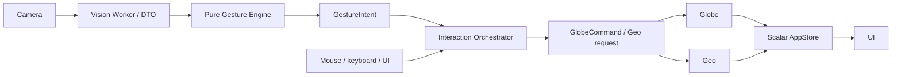

# Architecture

[main.ts](../src/main.ts) only composes App bootstrap and styles. App lifecycle owns wiring, disposal and orthogonal camera/vision/gesture state. Camera owns permission and streams, never gesture classification. Vision transfers one frame at a time to the actual local MediaPipe Worker, normalizes public DTOs and rejects stale/session-mismatched results. It does not manipulate Three.js. Gesture is deterministic pure interpretation with validated thresholds, hysteresis, hand continuity and bounded state; it has no DOM or camera access.

Interaction validates source, payload, age, speed and deduplication, owns source leases and buffers continuous commands to render flush. Mouse/keyboard/UI preempt gesture and optional Agent actions. Accepted buffering is distinguished from actual command execution. Globe owns Three.js, the authoritative camera and cancellable transitions; OrbitControls uses a proposal camera and cannot bypass command validation. Geo uses the named Earth surface, coordinate conventions, stable dwell and one selectionId across marker/card/city lookup. UI subscribes to scalar state and dispatches actions, never reading private MediaPipe objects.

Camera closure, visibility changes, cancellation and disposal clear movement anchors and queued work. Worker health has a bounded restart budget. Model/texture/city errors preserve explicit mouse fallback; fatal rendering capability failure produces an accessible static state. Errors are structured and deduplicated, not raw exception dumps.

Diagnostics use bounded rings and scalar metrics. UI refresh is capped at4Hz, inference/latency absence stays unknown. Capture-to-render traces end at the next render submission and do not measure display photons. AUTO adaptation has pressure dwell, step cooldown and slower recovery; user-selected quality remains pinned. Privacy limits prohibit video/frame/full-landmark persistence and audio permission.

Public module imports go through index.ts; same-module internals stay private. [Module rules](module-layout.md), [interaction contract](interaction-contract.md), [Vision contract](vision-runtime.md) and [AppStore contract](app-state.md) contain details and historical task notes. M12 is a separate implemented, default-off gateway through M06/M07; no LLM, external credentials or alternative camera pipeline is part of the P0 runtime.
